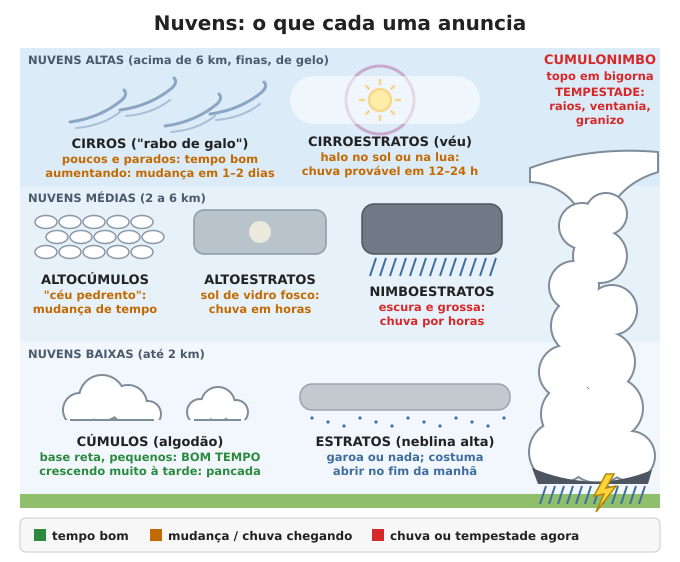
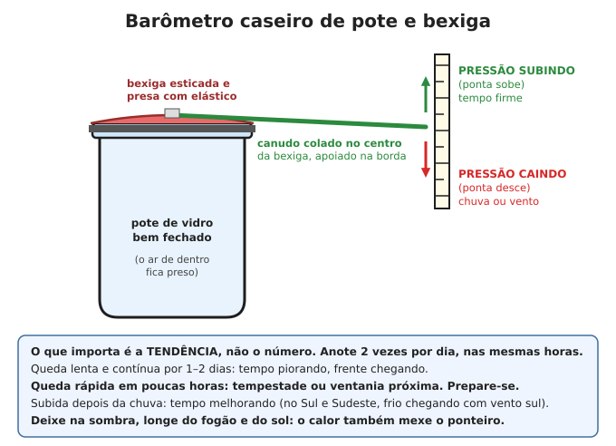
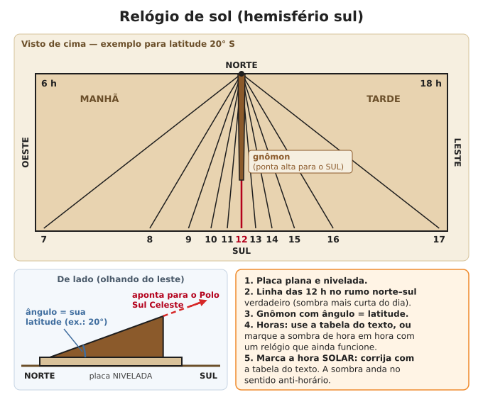
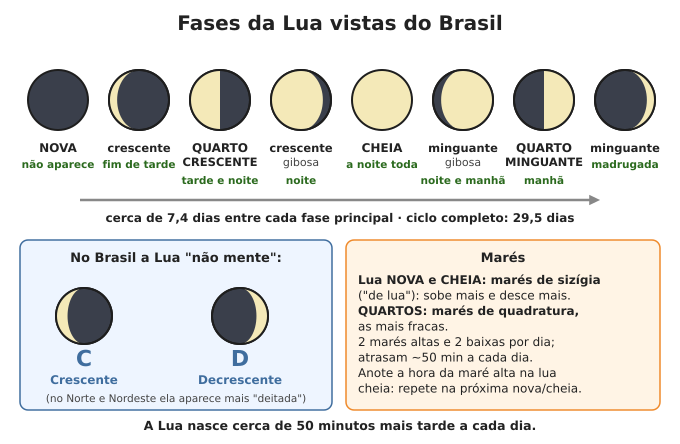

# Tempo, clima e calendário

**Resumo:** olhe o céu duas vezes por dia e anote. **Nuvens altas que engrossam, halo no sol ou na
lua e pressão caindo** anunciam chuva em 12 a 36 horas; **torres de nuvem com topo em bigorna**
anunciam tempestade em minutos a poucas horas. Conheça a época de chuva e de seca da sua região.
Sem celular, **mantenha o calendário** riscando um caderno ou um pau todos os dias, e use o sol
(sombra do meio-dia, ponto onde ele nasce) e a lua para conferir ou recuperar a data.

---

## 1. Prever o tempo pelas nuvens

| Nuvem | Como é | O que indica |
|---|---|---|
| **Cirros** ("rabo de galo") | Fios brancos finos e altos, com ganchos | Poucos e parados: tempo bom. **Aumentando e engrossando:** mudança em 24–36 h |
| **Cirroestratos** | Véu branco fino; **halo** (anel) em volta do sol ou da lua | Chuva provável em **12–24 h** (frente chegando) |
| **Cirrocúmulos / altocúmulos** | "Céu pedrento", carneirinhos em fileiras | Mudança de tempo; altocúmulos com **torrezinhas de manhã** = trovoada à tarde |
| **Altoestratos** | Camada cinza que cobre o céu; sol "de vidro fosco", sem sombra | Chuva em poucas horas |
| **Nimboestratos** | Camada grossa, escura, baixa | Chuva contínua por horas (às vezes dias) |
| **Estratos** | Camada cinza baixa, como neblina alta | Garoa ou nada; costuma abrir no fim da manhã |
| **Estratocúmulos** | Rolos ou flocos cinzentos baixos, com frestas | Tempo nublado, chuva fraca ou nenhuma |
| **Cúmulos** | "Algodão" de base reta, topo arredondado | Pequenos e esparsos: **tempo bom**. Crescendo muito à tarde: pancada |
| **Cumulonimbo** | Torre enorme, base escura, topo espalhado em **bigorna** | **Tempestade:** raios, ventania, chuva forte, às vezes granizo |

### A sequência típica de uma frente fria (Sul, Sudeste e Centro-Oeste)
1. Dias quentes e abafados, **vento norte ou noroeste**, céu limpo ou com cirros.
2. Cirros aumentam, depois véu de cirroestratos (halo), altoestratos: **12 a 36 h antes**.
3. Céu fecha e escurece a sudoeste; o vento vira para **sul ou sudoeste** com rajadas; chuva,
   às vezes trovoada.
4. Depois: temperatura cai, ar seco, céu limpo, pressão sobe. Em noites limpas e sem vento, no
   1º ao 3º dia depois da frente, **risco de geada** no Sul, nas serras e no sul de MG e SP.

### Vento e sinais locais
- **Litoral:** de dia o vento vem do mar (brisa marítima); à noite, da terra. Se a brisa do mar
  não aparece num dia de sol, algo maior está mudando o tempo.
- **Vento norte quente e abafado** no Sul e Sudeste: frente fria chegando em 1–2 dias.
- **Calma total e calor úmido** à tarde, com cúmulos crescendo: trovoada no fim da tarde.
- **Geada vem com:** céu completamente limpo, sem vento, ar seco e tarde fria (abaixo de ~10 °C
  ao pôr do sol no Sul). Cubra mudas e canteiros com palha, pano ou caixas à noite (ver
  [Calendário de plantio](../04-agricultura/05-calendario-de-plantio.md)).

### Sinais naturais (use como pista, nunca como certeza)

| Sinal | O que costuma indicar | Confiança |
|---|---|---|
| Halo em volta do sol ou da lua | Chuva em 12–24 h | Razoável |
| Orvalho forte ou geada de manhã | Noite limpa e calma; dia bom | Boa |
| Noite limpa sem orvalho | Vento ou umidade chegando | Média |
| Vento norte abafado (Sul/Sudeste) | Frente fria em 1–2 dias | Boa |
| Céu vermelho ao entardecer | Tempo seco a oeste, bom amanhã | Fraca no Brasil tropical; média no Sul |
| Céu vermelho de manhã com nuvens aumentando | Umidade chegando | Fraca |
| Revoada de cupins e formigas aladas (aleluias, siriris, içás) | Começo da estação chuvosa, em tarde quente e úmida | Boa para a estação, não para o dia seguinte |
| Sapos e rãs coaxando muito | Umidade alta, chuva perto | Média |
| Andorinhas e urubus voando baixo | Ar instável, insetos baixos antes de chuva | Fraca |
| Fumaça da chaminé descendo e se espalhando | Pressão baixa, ar úmido | Média |
| Formigas tapando o formigueiro, sal empedrando, dor nas juntas | Umidade alta | Fraca |

- **Anote todo dia** (manhã e fim de tarde): nuvens, vento, temperatura, chuva (em mm, num
  pluviômetro de garrafa), pressão. Em 1–2 anos você terá a melhor previsão possível **para o
  seu lugar**, e um registro precioso para a agricultura.
- **Pluviômetro caseiro:** garrafa PET cortada com a boca virada para dentro (funil), lados retos.
  Chuva em mm = volume coletado (mL) × 10 ÷ área da boca (cm²), sendo a área = 3,14 × raio².
  Ex.: boca de 10 cm de diâmetro (78,5 cm²) e 157 mL coletados = 20 mm. Esvazie todo dia na mesma hora.

---

## 2. Barômetro: a pressão do ar

A pressão cai quando um sistema de chuva se aproxima e sobe quando o tempo firma. **O que importa
é a tendência**, não o número.

### Barômetro de pote e bexiga

1. Corte o pescoço de uma bexiga e estique-a bem sobre a boca de um pote de vidro seco. Prenda
   com elástico e passe cola ou fita na borda para **vedar** (o ar não pode entrar nem sair).
2. Cole a ponta de um canudo no **centro** da bexiga, apoiado na borda do pote, apontando para fora.
3. Ao lado, prenda um cartão na vertical e marque a posição da ponta do canudo.
4. Pressão **caindo**: o ar de dentro empurra a bexiga para cima e a **ponta desce**. Pressão
   **subindo**: a bexiga afunda e a **ponta sobe**.

### Barômetro de garrafa
1. Encha um pote ou copo grande com água até a metade.
2. Encha uma garrafa até 3/4, tampe com o dedo, vire de boca para baixo dentro do pote e solte.
   A água fica "pendurada" dentro da garrafa, acima do nível do pote.
3. Marque o nível da água na garrafa com caneta. **Nível descendo = pressão caindo**; nível
   subindo = pressão subindo.

> **ATENÇÃO:** esses barômetros caseiros também reagem ao **calor** (1 °C a mais parece uma queda
> de pressão de ~3 hPa). Deixe-os **na sombra, dentro de casa, longe do fogão**, e compare sempre
> **nas mesmas horas**. Mesmo um barômetro de verdade varia sozinho 2–3 hPa por dia nos trópicos
> (mais alto por volta das 10 h e 22 h, mais baixo por volta das 4 h e 16 h).

### Como interpretar (barômetro de verdade, em hPa)

| Variação em 3 horas | Significado |
|---|---|
| Sobe devagar e contínuo | Tempo firmando, ar mais seco (no Sul/Sudeste, frio chegando) |
| Estável | Sem mudança próxima |
| Cai 1–3 hPa | Tempo piorando em 12–24 h |
| Cai 3–6 hPa | Mau tempo próximo, vento forte |
| Cai mais de 6 hPa | **Tempestade ou vendaval em poucas horas** |

Ao nível do mar a pressão normal é ~1.013 hPa. Ela cai ~1 hPa a cada 8–9 m de subida: compare
só leituras do mesmo lugar.

---

## 3. As estações em cada região do Brasil

| Região | Época de chuva | Época seca | Atenção |
|---|---|---|---|
| **Norte (Amazônia)** | Dez–mai (sul do PA, RO, AC: nov–abr; Roraima: abr–set) | Jun–nov (chove menos, mas chove) | Cheia dos rios com pico em mai–jul; vazante set–nov; fumaça de queimadas na seca |
| **Nordeste – sertão** | Fev–mai no norte (CE, RN, PB, PE, PI); nov–mar no sul e oeste (BA) | O resto do ano | Chuva irregular, secas de vários anos: guarde água (cisterna) |
| **Nordeste – litoral leste** (Natal a Salvador) | Abr–jul (outono-inverno) | Set–fev | Alagamentos e deslizamentos no inverno |
| **Centro-Oeste e Cerrado** | Out–abr | Mai–set (umidade do ar abaixo de 20–30%) | Queimadas e falta de água no fim da seca; temporais no começo das chuvas |
| **Sudeste** | Out–mar (trovoadas de fim de tarde) | Mai–set | Enchentes e deslizamentos no verão; geada nas serras e no sul de MG e SP no inverno |
| **Sul** | O ano todo, bem distribuída | Sem seca regular; estiagens em alguns anos | Geada (mai–ago), neve nas serras; ciclones, vendavais e granizo (primavera); enchentes |

- Plante e colha conforme o regime local: ver [Calendário de plantio](../04-agricultura/05-calendario-de-plantio.md).
- Tradições como "se chover até o dia de São José (19 de março), o inverno do sertão será bom"
  resumem a experiência de gerações, mas falham com frequência: guarde água mesmo assim.

### El Niño e La Niña
São aquecimento (El Niño) ou resfriamento (La Niña) do oceano Pacífico tropical. Duram de 9 a
18 meses e aparecem a cada 2 a 7 anos. Mudam o regime de chuva do Brasil:

| | El Niño | La Niña |
|---|---|---|
| **Sul** | **Chuva acima do normal**, enchentes (inverno e primavera) | **Estiagem**, perda de safra de verão |
| **Nordeste (norte)** | **Seca** no sertão | Chuva acima do normal |
| **Norte (Amazônia)** | **Seca**, rios muito baixos, incêndios | Mais chuva, cheias maiores |
| **Sudeste e Centro-Oeste** | Inverno mais quente; efeito variável na chuva | Efeito variável |

Sem notícias você não saberá se há um em andamento. Sinais: uma estação chuvosa muito fora do
normal logo no início. Defesa: **diversificar** plantios e variedades, guardar sementes e água
para 2 anos, não depender de uma só colheita.

---

## 4. Tempestades fortes, raios e granizo

### Sinais de tempestade forte
- Cumulonimbo crescendo depressa, com topo em bigorna; base muito escura, às vezes **esverdeada**
  (sinal de granizo).
- Trovões cada vez mais próximos; **vento frio e forte de repente**, poeira levantando, queda
  rápida de temperatura: a frente de rajada chega minutos antes da chuva.
- Barulho de "trem" ou rugido constante: granizo grande ou vendaval (no Sul, possível tornado).

### Raios: regra dos 30
1. Ao ver o relâmpago, conte os segundos até o trovão. **Segundos ÷ 3 = distância em km.**
2. **30 segundos ou menos (10 km): abrigue-se já.** Se ouve trovão, está ao alcance de um raio.
3. Só saia **30 minutos depois do último trovão**.
- **Abrigos seguros:** casa ou prédio fechado; carro ou ônibus com teto de metal, vidros fechados.
- **Perigosos:** campo aberto, topo de morro, árvore isolada, água (rio, lago, praia), cerca de
  arame, trilho, moto, bicicleta, barraca, quiosque aberto.
- **Pego no aberto:** afaste-se de árvores e objetos altos; grupo espalhado (5 m entre pessoas);
  **agache com os pés juntos**, cabeça baixa, mãos nos ouvidos. Não deite no chão.
- Dentro de casa: longe de janelas, chuveiro elétrico, torneiras e aparelhos ligados na tomada.
- O Brasil é um dos países com mais raios do mundo. Vítima de raio **não dá choque** em quem
  socorre: comece a RCP na hora ([Primeiros socorros](../02-saude/01-primeiros-socorros.md)).

### Granizo e vendaval
- Recolha animais, cubra mudas com caixas ou lona, proteja vidros e para-brisas com cobertores.
- Fique dentro de casa, longe das janelas, no cômodo mais interno do térreo (vendaval e tornado).
- Chuva forte na **cabeceira** do rio enche o rio horas depois, mesmo sem chover onde você está.
  Ver [Desastres](../11-natureza-e-desastres/03-desastres.md).

---

## 5. Manter o calendário sem celular

### Comece hoje e não pare
1. **Caderno-calendário:** no topo de cada página, mês e ano; uma linha por dia com a data, o dia
   da semana e o principal acontecimento (chuva, lua cheia, parto, plantio). **Todas as noites**,
   na mesma hora, preencha o dia. Uma pessoa responsável e uma reserva.
2. **Pau de calendário** (reserva que não molha): um entalhe por dia; entalhe **mais longo aos
   domingos**; um **X** no dia 1 de cada mês. Um pau por mês, com o nome do mês riscado.
3. **Confira** semanalmente com outra família ou com o rádio. Duas contagens independentes que
   batem são confiáveis.

- **Dias do mês:** "Trinta dias tem novembro, abril, junho e setembro; vinte e oito só tem um
  (fevereiro); os outros têm trinta e um." Nos nós dos dedos da mão fechada: nó = 31 dias,
  vão entre os nós = 30 (fevereiro 28).
- **Anos bissextos** (fevereiro com 29 dias): divisíveis por 4. Próximos: **2028, 2032, 2036**.

| Ano | 1º de janeiro cai numa | Ano | 1º de janeiro cai numa |
|---|---|---|---|
| 2027 | sexta | 2032 | quinta |
| 2028 | sábado | 2033 | sábado |
| 2029 | segunda | 2034 | domingo |
| 2030 | terça | 2035 | segunda |
| 2031 | quarta | 2036 | terça |

### Contar pelas luas
- De uma lua cheia à seguinte: **29,5 dias**. 12 luas = 354 dias: **11 dias a menos que o ano**.
  Contar só por luas atrasa um mês a cada 3 anos.
- A lua cheia é fácil de reconhecer e serve para **conferir** a contagem de dias:

| Ano | Luas cheias (horário de Brasília, ±1 dia) |
|---|---|
| 2026 | 24/11, 23/12 |
| 2027 | 22/01, 20/02, 22/03, 20/04, 20/05, 18/06, 18/07, 17/08, 15/09, 15/10, 14/11, 13/12 |
| 2028 | 12/01, 10/02, 10/03, 09/04, 08/05, 07/06, 06/07, 05/08, 03/09, 03/10, 02/11, 01/12, 31/12 |
| 2029 | 30/01, 28/02, 29/03, 28/04, 27/05, 26/06, 25/07, 23/08, 22/09, 22/10, 21/11, 20/12 |
| 2030 | 19/01, 18/02, 19/03, 18/04, 17/05, 15/06, 14/07, 13/08, 11/09, 11/10, 10/11, 09/12 |

Depois de 2030, as luas cheias se repetem quase nas mesmas datas **a cada 19 anos** (a de 2027
cai nas datas de 2046, com diferença de 1 dia).

---

## 6. Descobrir a data pelo sol

### As 4 datas-chave do ano

| Data aproximada | Nome | Como reconhecer |
|---|---|---|
| ~20 de março | Equinócio de outono | Sol nasce no **leste exato**; dia e noite com ~12 h |
| ~21 de junho | Solstício de inverno | Sol nasce **mais ao norte** que nunca; **dia mais curto**; sombra do meio-dia **mais longa** |
| ~22 de setembro | Equinócio de primavera | Sol nasce no leste exato; dia e noite com ~12 h |
| ~21 de dezembro | Solstício de verão | Sol nasce **mais ao sul** que nunca; **dia mais longo**; sombra do meio-dia mais curta (ou apontando para o norte) |

### Método 1: marcos no horizonte (observatório de quintal)
1. Escolha um **ponto fixo de observação** (estaca, pedra, banco) com vista para o leste.
2. Nos dias de céu limpo, marque **onde o sol nasce** em relação a algo distante (árvore, morro,
   torre) e anote a data. Faça um desenho do horizonte no caderno com as marcas.
3. O ponto do nascer anda para o norte até junho e para o sul até dezembro. **Perto dos
   equinócios** ele anda ~1 diâmetro do sol por dia (fácil de ver); **perto dos solstícios**
   parece parar por uma semana.
4. **Para achar o solstício:** anote duas datas em que o sol nasce no mesmo ponto, uma antes e
   outra depois do extremo. O solstício é o **dia do meio** entre elas.
5. Depois de um ano de marcas, o horizonte vira o seu calendário.

### Método 2: sombra do meio-dia
1. Finque uma vara **bem reta e vertical** (confira com um fio de prumo), de altura conhecida,
   por exemplo **1 m**, em chão plano.
2. Ao longo do meio-dia, marque a ponta da sombra a cada 5 minutos: a **mais curta** é a do
   meio-dia solar. Meça o comprimento.
3. Use a tabela (sombra de uma vara de 1 m ao meio-dia solar, em cm; **S** = aponta para o sul,
   **N** = aponta para o norte):

| Data | Lat. 0° | 5° S | 10° S | 15° S | 20° S | 25° S | 30° S |
|---|---|---|---|---|---|---|---|
| 21 jun | 43 S | 54 S | 66 S | 79 S | 95 S | 113 S | 135 S |
| 21 mai / 23 jul | 37 S | 47 S | 58 S | 70 S | 84 S | 100 S | 120 S |
| 20 abr / 23 ago | 20 S | 29 S | 39 S | 49 S | 61 S | 73 S | 88 S |
| 20 mar / 23 set | 0 | 9 S | 18 S | 27 S | 36 S | 47 S | 58 S |
| 20 fev / 23 out | 20 N | 11 N | 2 N | 7 S | 15 S | 25 S | 34 S |
| 21 jan / 22 nov | 37 N | 27 N | 18 N | 9 N | 0 | 9 S | 17 S |
| 21 dez | 43 N | 33 N | 24 N | 15 N | 6 N | 3 S | 11 S |

4. Cada comprimento corresponde a **duas datas** no ano. Para saber qual, meça de novo dias
   depois: se a sombra (para o sul) está **crescendo**, estamos indo para junho; **diminuindo**,
   indo para dezembro.
- A sua latitude: no mapa, pelo Cruzeiro do Sul (ver [Orientação](03-orientacao-e-navegacao.md))
  ou no equinócio: sombra da vara de 1 m em cm ÷ 100 = tangente da latitude
  (18 cm ≈ 10°; 36 cm ≈ 20°; 47 cm ≈ 25°; 58 cm ≈ 30°).
- **Nos equinócios** a ponta da sombra percorre uma **linha reta** de oeste para leste o dia
  todo; nos outros dias, uma curva. É outra forma de reconhecê-los.

---

## 7. Relógio de sol

### Como fazer (relógio horizontal)
1. **Placa** de madeira, cimento ou pedra, **plana e nivelada** (use nível de bolha ou uma
   vasilha rasa com água: a água fica paralela à borda quando a placa está nivelada).
2. **Gnômon:** um triângulo de tábua ou chapa com o ângulo da base **igual à sua latitude**.
   A borda inclinada (que faz a sombra) sobe **para o SUL** e aponta para o Polo Sul Celeste.
3. Alinhe a base do gnômon na direção **norte–sul verdadeira** (sombra mais curta do dia, método
   das sombras iguais, Cruzeiro do Sul, ou bússola corrigida pela declinação).
4. **Linhas das horas:** saem do pé do gnômon (lado norte). A linha das 12 h fica embaixo do
   gnômon, apontando para o sul. As demais fazem com ela os ângulos da tabela, **as da manhã
   para o lado oeste** e as da tarde para o leste. As de 6 h e 18 h são perpendiculares à das 12 h.

| Latitude | 11 h e 13 h | 10 h e 14 h | 9 h e 15 h | 8 h e 16 h | 7 h e 17 h |
|---|---|---|---|---|---|
| 5° S | 1,3° | 2,9° | 5,0° | 8,6° | 18,0° |
| 10° S | 2,7° | 5,7° | 9,9° | 16,7° | 32,9° |
| 15° S | 4,0° | 8,5° | 14,5° | 24,1° | 44,0° |
| 20° S | 5,2° | 11,2° | 18,9° | 30,6° | 51,9° |
| 25° S | 6,5° | 13,7° | 22,9° | 36,2° | 57,6° |
| 30° S | 7,6° | 16,1° | 26,6° | 40,9° | 61,8° |

- **Jeito mais fácil (marcação direta):** com o gnômon já inclinado e alinhado, enquanto ainda
  houver um relógio funcionando, marque a sombra **a cada hora cheia** num dia de sol, já com a
  correção de hora abaixo. Com o gnômon inclinado as marcas valem **o ano inteiro** (com uma
  vara vertical, não valem).
- **No Norte e Nordeste (latitude abaixo de ~10°)** as linhas ficam muito juntas. Faça o
  **relógio equatorial:** uma placa com um furo no centro, inclinada de modo que uma vareta
  passando pelo furo, **perpendicular à placa**, aponte para o Polo Sul Celeste (inclinação da
  vareta = latitude, subindo para o sul). As horas ficam **a cada 15°** num círculo em volta da
  vareta, nas **duas faces** da placa: de setembro a março o sol ilumina a face de cima (virada
  para o sul); de março a setembro, a de baixo. Perto dos equinócios a sombra fica rente à placa.
- No hemisfério sul a sombra anda no sentido **anti-horário**.

### Hora do sol x hora do relógio
O relógio de sol marca a **hora solar** (12 h = sol no ponto mais alto). Para a hora oficial:

**Hora oficial = hora do relógio de sol + correção da longitude − correção da época do ano**

| Cidade | Correção da longitude | Cidade | Correção da longitude |
|---|---|---|---|
| Recife, João Pessoa | −40 min | Brasília | +12 min |
| Salvador, Fortaleza | −26 min | Belém | +14 min |
| Rio de Janeiro | −7 min | Curitiba | +17 min |
| São Paulo | +6 min | Porto Alegre | +25 min |
| Manaus (fuso −4 h) | 0 min | Campo Grande (fuso −4 h) | −22 min |
| Cuiabá (fuso −4 h) | −16 min | Rio Branco (fuso −5 h) | −29 min |

Regra para qualquer lugar: **4 minutos por grau** de longitude a oeste (+) ou a leste (−) do
meridiano do fuso (45° W para o horário de Brasília; 60° W para o fuso −4 h; 75° W para −5 h).

| Época | Relógio de sol em relação ao relógio comum (correção da época) |
|---|---|
| Meados de fevereiro | 14 min **atrasado** (−14) |
| Meados de abril, meados de junho, 1º de setembro, fim de dezembro | ~0 |
| Meados de maio | 4 min adiantado (+4) |
| Fim de julho | 6 min atrasado (−6) |
| Início de novembro | **16 min adiantado** (+16) |

Exemplo, São Paulo em 1º de novembro: o relógio de sol marca 12h00 → hora oficial =
12h00 + 6 − 16 = **11h50**.

---

## 8. Fases da lua e marés

- **No Brasil (hemisfério sul) a Lua "não mente":** crescente tem forma de **C**, minguante de
  **D** (no hemisfério norte é o contrário). Perto do Equador ela aparece mais "deitada".
- **Crescente:** aparece no fim da tarde, a oeste. **Cheia:** nasce quando o sol se põe e fica a
  noite toda. **Minguante:** nasce tarde da noite e aparece de madrugada e de manhã, a leste.
- A lua nasce **~50 min mais tarde a cada dia**. Ciclo completo: **29,5 dias**; cada fase
  principal dura ~7,4 dias.
- Plantar pela lua é tradição forte no campo; veja o que se sabe em
  [Calendário de plantio](../04-agricultura/05-calendario-de-plantio.md).

### Marés
- São **2 marés altas e 2 baixas por dia**, separadas por ~6 h 12 min. A cada dia a maré atrasa
  **~50 minutos** (como a lua).
- **Lua nova e cheia:** marés de **sizígia** ("marés de lua"): sobem mais e descem mais.
  **Quartos:** marés de **quadratura**, as mais fracas. As maiores do ano vêm perto dos
  equinócios (março e setembro), quando aparecem também as pororocas no Pará e no Amapá.
- **Num mesmo lugar**, a maré alta acontece **sempre à mesma hora** nos dias de lua cheia e nova.
  Anote essa hora no seu porto e preveja as demais somando ~50 min por dia.
- **Regra dos doze avos:** em 6 horas a maré sobe (ou desce) 1/12 na 1ª hora, 2/12 na 2ª,
  **3/12 na 3ª e na 4ª**, 2/12 na 5ª e 1/12 na 6ª. A água corre mais forte no meio da maré.

| Litoral | Diferença entre maré alta e baixa (maré de lua) |
|---|---|
| Rio Grande do Sul | menos de 0,5 m (o vento pesa mais que a maré) |
| Santa Catarina a Rio de Janeiro | 1–1,5 m |
| Espírito Santo e Bahia | 1,5–2,5 m |
| Pernambuco ao Ceará | 2–3 m |
| Maranhão (São Luís) | até ~7 m |
| Pará e Amapá | 3 a 6 m ou mais |

- Guarde impressa a **tábua de marés** da Marinha do porto mais próximo, do ano atual e do
  seguinte. Atravessar baía, mangue ou estuário a pé ou de barco: vá **na virada da maré** (água
  parada) e nunca na enchente de maré de lua.

---

Ver também: [Orientação e navegação](03-orientacao-e-navegacao.md) · [Calendário de plantio](../04-agricultura/05-calendario-de-plantio.md) · [Desastres](../11-natureza-e-desastres/03-desastres.md) · [Calor, frio e ambiente](../02-saude/10-calor-frio-e-ambiente.md) · [Pesca](../11-natureza-e-desastres/02-pesca-armadilhas-caca.md) · [Educação e conhecimento](../12-comunidade-e-seguranca/04-educacao-e-conhecimento.md)
