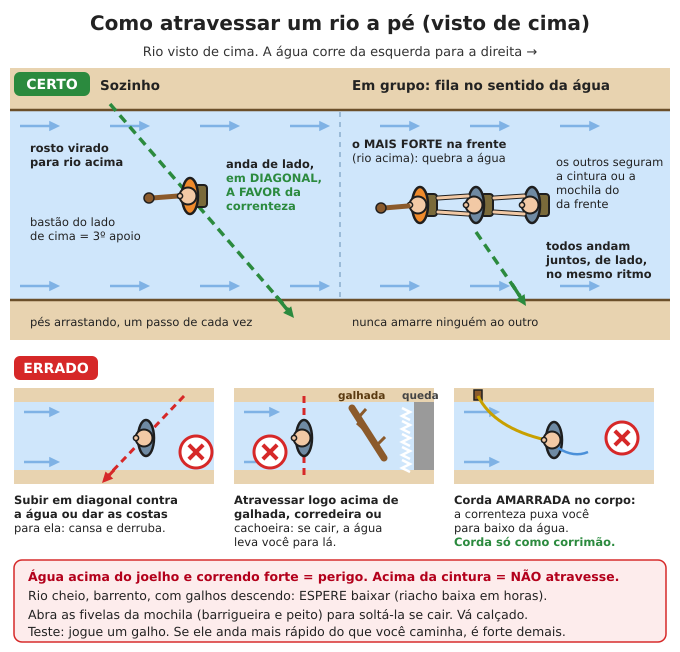

# Perdido no mato

**Resumo:** quem se perde morre mais por **pânico, frio/calor, queda e afogamento** do que por
fome. Ao perceber que está perdido: **PARE**, sente e pense (método P.A.R.A.). Se alguém sabe
onde você está, **fique parado e sinalize** — é muito mais fácil achar quem não se move. Só ande
se ninguém vai procurar você, e então siga trilhas, cercas e a água morro abaixo, com cuidado.

---

## Antes de entrar no mato (o que mais evita a tragédia)

1. **Avise alguém:** para onde vai, por qual caminho, com quem e **a hora limite de volta**.
   Combine: "se eu não voltar até as 18 h, procure a partir de tal lugar".
2. **Leve o kit mínimo** mesmo para "uma volta rápida": apito, lanterna, isqueiro, faca ou
   canivete, 1–2 L de água, saco de lixo grande (capa e abrigo), manta térmica, um lanche,
   celular carregado, mapa e bússola. Veja [Kits](../00-emergencia/03-kits-e-estoques.md).
3. **Roupa:** calça e manga comprida, bota ou tênis firme, chapéu; um agasalho mesmo no calor
   (serra e Sul esfriam muito à noite).
4. **Hora de voltar:** comece a volta quando tiver gasto **metade do tempo de luz** que resta.
5. Em cada cruzamento ou bifurcação, **olhe para trás** e grave a paisagem: é assim que o
   caminho vai parecer na volta.

## Percebeu que está perdido: método P.A.R.A.

O mesmo método de [Prioridades e decisão](../00-emergencia/02-prioridades-e-decisao.md), aplicado ao mato:

- **P — Pare.** Sente-se. Beba um gole de água, coma algo, respire fundo 4 vezes. **Não saia
  andando apressado** "para achar o caminho" — é assim que um susto vira uma noite perdida.
- **A — Avalie.**
  - Onde vi a trilha ou um ponto conhecido pela última vez? Há quanto tempo?
  - **Quanto tempo de luz resta?** Estique o braço, mão deitada entre o sol e o horizonte:
    cada dedo ≈ **15 minutos**; a mão inteira (4 dedos) ≈ **1 hora**. No Brasil escurece rápido:
    20–30 minutos depois que o sol some, já é noite.
  - Clima: vai chover? Vai esfriar? Tem água por perto?
  - Estou ferido? O que tenho na mochila? **Alguém sabe onde estou e quando eu devia voltar?**
- **R — Resolva o mais urgente.** Na ordem: ferimento grave → abrigo (frio, chuva, sol) →
  água → sinal → comida.
- **A — Aja e reavalie.** Uma ação de cada vez. Depois de cada uma, pergunte: melhorou?

### Tente o celular primeiro
- Ligue **193 (Bombeiros)** ou **190 (Polícia)**. Ligação de emergência funciona **sem crédito**.
- Sem sinal: suba para um ponto mais alto ou mais aberto e tente de novo.
- **SMS passa com sinal fraco** quando a ligação não completa. Mande para alguém de confiança:
  "perdido, estou bem/ferido, perto de [rio, morro, trilha], coordenadas [do mapa do celular]".
- Entre as tentativas, deixe em **modo avião** e brilho no mínimo. Uma bateria bem cuidada dura
  dias.

### Explorar sem se perder mais (método da estrela)
1. **Marque o ponto onde você está** (pano colorido, pilha de pedras, X no chão).
2. Ande **no máximo 50–100 passos** numa direção, marcando o caminho (galhos quebrados
   apontando para o ponto, pedaços de fita). Procure trilha, cerca, estrada, barulho.
3. Não achou? **Volte ao ponto** pelo mesmo caminho e tente outra direção.
4. Faça isso em 4 direções. Se não achar nada, fique no ponto e sinalize.

## Ficar parado ou andar?

| FIQUE onde está se... | ANDE (com cuidado) se... |
|---|---|
| Alguém sabe onde você está e quando devia voltar | Ninguém sabe nem vai procurar (colapso, sem resgate) |
| Está ferido, exausto, com criança ou idoso | Não há água no lugar e você sabe onde achar |
| Está anoitecendo, chovendo forte, com neblina | O lugar é perigoso (fogo, rio subindo, deslizamento) |
| O terreno à frente é desconhecido e difícil | Você tem uma referência clara (estrada, rio grande, linha de energia, cerca) e sabe a direção |

**Por que ficar funciona:** as buscas começam pelo **último ponto conhecido** e vão abrindo em
volta. Quem anda sem rumo sai da área de busca, se cansa, se machuca e às vezes cruza o próprio
caminho sem ver. Sem referências visíveis (sol, morro), **as pessoas andam em círculos** sem
perceber.

### Se decidir andar
1. Deixe um **bilhete ou sinal** no ponto: seta no chão feita com pedras ou galhos, data e hora,
   para onde foi.
2. Ande **em linha reta**: escolha uma árvore ou morro bem à frente, vá até ele, escolha outro
   na mesma linha. Com bússola, siga um rumo fixo. Veja [Orientação](../10-comunicacao-e-navegacao/03-orientacao-e-navegacao.md).
3. **Procure sinais de gente:** trilhas largas, cercas, marcas de corte de árvore, lixo, trilhas
   de gado (levam a água e a sedes de fazenda), linhas de energia, barulho de motor, galo,
   cachorro, motosserra, cheiro de fumaça.
4. **Siga a água morro abaixo.** Córregos se juntam em rios maiores, e gente mora perto de rios
   (no interior e principalmente na Amazônia, os rios são as estradas).
5. Marque o caminho a cada 50–100 m (galho quebrado, seta riscada no chão) para ser seguido.
6. **Pare 1 hora antes de escurecer** para preparar abrigo e fogo.

> **ATENÇÃO:** seguir água tem riscos: **cachoeiras, paredões, cânions e pedras com limo**
> matam muita gente. Nunca desça por dentro da cachoeira nem por pedra molhada. Saia do leito,
> **contorne pelo alto da margem**, pelo mato, e volte ao rio mais abaixo. Em serra, um vale
> pode virar um cânion sem saída: se a descida ficar perigosa, volte e procure outro caminho.

## Sinalizar (para ser achado)

Fique em **lugar aberto**: clareira, margem de rio, praia de areia, topo de morro, roça.
Do alto, uma pessoa no meio do mato é invisível.

- **Apito:** 3 apitos longos, pausa de 1 minuto, repita. Apito cansa menos e vai mais longe
  que a voz. Ao ouvir resposta, apite de novo para guiar.
- **Fogo e fumaça:** de dia, **fumaça** (jogue folhas verdes, capim verde ou um pedaço de
  borracha sobre uma fogueira forte); à noite, **chama viva**. **3 fogueiras em triângulo**
  (cerca de 20–30 m entre elas) é pedido de socorro internacional.
- **Espelho**, celular, CD ou tampa de lata brilhante: reflita o sol mirando entre dois dedos
  em "V" na direção do avião ou do morro. É visto a quilômetros.
- **No chão, para aeronaves:** letras grandes (3 m ou mais) feitas com galhos, pedras, roupas
  coloridas ou valetas na terra. **V** = preciso de ajuda; **X** = preciso de médico;
  **SOS** = socorro. Contraste: escuro sobre areia, claro sobre capim.
- **Lanterna:** 3 piscadas, pausa, repita. SOS em Morse: `··· ——— ···`.
- Roupa e lona de **cor viva** estendidas no aberto.

Detalhes, código Morse e sinais terra-ar: [Sinais e Morse](../10-comunicacao-e-navegacao/02-sinais-e-morse.md).

> **ATENÇÃO:** no Cerrado e na Caatinga na época seca (maio a outubro), uma fogueira de sinal
> pode virar **incêndio** e matar você. Limpe um círculo de 3 m até a terra, faça o fogo em
> área de areia, pedra ou já queimada, e mantenha água e terra à mão.

## Abrigo, fogo, água e comida

| Prioridade | O essencial | Onde aprender |
|---|---|---|
| **Abrigo** (antes de anoitecer) | Isolar do **chão** (galhos, folhas secas, 20–30 cm de altura), cobrir da chuva (lona, saco de lixo, folhas de palmeira em camadas), fechar do vento. Pequeno = mais quente. Na Amazônia e no Pantanal: **rede + mosquiteiro + lona**, nunca dormir no chão | [Abrigo emergencial](../07-abrigo-e-construcao/01-abrigo-emergencial.md) |
| **Fogo** | Aquece, seca a roupa, ferve a água, sinaliza, espanta bichos e acalma. Junte **3 vezes** mais lenha do que acha que precisa para a noite. Na mata úmida: galhos mortos ainda **presos na árvore** (secos), lascas do miolo de troncos, resina (breu-branco da Amazônia queima bem) | [Fogo](../06-energia/01-fogo.md) |
| **Água** | Ferva ou trate sempre. Fontes de mato abaixo | [Encontrar água](../01-agua/01-encontrar-e-captar-agua.md) · [Tratar](../01-agua/02-tratamento-e-purificacao.md) |
| **Comida** | Você aguenta **semanas** sem comer; não arrisque plantas e cogumelos desconhecidos. Peixe, insetos cozidos e frutos que você conhece com certeza | [Plantas comestíveis](../03-alimentacao/04-plantas-silvestres-comestiveis.md) · [Pesca e armadilhas](02-pesca-armadilhas-caca.md) |

### Água no mato (quando não há rio)
- **Cipó-d'água:** corte um pedaço de ~1 m — **primeiro em cima, depois embaixo** (ao contrário,
  a água sobe e se perde). Segure em pé e deixe pingar na boca ou na caneca, sem encostar a boca
  na casca. Só beba se for **transparente, sem leite e sem gosto amargo ou ardido**.
- **Bambu (taquaruçu):** sacuda os gomos; o que faz barulho de água tem líquido. Fure embaixo
  do gomo com a faca.
- **Bromélias:** acumulam água no centro (com larvas e folhas). Coe num pano e **ferva**.
- **Orvalho:** passe um pano limpo no capim ao amanhecer e torça.
- **Chuva:** estenda lona ou saco plástico em funil para dentro de um recipiente.

## Particularidades de cada bioma

### Amazônia
- **Calor + umidade** de 80–100%: o suor não evapora, a roupa não seca. Beba 4–6 L/dia em
  esforço. Fungos nos pés: tire as botas à noite e seque os pés.
- Mata fechada, quase sem ver o sol. É muito fácil se perder a 50 m da trilha.
- **Os rios são as estradas:** comunidades ribeirinhas ficam nas margens. Igarapé leva a rio
  maior. Na Amazônia central, os rios **sobem de dezembro a junho** e baixam de julho a
  novembro; na cheia, a mata alagada (igapó, várzea) não tem chão firme.
- **Perigos:** arraia (ferrão na areia do fundo — **arraste os pés** ao andar na água),
  poraquê (peixe-elétrico, descarga de centenas de volts que derruba e afoga), jacaré e sucuri
  (evite entrar na água ao entardecer e à noite), piranha (em poços rasos da seca; não entre
  sangrando), formiga tocandira (picada dolorosíssima), surucucu e jararaca, onça (ataque é
  raro). **Malária**: mosquiteiro e repelente. Veja [Peçonhentos](../02-saude/06-animais-peconhentos.md).

### Mata Atlântica
- Relevo de **serra**: encostas íngremes, cachoeiras, cânions, neblina que esconde tudo.
- **Cabeça d'água (tromba d'água):** depois de chuva forte rio acima — mesmo onde não está
  chovendo — o rio sobe em minutos. **Sinais:** água ficando barrenta de repente, galhos e folhas
  descendo, nível subindo, **ronco** vindo de cima. **Saia do leito na hora, para o alto e para
  o lado.** Não acampe em prainha de rio de serra.
- **Frio à noite** nas serras (Mantiqueira, Serra do Mar, serra gaúcha e catarinense): pode
  chegar perto de 0 °C no inverno. Molhado + vento = hipotermia ([Calor e frio](../02-saude/10-calor-frio-e-ambiente.md)).
- Perigos: jararaca e jararacuçu, coral, aranha-armadeira, abelhas, **javali** (bando agressivo
  no Sul e Sudeste: suba numa árvore), carrapato-estrela (**febre maculosa** — examine o corpo
  todo à noite).
- É uma mata muito fragmentada: descendo o morro, em geral se chega a estrada, sítio ou
  plantação em horas ou poucos dias.

### Cerrado
- **Seca de maio a setembro**, calor de dia e **noites frias** no planalto (5–10 °C em julho).
  Sol forte e pouca sombra: chapéu, manga comprida, ande cedo e no fim da tarde.
- **Água:** procure as **matas de galeria** (faixas verde-escuras nas baixadas seguem os
  córregos) e as **veredas** com **buritis** (palmeira alta = água no chão).
- **Incêndio** na seca corre muito rápido com vento, e **sobe morro** mais rápido ainda. Fuja
  para área já queimada, para trás de rio ou para solo sem capim. Se as chamas forem baixas
  (capim ralo) e a faixa de fogo for estreita, pode ser mais seguro atravessar rápido para o
  lado já queimado, cobrindo rosto e mãos.
- Perigos: cascavel (campos abertos), jararaca, escorpião, abelhas africanizadas, queixada
  (porco-do-mato em bando — suba numa árvore), **tamanduá-bandeira** (não encurrale: o abraço
  com garras já matou pessoas). Lobo-guará é inofensivo.

### Caatinga
- **Semiárido:** 35–40 °C de dia, chuva concentrada em poucos meses, rios **secos** a maior parte
  do ano. **Poupe suor, não poupe água:** ande de madrugada e no fim da tarde, descanse na
  sombra das 10 h às 16 h, cubra a pele.
- **Água no rio seco:** cave na **parte de fora da curva**, no ponto mais baixo do leito, onde a
  areia está úmida ou há plantas verdes. Às vezes a água aparece a 50 cm–1 m (é a cacimba
  sertaneja). Deixe assentar e trate.
- Plantas que guardam água: **macambira** e caroá (água no meio das folhas — coe e ferva),
  **batata (xilopódio) do umbuzeiro** (raiz cheia de água, usada pelos sertanejos na seca).
  Frutos comestíveis: umbu, fruto do mandacaru (vermelho, polpa branca), facheiro,
  coroa-de-frade.
- Espinhos em tudo (xique-xique, jurema, macambira) e plantas que queimam a pele (cansanção,
  favela): calça grossa e luvas.
- Perigos: **cascavel** (muito comum), jararaca, coral, escorpião, abelhas.

### Pantanal
- Planície que **alaga** na cheia (em geral de dezembro a maio; o pico muda de região para
  região). Tudo é plano: suba numa árvore para enxergar longe.
- Lugares secos e firmes: **cordilheiras** (faixas mais altas com mata) e **capões** (ilhas de
  mato). Sedes de fazenda ficam nas partes altas; **siga cercas, aterros e estradas boiadeiras**.
- Água em todo lugar, mas suja de animais: trate sempre.
- Perigos: **arraia** (arraste os pés), piranha, jacaré (raramente ataca, mas não chegue perto),
  sucuri, **onça-pintada** (se encontrar: **não corra**, não dê as costas, fique grande, fale alto
  e recue devagar), queixada, nuvens de mosquitos e mutucas, calor de 40 °C.

### Pampa
- Campo aberto, poucas árvores: falta abrigo e lenha. Use **esterco seco de gado**, capim
  seco e galhos dos capões e das matas de beira de sanga (riacho).
- **Inverno rigoroso:** geada, temperaturas abaixo de 0 °C, vento minuano, chuva fria e
  cerração (neblina). Hipotermia é o maior risco: proteja-se do vento antes de tudo.
- **Cercas de arame levam a estâncias** (fazendas). Siga-as.
- Perigos: cruzeira (urutu), jararaca, aranha-marrom, **javali**.

### Litoral, restinga e mangue
- No mangue, a lama prende até o joelho e a **maré sobe rápido** (no Maranhão a diferença
  entre maré baixa e alta passa de 6 m). Saia antes da maré encher.
- Ostras e cracas cortam os pés: vá calçado. Caranguejo e marisco são comida, mas veja os
  riscos em [Pesca](02-pesca-armadilhas-caca.md).
- Siga a costa: sempre há povoados e pescadores.

## Travessia de rios

Afogamento é uma das maiores causas de morte de quem está perdido. **Antes de atravessar,
pergunte: preciso mesmo?** Muitas vezes dá para seguir pela margem até achar ponte, vau ou
trecho raso.

### Escolher o lugar
1. Procure trecho **largo, reto e raso**, com fundo de cascalho ou areia firme (onde o rio
   se espalha, a água corre mais devagar).
2. **Evite:** curvas (a parte de fora é funda e rápida), logo acima de corredeira, cachoeira
   ou **galhada** (tronco caído na água: a água passa, a pessoa fica presa embaixo — é a
   armadilha mais mortal), água barrenta e subindo, galhos descendo.
3. **Teste a força:** jogue um galho e ande ao lado dele na margem. Se ele vai mais rápido do
   que você caminha, a correnteza é forte demais.
4. **Profundidade:** água correndo **acima do joelho já derruba**; **acima da cintura, não
   atravesse** a pé.
5. **Rio cheio: espere.** Riacho de serra baixa em horas depois que a chuva para; rio grande,
   em um ou dois dias. Atravesse de manhã cedo (a água das chuvas da tarde já desceu).

### Preparar
1. **Abra as fivelas da barrigueira e do peito da mochila** e afrouxe as alças: se cair, tire a
   mochila na hora (cheia de água, ela afunda você).
2. Fósforos, documentos, celular e roupa seca em **saco plástico fechado**.
3. **Vá calçado** (protege de pedras, cacos e arraias). Tire as meias e a calça, se o frio
   deixar, para mantê-las secas.
4. Pegue um **bastão firme** de 1,5–2 m: ele é o terceiro apoio.

### Atravessar sozinho
1. Fique **de frente para rio acima** (ou de lado), com o bastão do lado de cima.
2. Ande **de lado, em diagonal, a favor da correnteza** (descendo um pouco a cada passo).
3. **Arraste os pés** no fundo, mova **um apoio de cada vez** (pé, pé, bastão). Nunca cruze
   as pernas. Não pule de pedra em pedra.

### Atravessar em grupo
- **Fila no sentido da água:** a pessoa **mais forte na frente, rio acima**, quebra a
  correnteza; as outras atrás seguram a cintura ou a alça da mochila de quem está à frente.
  Todos andam **juntos, de lado**, no ritmo de quem comanda ("passo... passo...").
- Os mais fracos e as crianças **no meio**. Criança pequena atravessa nas costas de um adulto
  forte, **sem ser amarrada a ele**, e só em água abaixo do joelho do adulto.
- **Corda:** só como **corrimão** esticado entre as margens, em diagonal rio abaixo, preso em
  árvores. Cada pessoa segura com as mãos. **Nunca amarre a corda no corpo** em água corrente:
  a correnteza puxa a pessoa para o fundo e não deixa ela se soltar.

### Se cair na correnteza
1. **Solte a mochila** se ela puxar você.
2. Deite **de costas, pés para frente e na superfície**, apontando rio abaixo: os pés batem
   nas pedras, não a cabeça. **Não tente ficar de pé** em água rápida (o pé prende entre pedras
   e a água empurra você para baixo).
3. Nade **em diagonal** em direção à margem, aproveitando a correnteza.
4. Indo para uma galhada sem conseguir desviar: vire de barriga, nade forte e **jogue-se por
   cima** do tronco — nunca por baixo.
5. Para salvar alguém: **jogue** algo que flutue ou uma corda, ou estenda um galho, de dentro da
   margem. Não entre na água atrás (veja [Afogamento](../02-saude/10-calor-frio-e-ambiente.md)).

## Evitar quedas e ferimentos

Sem resgate, **um tornozelo torcido pode matar**. Vá devagar.

- **Olhe onde pisa e onde põe a mão:** cobras e aranhas ficam sob troncos, pedras e folhas.
  Bata no mato à frente com o bastão. Pise **em cima** do tronco caído, não do outro lado sem ver.
- **Pedra molhada, com limo, e tronco molhado escorregam como sabão.** Contorne.
- **Descidas:** em zigue-zague, de lado, joelhos dobrados; barranco íngreme, desça **de costas**
  segurando-se. Mantenha **3 pontos de apoio** (2 mãos e 1 pé, ou 2 pés e 1 mão).
- Não escale paredão nem cachoeira. Não ande à noite.
- Teste galhos e cipós antes de pôr peso. Cuidado com espinhos de palmeiras e taquaras cortantes.
- **Árvore morta** ou galho seco pendurado **acima do abrigo** cai à noite com vento: escolha outro lugar.
- **Pés:** troque a meia molhada por seca à noite, cuide de bolhas cedo (esparadrapo).
- Ferimentos, entorses e imobilização: [Ferimentos e fraturas](../02-saude/02-ferimentos-queimaduras-fraturas.md).

## À noite

1. **Pare 1 hora antes de escurecer.** Abrigo, fogo e lenha prontos com luz.
2. Lenha para a noite inteira, separada por grossura, ao alcance da mão.
3. **Isole-se do chão** (é o chão que rouba o calor), vista tudo o que tiver de seco, cabeça
   coberta, manta térmica por dentro da roupa ou do saco de lixo.
4. Encha a garrafa de água antes de deitar. Sapatos dentro do abrigo, de boca para baixo, e
   sacuda antes de calçar (escorpião e aranha).
5. **Barulhos à noite são normais** (sapos, insetos, galhos caindo, bichos pequenos). Animais
   grandes evitam fogo e gente.
6. Em grupo: alguém sempre acordado para o fogo, em turnos de 1–2 horas.
7. **Não ande no escuro**, nem com lanterna, exceto em emergência. Exceção: na Caatinga, em
   terreno aberto e conhecido, andar de madrugada evita o calor — com lanterna, porque a
   cascavel caça à noite.
8. O medo é maior à noite. Use [técnicas para acalmar](../02-saude/11-saude-mental.md) e
   pense no plano do dia seguinte.

## Crianças perdidas: "abrace uma árvore"

Ensine **antes**, como brincadeira, e treine com elas:

1. **Percebeu que se perdeu? Pare e abrace uma árvore** (ou sente encostado nela). Fique ali.
   Quanto mais a criança anda, mais difícil é achá-la.
2. **Não se esconda.** As pessoas que chamarem seu nome **são amigas** vindo ajudar, mesmo se
   forem desconhecidas, mesmo de uniforme. **Ninguém vai brigar com você.**
3. **Responda** quando ouvir chamarem. Grite ou **apite 3 vezes**.
4. Use o **saco de lixo grande** da mochila: faça um buraco **para o rosto** (nunca cubra a
   cabeça inteira) e vista como capa para se aquecer e ficar seca.
5. Sente em cima de galhos ou folhas, não na terra molhada.
6. Se ouvir avião ou helicóptero, vá para um lugar aberto perto da árvore e balance algo colorido.

**Kit da criança (no bolso ou mochila pequena):** apito no pescoço, saco de lixo grande,
lanterninha, uma barra de cereal, roupa de cor viva. Antes do passeio, faça a criança pisar
num papel-alumínio dobrado sobre uma toalha: a **pegada** ajuda os buscadores a reconhecer o
rastro.

### Se uma criança sumiu (para os adultos)
1. **Procure primeiro na água**: rios, açudes, poços, cisternas, piscinas. Afogamento é rápido.
2. Anote **onde e quando** ela foi vista pela última vez, a roupa e o calçado. Marque o ponto.
3. Crianças de 1–3 anos costumam ficar perto e **dormir escondidas** (moitas, buracos, embaixo
   de coisas); maiores podem ir longe. A maioria é achada a menos de 1–2 km.
4. Chame pelo nome e **depois fique em silêncio ouvindo** por 1 minuto. Repita.
5. **Busca em linha:** pessoas lado a lado, a 5–10 m uma da outra (menos no mato fechado), andando
   devagar; marque as faixas já vistas com fitas.
6. Mantenha alguém **no ponto inicial** (ela pode voltar) e uma fogueira acesa à noite.
7. Avise os Bombeiros (193) assim que possível.

## Lista rápida

- [ ] Parei, sentei, bebi água, respirei
- [ ] Avaliei luz, clima, ferimentos, recursos e quem sabe onde estou
- [ ] Tentei 193/190 e SMS do ponto mais alto
- [ ] Decidi: ficar (alguém vai procurar) ou andar (ninguém vai)
- [ ] Sinal montado em lugar aberto (apito, fumaça, cor, letras no chão)
- [ ] Abrigo isolado do chão antes de escurecer
- [ ] Água tratada; comida só a que conheço
- [ ] Rio: só atravesso se precisar, no lugar certo, mochila solta

---

Ver também: [Prioridades e decisão](../00-emergencia/02-prioridades-e-decisao.md) · [Sinais e Morse](../10-comunicacao-e-navegacao/02-sinais-e-morse.md) · [Orientação e navegação](../10-comunicacao-e-navegacao/03-orientacao-e-navegacao.md) · [Abrigo emergencial](../07-abrigo-e-construcao/01-abrigo-emergencial.md) · [Fogo](../06-energia/01-fogo.md) · [Pesca, armadilhas e caça](02-pesca-armadilhas-caca.md) · [Animais peçonhentos](../02-saude/06-animais-peconhentos.md)
