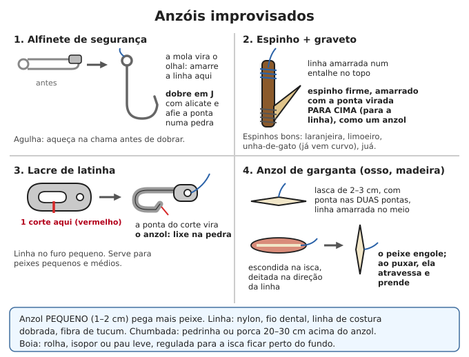
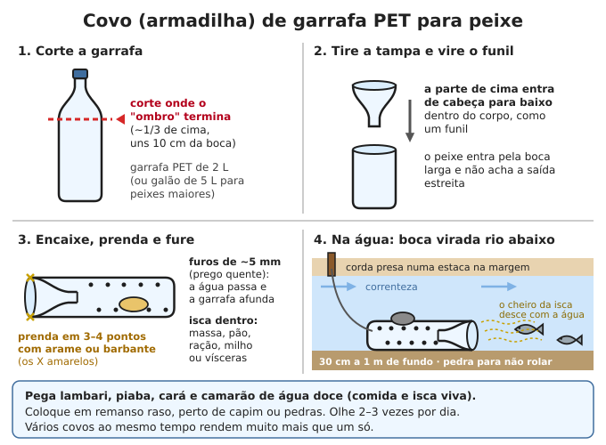

# Pesca, armadilhas e caça

**Resumo:** a **pesca** é a fonte de proteína mais fácil e mais legal na natureza: anzol
pequeno, isca certa, lugar certo e **várias linhas e covos ao mesmo tempo**. Armadilhas para
bichos de terra são **último recurso**, só em fome real, de preferência para espécies invasoras
e pragas, e conferidas várias vezes por dia. Criar galinhas, coelhos e peixes rende muito mais
que caçar ([Criação de animais](../05-animais/01-principios-gerais.md)).

---

## Legislação: leia antes

- **Caçar animal silvestre é crime** no Brasil: matar, perseguir, caçar ou apanhar fauna
  silvestre sem autorização dá **detenção de 6 meses a 1 ano e multa** (Lei 9.605/1998,
  art. 29). Os animais silvestres são protegidos pela Lei 5.197/1967.
- A mesma lei diz que **não é crime** abater animal **em estado de necessidade, para matar a
  fome** da pessoa ou da família (art. 37). Isso vale para **fome real**, será avaliado depois
  e **não autoriza** caça por esporte, para vender ou para estocar.
- **Javali** é espécie invasora; o controle é permitido a pessoas **cadastradas no Ibama**.
- **Pesca:** a pesca amadora exige **licença** (emitida pelo Ministério da Pesca; há dispensas
  para alguns casos — confirme as regras atuais). Respeite **tamanho mínimo** dos peixes e locais
  proibidos.
- **Defeso:** na **piracema** (reprodução dos peixes de rio, em geral de **novembro a fevereiro
  ou março**, conforme a bacia) a pesca é proibida ou restrita. Também há defeso de camarão,
  lagosta e caranguejo-uçá (na "andada"). Pescar no defeso: **detenção de 1 a 3 anos** (art. 34).
- **Explosivos e venenos** (inclusive timbó e outras plantas que "envenenam" a água) são
  crime grave (art. 35) e matam tudo, inclusive filhotes e peixes rio abaixo. **Não use.**

> **ATENÇÃO:** mesmo num colapso, **respeite a piracema e solte fêmeas ovadas e filhotes**.
> Quem esvazia o rio este ano não tem peixe no ano que vem. Use os peixes invasores à vontade:
> **tilápia, bagre-africano, carpa** e, fora da Amazônia, **tucunaré**.

## Pesca: equipamento improvisado

### Anzol
| Material | Como fazer |
|---|---|
| **Alfinete de segurança** | Abra, dobre a haste em "J" com alicate, afie a ponta numa pedra. A mola vira o olhal |
| **Alfinete comum, agulha, arame de clipe** | Dobre em J. Agulha quebra a frio: aqueça na chama até ficar vermelha, dobre e deixe esfriar |
| **Espinho + graveto** | Graveto de 3–4 cm com entalhe no topo para a linha; espinho firme amarrado embaixo, ponta virada **para cima** (para a linha). Espinhos: laranjeira, limoeiro, juá, unha-de-gato |
| **Lacre de latinha** | Corte a argola grande num só ponto; a ponta cortada vira o anzol. Lixe na pedra. Linha no furo pequeno |
| **Anzol de garganta** (osso, madeira dura, espinho de peixe) | Lasca de 2–3 cm pontuda nas **duas pontas**, linha amarrada no meio, escondida na isca deitada no sentido da linha. O peixe engole, você puxa, ela atravessa na garganta |

**Anzol pequeno (1–2 cm) pega muito mais peixe** que anzol grande: lambaris, piaus, carás e
tilápias têm boca pequena.

### Linha, chumbada, boia e vara
- **Linha:** nylon de pesca (guarde um rolo no kit), fio dental, linha de costura dobrada e
  torcida, fios internos de corda paracord, **fibra de tucum** (palmeira, tradicional para linha
  e rede). Veja [Cordas e nós](../09-quimica-e-oficios/03-cordas-nos-e-cestaria.md).
- **Chumbada:** pedrinha amarrada, porca, parafuso, prego, 20–30 cm acima do anzol.
- **Boia:** rolha, pedaço de isopor, chinelo velho, graveto de madeira leve (embaúba), pena
  grossa. Ajuste a altura para a isca ficar **um palmo acima do fundo**.
- **Vara:** bambu ou taquara de 2–3 m, linha do comprimento da vara. Sem vara: **linha de mão**
  enrolada numa lata ou garrafa.
- **Nó do anzol (nó clinch):** passe a linha pelo olhal, dê **5–7 voltas** na própria linha,
  passe a ponta de volta pelo laço junto ao olhal, **molhe com saliva** e puxe firme.

### Iscas
| Isca | Como conseguir | Pega bem |
|---|---|---|
| **Minhoca** | Cave em terra úmida, sob folhas, esterco e pedras; à noite após chuva saem sozinhas | Quase todos: lambari, cará, tilápia, mandi, bagre, piau |
| **Massa** | 1 xícara de fubá + ½ de farinha de trigo + água aos poucos até dar ponto de massinha; cozinhe bolinhas 1–2 min em água fervendo para firmar | Lambari, tilápia, carpa, piau |
| **Milho cozido, pão** | Do estoque ou da roça | Pacu, carpa, piau, tilápia |
| **Insetos** | Gafanhoto, grilo, cupim, larva de besouro (coró), içá | Lambari, peixes de superfície |
| **Vísceras e pedaços de peixe, fígado de galinha** | Restos da limpeza | Bagre, mandi, jundiá, traíra, piranha |
| **Peixinho vivo** (lambari do covo) | Covo de garrafa (abaixo) | Traíra, tucunaré, dourado, peixe-cachorro |
| **Frutas** (goiaba, figo, coquinhos) | Que caem na água | Pacu, tambaqui, piraputanga |
| **Camarão, caranguejo, marisco** | Praia, mangue | Peixes de mar e de mangue |

**Ceva:** jogue um punhado de milho, massa ou restos no mesmo ponto por 1–2 dias antes: os
peixes se acostumam a comer ali.

### Onde e quando estão os peixes
- **Remansos** (água parada atrás de pedras e curvas), **poços fundos** logo abaixo de
  corredeiras, **sombra** de árvores e barrancos, **galhadas** e pedras submersas, **encontro de
  rios**, beira com capim e plantas aquáticas.
- **Horários:** amanhecer e entardecer são os melhores. À noite: bagres, jundiás, traíras.
  Meio-dia quente: peixes no fundo e na sombra. Logo depois da chegada de frente fria, comem pouco.
- **Não deixe sua sombra cair na água**, fique abaixado e em silêncio, sem bater na margem.

## Armadilhas de água (trabalham sozinhas enquanto você faz outra coisa)

### Covo de garrafa PET

1. Garrafa PET de **2 L** (ou galão de 5 L para peixes maiores). Corte onde o "ombro" termina
   (~1/3 de cima, uns 10 cm da boca). Tire a tampa.
2. Vire a parte de cima de cabeça para baixo e encaixe dentro do corpo: vira um **funil**.
3. Prenda em 3–4 pontos com arame fino ou barbante.
4. Faça **furos de ~5 mm** no corpo todo (prego aquecido no fogo) para a água passar.
5. Isca dentro: massa, pão, ração, milho, vísceras. Uma pedra dentro ou amarrada para afundar.
6. Coloque em **água rasa e calma (30 cm a 1 m)**, perto de capim ou pedras, com a **boca virada
   rio abaixo** (o peixe sobe a correnteza seguindo o cheiro). Amarre numa estaca da margem.
7. Confira **2–3 vezes por dia**. Pega lambari, piaba, cará e camarão de água doce, ótimos
   fritos inteiros ou como isca viva.

### Jequi (covo de taquara)
1. Corte **30–40 varetas** de taquara ou bambu de 1 cm de largura e 80–120 cm.
2. Amarre-as com cipó ou arame em **3–4 anéis** (de 30–40 cm de diâmetro na boca, diminuindo),
   formando um cone comprido. A ponta fica fechada com um nó que se desamarra para tirar os peixes.
3. Faça um **segundo cone menor** (varetas de ~30 cm) e encaixe na boca, com a ponta para dentro,
   deixando abertura de **5–8 cm**. É a "sanga": o peixe entra e não acha a saída.
4. Coloque numa **passagem estreita**: entre pedras, numa abertura de pequena barragem de
   pedras, na saída de uma lagoa que esvazia. Firme com estacas e pedras.

### Curral de pedras no rio raso
1. Em rio raso e de correnteza fraca, faça **duas paredes baixas de pedras em "V"** (cada uma
   de 3–5 m), da margem para o meio, fechando num cercadinho de ~1 m com entrada de 20–30 cm.
2. Os peixes que descem ou sobem acompanhando a parede entram no cercado. Feche a entrada com
   uma pedra e pegue com as mãos, peneira ou cesto.
3. **Nunca feche o rio inteiro** (proibido e acaba com a pesca de todos rio abaixo).

### Curral de maré (praia)
1. Na faixa de praia que **cobre na maré alta e seca na baixa**, monte um muro de pedras em
   **arco**, de 60–100 cm de altura, com as pontas encostando na praia.
2. Na maré alta os peixes passam por cima; na baixa a água escorre entre as pedras e os peixes
   ficam presos na poça. Recolha logo que a maré baixar.
3. Use a **tábua de marés** (no rádio, na colônia de pescadores ou anote o padrão: a maré
   atrasa cerca de **50 minutos por dia**). Cuidado com moreias, ouriços e cortes nas pedras.

### Linha de espera e espinhel
- **Linha de espera:** linha forte amarrada num **galho flexível** sobre a água (ele cansa o
  peixe e mostra quando pegou), anzol com isca, de um palmo a meio metro do fundo. Arme no fim da
  tarde, confira ao amanhecer: pega bagre, jundiá, traíra.
- **Espinhel:** uma linha principal esticada (entre margens ou ancorada com pedra e boia), com
  **linhas curtas de 30–50 cm a cada 1–2 m**, cada uma com anzol e isca. 10 anzóis trabalhando a
  noite toda rendem mais que um dia de vara.
- Confira **de manhã e no fim da tarde** e **recolha tudo** ao ir embora: linha esquecida mata
  aves, jacarés e tartarugas por meses.

### Rede e tarrafa (uso básico)
- **Rede de espera:** boias em cima, chumbo embaixo, presa nas pontas. Coloque **atravessando só
  parte do rio**, em remanso, no fim da tarde; confira a cada 2–4 horas (peixe morto na rede
  estraga e é comido por piranhas). **Malha pequena pega filhotes**: prefira malha de 4 cm ou mais
  entre nós.
- **Tarrafa** (rede redonda com chumbos na borda): prenda a corda no pulso, segure parte da
  borda na mão e apoie outra parte no ombro, gire o corpo e solte para ela abrir em roda sobre a
  água. Treine na terra antes. Deixe afundar e puxe a corda devagar: a borda fecha e
  prende os peixes. Use em água rasa **sem galhos** (rasgam a rede).
- **Peneira, puçá ou mosquiteiro** passados rente à margem com capim pegam camarão e peixinhos.
- Fazer e consertar rede: [Cordas, nós e cestaria](../09-quimica-e-oficios/03-cordas-nos-e-cestaria.md).

## Limpar e conservar o peixe

1. **Mate logo** com uma pancada firme atrás da cabeça. Corte as guelras para sangrar (carne
   mais clara e que dura mais).
2. **Peixe de escama:** raspe as escamas do rabo para a cabeça. **Peixe de couro** (bagre,
   mandi, surubim, jundiá): corte os **ferrões** com alicate antes de mexer e tire o couro.
3. Abra a barriga do ânus até as guelras, tire as vísceras **sem estourar o fel** (bolsinha
   verde, amarga), tire as guelras, raspe a linha escura junto à espinha. Lave com água limpa.
4. **Cozinhe bem**, até a carne ficar opaca e soltar em lascas. **Nunca coma peixe de água doce
   cru** (vermes).

| Peixe fresco | Peixe estragado (jogue fora) |
|---|---|
| Olhos brilhantes e saltados | Olhos fundos e opacos |
| Guelras vermelho-vivo | Guelras marrons ou cinzentas |
| Carne firme (o dedo não deixa marca) | Carne mole, barriga estufada |
| Cheiro de água, de mar | Cheiro forte, de amônia |

- **No calor, peixe morto estraga em poucas horas.** Mantenha vivo até a hora de preparar
  (num cesto ou cercado dentro da água) ou limpe e cozinhe no mesmo dia.
- **Salga seca:** abra o peixe em manta (espalmado), faça cortes rasos na carne grossa,
  cubra com sal grosso em camadas numa caixa com furos para escorrer (cerca de **1 kg de sal
  para 3 kg de peixe**). Depois de 1–3 dias, seque ao sol por 4–7 dias, recolhendo à noite e na
  chuva, até ficar duro e seco. Guardado seco, dura meses. Antes de comer, deixe de molho
  trocando a água.
- **Moquém (técnica indígena):** grelha de varas verdes a **60–80 cm** do chão sobre brasa fraca
  com fumaça; peixe aberto, virando de vez em quando, por **12–24 horas**, até secar. Dura de
  alguns dias a uma semana.
- Mais técnicas: [Conservação de alimentos](../03-alimentacao/02-conservacao-de-alimentos.md).

> **ATENÇÃO:** ferrões de bagre, mandi, arraia e niquim (peixe-sapo do mangue) causam dor
> fortíssima. Tratamento: mergulhe o local em **água quente** (~45 °C, o mais quente que a
> pessoa aguentar sem queimar) por 30–90 minutos. Veja [Animais peçonhentos](../02-saude/06-animais-peconhentos.md).

## Peixes e frutos do mar perigosos

### Baiacu: NUNCA coma
- **Baiacu** (de mar e de rio) e **baiacu-de-espinho**: incham como bola, não têm escamas, pele
  áspera ou com espinhos, dentes juntos formando um "bico". Têm **tetrodotoxina** no fígado,
  ovas, vísceras e pele.
- **Cozinhar não destrói o veneno. Não existe antídoto.** Não dê para cachorro nem gato.
  Enterre as vísceras.
- **Sintomas** (10 minutos a 3 horas depois): formigamento na boca e na língua, dormência,
  tontura, fraqueza, paralisia, falta de ar.
- **O que fazer:** a pessoa morre porque **para de respirar**; o coração e a mente seguem
  funcionando. Se parar de respirar, faça **respiração boca a boca sem parar** (por horas, se
  preciso, revezando) até o veneno passar — muitos sobrevivem assim. Veja [RCP](../02-saude/01-primeiros-socorros.md).

### Outros riscos
- **Peixe "picante" (escombroide):** atum, bonito, cavala, sardinha e dourado-do-mar **mal
  conservados** fazem rubor, coceira, dor de cabeça e ardência na boca em minutos. Coma fresco.
  Melhora com antialérgico ([Medicamentos](../02-saude/04-medicamentos-e-doses.md)).
- **Áreas de garimpo (Amazônia, Pantanal norte):** peixes **carnívoros** (tucunaré, piranha,
  traíra, dourado, surubim) acumulam **mercúrio**. Grávidas e crianças devem preferir peixes que
  comem plantas e lodo (pacu, tambaqui, jaraqui, curimatã).
- **Água com esgoto ou espuma verde** (algas): não pesque ali.
- **Peixe encontrado morto ou boiando**: não coma.

### Mariscos, ostras, sururu, berbigão
Eles **filtram a água** e concentram micróbios e toxinas.
- **Maré vermelha:** água do mar avermelhada ou marrom em manchas, peixes e mariscos mortos na
  praia. As toxinas **não saem no cozimento** e causam formigamento nos lábios, dormência,
  diarreia e **paralisia da respiração**. Não colete por semanas depois.
- Colete só **longe de esgoto, cidade e porto**, e não depois de chuva forte (a enxurrada leva
  sujeira para o mar).
- Jogue fora os que estão **abertos e não fecham** ao bater. **Ferva até abrir e mais 5
  minutos**; descarte os que não abrirem.
- **Caramujo-africano** (caramujo grande de jardim, concha listrada em espiral alta): **nunca
  coma nem mexa sem luva** — transmite verme que causa meningite.

## Armadilhas de terra: só em emergência real

### Regras
1. **Só em fome real**, quando a pesca, a roça e a criação não bastam.
2. **Prefira espécies invasoras e pragas:** pombo doméstico, pardal, lebre-europeia (Sul),
   javali (só quem sabe — é grande e perigoso). **Ratos de cidade:** capture para proteger o
   estoque, **mas não coma** (leptospirose e outras doenças).
3. **Armadilha que prende vivo** (gaiola) é melhor: você **solta** o que não deve pegar (espécie
   ameaçada, fêmea com filhotes, animal doméstico).
4. **Confira 2–3 vezes por dia** (amanhecer, meio-dia, fim de tarde). Animal preso sofre,
   e outro bicho come antes de você.
5. Anote num papel **onde** está cada armadilha. Ao ir embora, **recolha todas**: armadilha
   esquecida mata cachorros e machuca crianças por meses.
6. **Proibido:** armadilha que mata ou fere pessoas, armadilha escondida em caminho de gente,
   armas improvisadas, venenos.

### Onde colocar
- Em **trilhas** de bicho (carreiros: caminhos estreitos e batidos no mato), passagens entre
  pedras e moitas, buracos em cercas, perto de comedouros (árvores com frutas roídas no chão),
  bebedouros e tocas. Procure **pegadas, fezes e pelos**.
- Afunile a passagem com galhos para o bicho passar exatamente pela armadilha.
- Mexa o mínimo no lugar. Esfregue as mãos em terra e folhas para tirar o cheiro.
- Várias armadilhas espalhadas pegam mais que uma só.

### Gaiola de alçapão (pega vivo)
1. **Versão mais simples (puxada à mão):** uma caixa, cesto ou arapuca virada para baixo,
   apoiada num pauzinho; um barbante de 5–10 m do pauzinho até você, escondido. Isca debaixo
   (milho, quirera, pão ou arroz para pombos e pardais). Quando o animal entra, puxe.
   Você vê o que entrou antes de puxar.
2. **Caixa com porta que cai:** caixa de madeira ou tela de **60–80 × 20–25 × 20–25 cm**,
   porta de tábua correndo em trilhos verticais numa ponta e **tela fechada** na outra (o bicho
   vê a saída e entra). A porta fica levantada presa a um arame que passa por cima da caixa até
   o **gatilho** no fundo: um gancho onde se pendura a isca. Quando o bicho puxa a isca, o arame
   solta e a porta cai.
3. Teste o gatilho várias vezes: a porta tem que cair sempre, sem prender no meio.

### Laço simples
- Arame fino maleável ou cordinha de náilon, com **laço corrediço do diâmetro de um punho
  (~10 cm)** para bicho do tamanho de lebre; a parte de baixo do laço a **4 dedos (~7 cm) do
  chão**, no meio da trilha afunilada; a outra ponta presa numa **estaca firme ou árvore**.
- O laço é **pouco seletivo e faz o animal sofrer**: confira com frequência, sinalize o local
  para as pessoas e **prefira a gaiola**. Não use em lugar onde passam cães e crianças.

### Abater e preparar
- Animal preso na gaiola: abata **rápido**, com pancada firme na nuca, ou entregue a quem sabe.
  Veja [Abate e carne](../05-animais/12-abate-e-carne.md).
- **Luvas** para limpar. Não rompa intestino e bexiga. Olhe o **fígado**: manchas brancas,
  bolhas ou vermes = enterre tudo.
- **Cozinhe muito bem**, nunca mal passada (vermes como a triquinela do javali, toxoplasmose,
  bactérias).

### NUNCA coma
- **Animais encontrados mortos** (doença, veneno, carniça — botulismo e carbúnculo matam).
- Animal **agindo estranho**: agressivo, babando, cambaleando, paralisado, manso demais (raiva).
- **Morcego** (raiva) — nem toque sem luva grossa.
- **Tatu:** além de ser crime, transmite **hanseníase** (lepra) ao manusear e comer.
- **Sapos:** pele seca e rugosa, com "verrugas" e glândulas grandes atrás dos olhos (cururu) —
  o veneno não sai no cozimento e mata pessoas e cachorros. Nem os ovos e girinos.
  **Pererecas e rãzinhas coloridas** (Amazônia) também são venenosas.

## Insetos: proteína legal e fácil

| Inseto | Como preparar |
|---|---|
| **Içá / tanajura** (rainha da saúva, sai em revoada na primavera depois da chuva) | Tire asas, cabeça e patas; torre na panela com sal. Prato tradicional no interior |
| **Larva de besouro (coró, bicho-do-coco)** | De troncos e cocos podres; frite ou asse |
| **Gafanhoto, grilo** | Tire asas, patas e cabeça; torre bem |
| **Cupim** (rainha e operários) | Torrado |

**Sempre cozidos**. Evite lagartas peludas, insetos muito coloridos ou que fedem, besouros que
soltam líquido, moscas, baratas e carrapatos.

## Lista rápida de pesca de sobrevivência

- [ ] Rolo de linha de nylon e 20 anzóis pequenos no kit (pesam quase nada)
- [ ] 3–5 covos de garrafa armados com isca
- [ ] 1 espinhel de 10 anzóis armado à noite
- [ ] Iscas: minhocas, massa, vísceras do último peixe
- [ ] Confiro tudo de manhã e à tarde e recolho ao sair
- [ ] Baiacu: devolvo à água ou enterro. Nunca como

---

Ver também: [Perdido no mato](01-perdido-no-mato.md) · [Peixes (criação)](../05-animais/08-peixes.md) · [Abate e carne](../05-animais/12-abate-e-carne.md) · [Conservação de alimentos](../03-alimentacao/02-conservacao-de-alimentos.md) · [Plantas silvestres comestíveis](../03-alimentacao/04-plantas-silvestres-comestiveis.md) · [Animais peçonhentos](../02-saude/06-animais-peconhentos.md)
