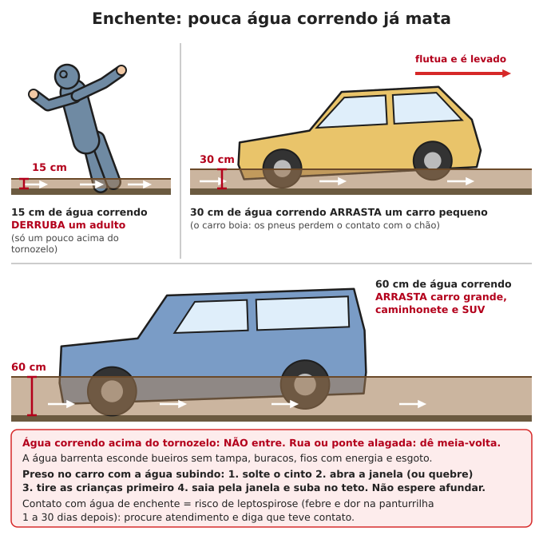
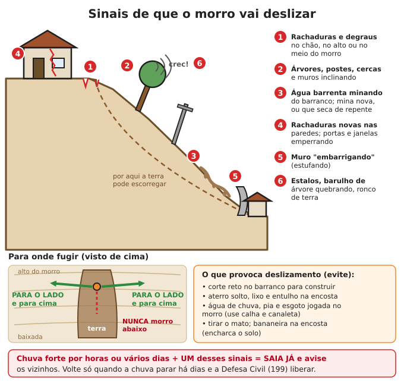

# Desastres e catástrofes

**Resumo:** para cada desastre há três momentos: **ANTES** (preparar: é aqui que se salva a
maioria das vidas), **DURANTE** (agir rápido, sem pânico, na ordem certa) e **DEPOIS** (os
perigos continuam: doenças, estruturas danificadas, fios, saques). Conheça os riscos da sua
região, tenha a mochila de fuga pronta e um plano de família escrito.

---

## Antes de tudo

- **Telefones:** Defesa Civil **199** · Bombeiros **193** · SAMU **192** · Polícia **190** ·
  Disque-Intoxicação **0800 722 6001**.
- **Alerta por SMS:** envie o seu **CEP para 40199** (Defesa Civil). Pode cadastrar vários CEPs
  (casa, trabalho, escola, casa de parente).
- **Rádio a pilha** sempre pronto: quando tudo cai, é por ele que chegam as ordens.
- **Plano de família e mochila de fuga:** [Primeiras 72 horas](../00-emergencia/01-primeiras-72-horas.md)
  · [Kits](../00-emergencia/03-kits-e-estoques.md) · [Ficar ou sair](../00-emergencia/02-prioridades-e-decisao.md).
- **Quais desastres ameaçam onde você mora?** Pergunte aos moradores antigos, procure marcas de
  enchentes nas paredes e consulte a Defesa Civil do município enquanto ela existir.

## Enchente e inundação

Tipos: **inundação lenta** (rio grande sobe em dias, como no Rio Grande do Sul em 2024, quando a
água ficou semanas nas cidades e houve mais de 180 mortes), **enxurrada e alagamento** (minutos
a horas, em cidade e baixada) e **cabeça d'água** (rio de serra sobe em minutos).

**ANTES**
1. Descubra se a casa já alagou e até que altura. Defina **para onde ir** (lugar alto, casa de
   parente, abrigo) e **por qual caminho** (que não alague).
2. Documentos, remédios e dinheiro em **saco plástico fechado**, num lugar alto, junto da
   mochila de fuga.
3. Prateleiras altas para o que é valioso; móveis sobre blocos; tomadas a 1,5 m do chão se for
   reformar.
4. Guarde **água potável** (a rede costuma ser contaminada) e água sanitária para a limpeza.
5. **Galões vazios bem tampados** amarrados ao corpo viram boia. Tenha corda (15 m), apito e
   lanterna.
6. Plano para os animais: **nunca deixe cachorro preso por corrente** em área que alaga.

**DURANTE**
1. Ao primeiro sinal (chuva forte contínua, alerta, rio subindo rápido): **saia cedo**, de dia.
   Esperar "para ver" faz a pessoa ficar ilhada à noite.
2. Antes de a água chegar: **desligue o disjuntor geral e feche o gás**. Se já houver água no
   chão, **não toque** em nada elétrico.
3. **Não entre em água correndo** acima do tornozelo e **não atravesse rua ou ponte alagada de
   carro** (veja a figura).
4. Ilhado: suba para o andar mais alto ou para o telhado. **Não se tranque no forro/sótão sem
   saída**: leve martelo ou machadinha para abrir o telhado. Sinalize com pano claro, lanterna
   e apito (3 sinais).
5. Longe de **fios e postes**: a água conduz eletricidade.
6. Alguém caiu na água: jogue algo que flutue, não pule atrás. Veja [Afogamento](../02-saude/10-calor-frio-e-ambiente.md).

**DEPOIS**
1. Volte só quando a água baixar e a Defesa Civil liberar. Entre com **botas e luvas de
   borracha** (leptospirose). Cuidado com cobras, escorpiões e ratos abrigados na casa.
2. Paredes rachadas, piso afundado, portas emperrando: **não entre** até um entendido avaliar.
3. **Energia:** só religue depois de tudo seco e de um eletricista conferir.
4. **Limpeza:** tire a lama, lave com água e sabão e depois desinfete pisos, paredes e móveis
   com **2 xícaras (400 mL) de água sanitária em um balde de 20 L de água**; deixe agir 15–30
   minutos.
5. **Jogue fora:** alimentos que tocaram a água (exceto **latas intactas**, sem amassado nem
   ferrugem — lave e deixe 15–30 minutos em água com 1 colher de sopa de água sanitária por
   litro), remédios molhados, colchões, travesseiros e bichos de pelúcia encharcados.
6. **Caixa d'água e poço:** esvazie, esfregue e desinfete. Caixa: **1 L de água sanitária para
   cada 1.000 L**, deixe 2 horas, esvazie e encha de novo. Poço: veja [Encontrar água](../01-agua/01-encontrar-e-captar-agua.md).
7. **Saúde:** febre, dor de cabeça e **dor na batata da perna** de 1 a 30 dias depois do
   contato com a água = suspeite de **leptospirose** e trate cedo ([Doenças](../02-saude/03-doencas-e-infeccoes.md)).
   Corte em contato com lama: confira a vacina de **tétano**. Semanas depois vem a **dengue**:
   esvazie tudo que acumula água.

## Deslizamento de terra

**ANTES**
1. Não corte barranco na vertical, não faça aterro solto, não jogue lixo, entulho, esgoto ou
   água de calha na encosta. Leve a água em **canaletas** até o pé do morro.
2. Mantenha o mato e plante capim e árvores na encosta; tire bananeiras de encostas ocupadas
   (encharcam o solo).
3. **Pluviômetro caseiro:** garrafa PET de paredes retas, cortada no ombro, com marcas de
   centímetro. **1 cm de água = 10 mm de chuva.** Esvazie todo dia no mesmo horário e anote.
4. Em encosta ocupada, **chuva forte por horas** ou **mais de ~50 mm num dia** já pedem atenção;
   **vários dias seguidos de chuva** encharcam o solo e aumentam o risco mesmo com chuva fraca.
5. Combine com os vizinhos um sinal de alarme (apito, sino, panela) e um ponto de encontro em
   terreno firme.

**DURANTE**
1. Apareceu **um sinal** da figura durante ou depois de chuva forte: **saia já**, avise os
   vizinhos e não volte para buscar nada.
2. Fuja **para o lado** do caminho da terra e para cima, para terreno firme. **Nunca morro
   abaixo** na frente da lama.
3. Se não der para sair: fique junto a uma parede interna ou debaixo de mesa forte, encolhido,
   protegendo a cabeça.

**DEPOIS**
1. **Fique longe**: novos deslizamentos são comuns nas horas e dias seguintes.
2. Pessoas soterradas: chame e **fique em silêncio para ouvir**. Cave com cuidado, tirando terra
   de cima, e **libere primeiro o rosto e o peito** para a pessoa respirar. Alguém sempre
   vigiando o barranco, com rota de fuga combinada.
3. Cuidado com **canos de gás e fios** rompidos. Volte só com liberação.

## Seca prolongada

**ANTES**
1. **Guarde água** de chuva: cisterna (16 mil litros abastece uma família de 5 por cerca de 8
   meses só para beber e cozinhar), barreiro, caixas. Veja [Encontrar e captar água](../01-agua/01-encontrar-e-captar-agua.md).
2. **Barragem subterrânea:** vala atravessando o leito de um riacho seco até a rocha, forrada
   com lona plástica e aterrada de novo. A água da chuva fica presa na areia e umedece o terreno
   para plantar meses depois.
3. Plante o que aguenta seca: mandioca, feijão-de-corda (caupi), sorgo, milheto, guandu, palma
   forrageira (para os animais), umbu, caju. [Culturas](../04-agricultura/04-culturas-principais.md).
4. **Cobertura morta** (palha, folhas) no canteiro: corta a perda de água pela metade.
5. Forragem guardada para os animais (silagem, feno, palma).

**DURANTE**

| Uso | Litros por pessoa por dia | Observação |
|---|---|---|
| Beber | 2–4 (mais no calor) | Nunca corte |
| Cozinhar | 2 | Prefira cozidos com pouca água |
| Higiene mínima | 2–5 | Mãos sempre; banho de caneca |
| Animais e plantas | o que sobrar | Use água de reuso |

1. **Reuse:** água do banho e de lavar louça (sem muito sabão) vai para a descarga e para as
   plantas; água de lavar arroz e verduras vai para as plantas.
2. Irrigue **de madrugada ou à noite**, no pé da planta: garrafa PET furada enterrada ao lado
   gasta muito menos. Veja [Irrigação](../04-agricultura/07-irrigacao.md).
3. **Cubra reservatórios** (sol e vento evaporam muito). Em açude que baixa, a água piora:
   trate sempre. Água de carro-pipa: **clore** antes de beber.
4. Animais: venda ou abata os menos produtivos **antes de emagrecerem**; guarde os
   reprodutores. Sombra e água limpa para todos.

**DEPOIS**
- Primeiras chuvas: limpe calhas, **descarte os primeiros minutos** de chuva e capte o resto.
  Plante logo, aproveitando a umidade.

## Incêndio florestal e queimadas

**ANTES**
1. **Aceiro:** faixa de **pelo menos 5–10 m** limpa até a terra, sem capim seco, folhas ou lixo,
   em volta da casa, do paiol e dos galinheiros; **3 m** ao longo das cercas.
2. Lenha, palha, gás e combustíveis **longe da casa**.
3. Caixa d'água cheia, mangueira, baldes, enxadas, rastelo e **abafadores** (cabo de 1,5 m
   com um pedaço de borracha de pneu ou lona grossa de 40 × 40 cm na ponta).
4. **Não queime lixo nem pasto na seca.** Provocar incêndio em mata é crime (Lei 9.605/1998,
   art. 41). Queimada só com autorização e com aceiro, de manhã cedo, sem vento.
5. Duas rotas de fuga, em direções diferentes. Máscaras PFF2 para a fumaça.

**DURANTE**
1. **Fogo à vista? Saia cedo.** Quem espera fica cercado. Roupa de algodão de manga comprida,
   calça, botas, pano molhado no rosto.
2. **Nunca fuja morro acima** à frente do fogo (o fogo sobe morro muito mais rápido que uma
   pessoa) nem na direção para onde o vento sopra. Vá para área **já queimada**, rio, estrada
   larga, roça lavrada ou irrigada.
3. **Cercado de carro:** pare longe do mato, pisca-alerta ligado, janelas e entradas de ar
   fechadas, ar no modo recircular, abaixe-se abaixo das janelas, cubra-se com cobertor de lã e
   espere a frente de fogo passar. O carro protege mais que ficar a pé.
4. **Combater só foco pequeno** (chama baixa, capim): ataque **pelos lados e por trás**, nunca
   pela frente, batendo com o abafador ou jogando terra, sempre com a área queimada atrás de
   você como fuga. Se o vento virar ou a chama passar da altura do joelho, **saia**.
5. Em casa, se não der para sair: feche portas e janelas, tire cortinas de perto das janelas,
   encha baldes e a banheira, molhe o telhado e a volta da casa, fique dentro (as paredes
   protegem do calor) e saia depois que a frente passar.

**DEPOIS**
- **Brasas** em tocos, raízes, montes de esterco e serragem reacendem dias depois: molhe e
  revolva com a enxada. Árvores queimadas caem sem aviso.
- Cubra cisternas (cinza e fuligem) e descarte a primeira chuva.
- Fumaça faz mal a crianças, idosos, asmáticos e cardíacos: casa fechada, pano úmido na fresta
  da porta, PFF2. Veja [Fumaça](../02-saude/10-calor-frio-e-ambiente.md).

## Vendaval, ciclone extratropical e tornado (Sul e Sudeste)

O Sul recebe **ciclones extratropicais** quase todo ano (ventos de 80 a mais de 100 km/h e chuva
forte), teve o **furacão Catarina** em 2004 e está numa das regiões com mais **tornados** da
América do Sul (oeste do Paraná, Santa Catarina, Rio Grande do Sul, oeste de São Paulo, Mato
Grosso do Sul).

**ANTES**
1. Pode galhos que ficam sobre a casa e a rede elétrica. Árvore doente perto da casa: corte.
2. **Prenda o telhado:** telhas de fibrocimento parafusadas com arruela de vedação; telhas
   cerâmicas soltas, amarradas com arame nas ripas; beirais reforçados.
3. Recolha objetos que voam: telhas soltas, latões, placas, lonas, móveis de quintal.
4. Escolha o **cômodo mais seguro**: no térreo, no centro da casa, **sem janelas** (banheiro,
   corredor, despensa).
5. Tenha lona grande, pregos, ripas e martelo para depois.

**Sinais de tornado:** céu escuro esverdeado, nuvem em forma de funil, granizo grande, barulho
forte e contínuo como **trem ou turbina**, vento que para de repente e volta de outra direção.

**DURANTE**
1. Vá para o cômodo seguro, **longe de janelas**. Agache-se, cubra cabeça e pescoço com os
   braços e puxe um **colchão** ou cobertor grosso por cima.
2. No carro: não tente fugir no meio do trânsito. Se não houver construção forte por perto,
   **saia e deite numa vala ou valeta**, abaixo do nível da estrada, protegendo a cabeça.
3. **Nunca se abrigue embaixo de viaduto ou passarela** (o vento acelera ali).
4. No mar ou em lagoa: volte para a margem antes de o tempo virar.

**DEPOIS**
1. **Fios caídos: considere todos com energia.** Fique a pelo menos **10 m** e avise todos.
2. Galhos pendurados e árvores tortas caem depois. Cheiro de gás: não acenda nada, abra tudo,
   saia.
3. Cubra o telhado com lona presa por **ripas pregadas por cima** (só pedra o vento leva).
4. Confira os vizinhos, principalmente idosos e quem mora sozinho.

## Granizo

- **ANTES:** tela de sombreamento (sombrite) ou tela antigranizo sobre a horta; abrigo para
  animais; lona e telhas de reserva; carro na garagem.
- **DURANTE:** fique dentro, **longe de janelas e claraboias**. Na rua, proteja a cabeça
  (mochila) e entre no primeiro abrigo. Pedras do tamanho de bola de pingue-pongue ferem.
- **DEPOIS:** telhas quebradas: cubra com lona antes da próxima chuva. Gelo entupindo a calha
  causa infiltração: desentupa. Plantas danificadas: tire as partes quebradas, adube e replante
  o que morreu (tenha sementes de reserva).

## Onda de calor

O Inmet chama de onda de calor quando a temperatura fica **5 °C ou mais acima da média por 5
dias ou mais**.

- **ANTES:** sombra em volta da casa (árvores, toldos), telhado claro, ventilação cruzada.
  Faça a lista de quem é mais frágil na vizinhança (idosos, bebês, doentes, acamados).
- **DURANTE:**
  1. Beba água **antes de ter sede**; urina clara = bem hidratado.
  2. Trabalho pesado só **cedo e no fim da tarde**. Roupa clara e folgada, chapéu.
  3. Casa: janelas abertas à noite, fechadas e com sombra de dia. Pano molhado no corpo, banho
     frio, pés na bacia.
  4. **Visite idosos e doentes 2 vezes por dia.**
  5. **Nunca deixe criança ou animal em carro fechado** (a temperatura dentro sobe mais de
     10 °C em 10 minutos).
  6. Animais: água fresca à vontade e sombra. Comida estraga mais rápido: cozinhe e coma na hora.
- **DEPOIS:** reponha o sal e a água; observe quem ficou fraco.
- Exaustão e insolação: [Calor e frio](../02-saude/10-calor-frio-e-ambiente.md).

## Onda de frio (e friagem)

Atinge o Sul, as serras do Sudeste e o Centro-Oeste. Na Amazônia (Rondônia, Acre, sul do
Amazonas, Mato Grosso) a **friagem** derruba a temperatura de 30 °C para perto de 10 °C em um
dia: quem não tem agasalho sofre muito.

- **ANTES:** cobertores, roupa de lã, gorros, meias, colchões. Vede frestas de portas e janelas
  (pano, jornal). Lenha seca guardada. Abrigo e cama de palha para os animais.
- **DURANTE:**
  1. Aqueça **um cômodo só** e reúna todos ali. Durmam juntos.
  2. Roupas em **camadas**, cabeça, mãos e pés cobertos. Isole do chão.
  3. Bebidas quentes e comida calórica. **Álcool não esquenta** (faz perder calor).
  4. **Nunca use braseiro, fogareiro a carvão, churrasqueira ou gerador dentro de casa**:
     monóxido de carbono mata sem cheiro. Fogão a lenha só com chaminé.
  5. **Geada:** cubra a horta no fim da tarde com pano, palha ou plástico apoiado em varetas.
     Dê mais ração aos animais (eles gastam energia para se aquecer) e cuide para a água não
     congelar.
- **DEPOIS:** planta queimada pela geada: **espere** 1–2 semanas antes de podar, para ver o que
  morreu de verdade. Hipotermia: [Calor e frio](../02-saude/10-calor-frio-e-ambiente.md).

## Terremoto (raro, mas existe)

O Brasil tem tremores pequenos com frequência e alguns médios: Mato Grosso (1955, magnitude
6,2), Ceará (1980), João Câmara no Rio Grande do Norte (1986, centenas de tremores e casas
rachadas) e Itacarambi, em Minas Gerais (2007), onde uma criança morreu com o desabamento de uma
casa. Casas de **taipa, adobe e alvenaria sem amarração** (sem vigas e colunas) são as que caem.

- **ANTES:** prenda estantes e armários altos na parede; coisas pesadas embaixo; nada pesado
  pendurado sobre camas. Saiba fechar o gás. Reforço de casas de terra: [Construção com terra](../07-abrigo-e-construcao/02-construcao-com-terra.md).
- **DURANTE — "abaixe, proteja-se, segure":**
  1. **Abaixe-se** no chão, **proteja-se** embaixo de uma mesa forte (ou junto a uma parede
     interna, cobrindo cabeça e pescoço) e **segure** firme até o tremor parar.
  2. Longe de janelas, estantes e espelhos. **Não corra para fora durante o tremor** (é na
     saída que caem telhas, reboco e marquises).
  3. Na cama: fique, cubra a cabeça com o travesseiro.
  4. Na rua: vá para área aberta, longe de muros, postes, fios e fachadas. No carro: pare longe
     de pontes e postes e fique dentro.
- **DEPOIS:** espere **réplicas** (tremores menores). Cheiro de gás: feche o registro, não
  acenda nada. Casa rachada: saia e não volte até avaliar. Ajude os presos sem se arriscar.
  No litoral, se o mar recuar de repente, **suba para o alto** (no Brasil o risco de tsunami é
  muito baixo, mas o sinal vale em qualquer praia).

## Epidemia e pandemia

**Duas palavras diferentes:**
- **Quarentena:** separar pessoas **sadias que tiveram contato** (ou que chegaram de fora) pelo
  tempo de incubação da doença, para ver se adoecem.
- **Isolamento:** separar quem **está doente** até deixar de transmitir.

| Doença | Incubação (contato até sintomas) |
|---|---|
| Gripe | 1–4 dias |
| Covid-19 | 2–14 dias (em geral ~5) |
| Cólera e diarreias | horas a 5 dias |
| Sarampo | 7–21 dias |
| Doença desconhecida | use **14 dias** (21 se for muito grave) |

**ANTES:** máscaras **PFF2** (pelo menos 20 por pessoa), sabão, álcool 70%, água sanitária,
luvas, termômetro, oxímetro, sais de reidratação, remédios de uso contínuo. Vacinas em dia.
Escolha o cômodo de isolamento (com janela).

**DURANTE**
1. Menos contatos: um só sai para as compras e tarefas, de máscara, em horários vazios.
2. **Ventilação é a medida mais forte contra doenças pelo ar:** janelas abertas, reuniões ao ar
   livre, 2 m de distância.
3. Lavar as mãos sempre ([Higiene](../02-saude/09-higiene-e-saneamento.md)).
4. **Comunidade:** uma só entrada, triagem na porta (febre, tosse, diarreia, manchas),
   **quarentena de quem chega** num lugar separado ([Organização comunitária](../12-comunidade-e-seguranca/01-organizacao-comunitaria.md)).
5. **Doente em casa:** quarto ventilado com porta fechada, **um só cuidador** (de PFF2 e
   luvas), pratos, copos e toalhas separados, banheiro separado ou limpo após o uso; roupa
   lavada com sabão, de preferência em água quente.
6. **Desinfetar superfícies:** água sanitária (2–2,5%) **40 mL por litro de água** (pouco menos
   de 3 colheres de sopa). Para vômito, fezes e sangue: **1 parte de água sanitária para 4 de
   água**. Deixe agir 10 minutos.
7. **Mortos:** luvas, máscara e avental; enrole o corpo num lençol, enterre logo, em cova de
   pelo menos **1,5 m**, a **30 m ou mais** de poços e rios e abaixo deles no terreno. Anote nome,
   data e local ([Registro](../12-comunidade-e-seguranca/04-educacao-e-conhecimento.md)).

**DEPOIS:** reabra aos poucos; mantenha a quarentena de quem chega por mais algumas semanas.
Doenças e tratamentos: [Doenças e infecções](../02-saude/03-doencas-e-infeccoes.md).

## Apagão prolongado

O Amapá ficou **22 dias** com pouca ou nenhuma energia em 2020: faltou água (as bombas param),
a comida estragou, formaram-se filas enormes e os preços dispararam.

**O que para junto com a energia:** bombas de água (prédios e cidades, em horas ou dias),
geladeiras, celular e internet (as antenas têm bateria para poucas horas), bombas dos postos de
combustível, caixas eletrônicos e maquininhas de cartão, elevadores, semáforos.

**ANTES:** dinheiro em espécie em notas pequenas, água guardada, lanternas e pilhas, rádio,
carregador portátil, painel solar pequeno ([Energia solar](../06-energia/04-energia-solar.md)),
fogareiro e gás. Garrafas de água congeladas no freezer seguram o frio por mais tempo. Saiba
abrir o portão eletrônico na mão.

**DURANTE**
1. **Freezer e geladeira fechados**: freezer cheio segura ~48 h, meio cheio ~24 h; geladeira
   ~4 h. Coma primeiro o que estraga.
2. **Desligue aparelhos da tomada** (a energia volta com picos que queimam) e deixe uma lâmpada
   ligada para saber quando voltou.
3. **Gerador sempre do lado de fora**, a pelo menos **6 m** de portas e janelas (monóxido).
   Vela: nunca sozinha acesa nem perto de cortinas.
4. **Insulina** fora da geladeira dura cerca de **4 semanas abaixo de 30 °C**: guarde no lugar
   mais fresco (pote de barro com água, moringa, pano úmido).
5. Iluminação e alternativas: [Iluminação](../06-energia/08-iluminacao.md).

**DEPOIS:** jogue fora carne, leite, ovos cozidos e sobras que ficaram **mais de 4 horas
quentes** (acima de 5 °C). Na dúvida, jogue fora.

## Colapso econômico e hiperinflação

**Lições da história do Brasil:**
- Entre 1980 e 1994 a inflação passou de **1.000% ao ano** várias vezes (em 1993, cerca de
  2.500%). Os preços mudavam **todo dia**: o supermercado remarcava as etiquetas de manhã e de
  tarde. Em 8 anos o país trocou de moeda 5 vezes (cruzado, cruzado novo, cruzeiro, cruzeiro
  real, real).
- **Congelamento de preços** (Plano Cruzado, 1986) levou a **prateleiras vazias**, filas e
  cobrança de "ágio" por fora.
- **Confisco** (Plano Collor, 1990): o governo bloqueou por 18 meses o dinheiro de contas e
  poupanças acima de um limite. Quem tinha tudo no banco ficou sem nada para gastar.

**O que as pessoas aprenderam:**
1. **Receber e gastar no mesmo dia:** quem recebia o salário fazia a compra do mês na hora.
   Dinheiro parado perde valor.
2. **Não deixar tudo num lugar só:** um pouco em espécie, um pouco no banco, muito em **coisas
   úteis** (comida estocável, ferramentas, sementes, remédios, materiais) e em **habilidades**.
3. **Pensar o preço em coisas:** "quanto custa em quilos de arroz, dúzias de ovos, dias de
   trabalho?". Isso vira a base da troca quando o dinheiro some.
4. **Bens que guardam valor:** comida que não estraga, sementes, ferramentas, animais
   reprodutores, terra que produz, remédios, sabão, sal. Combustível estraga em meses.
5. Evite dívidas com juros que acompanham a inflação.
6. **Escambo, feira, moeda local e banco de horas** voltam rápido: veja [Troca e economia](../12-comunidade-e-seguranca/03-troca-e-economia.md).
7. Desemprego e crime sobem: discrição sobre o que você tem ([Segurança](../12-comunidade-e-seguranca/02-seguranca.md)).

## Contaminação química

### Vazamento (caminhão, trem, indústria)
- Caminhões e vagões de produtos perigosos têm uma **placa laranja**: número de cima = tipo de
  risco; número de baixo = **número ONU** do produto (ex.: 1203 gasolina, 1202 diesel, 1170
  etanol, 1075 gás de cozinha, 1005 amônia, 1017 cloro). Leia **de longe** e informe ao 193 ou
  ao Pró-Química (**0800 11 8270**).
- **Afaste-se para o lado e contra o vento** (o vento deve bater no seu rosto vindo de onde
  você vai, não de onde está o vazamento). Gases como cloro e gás de cozinha são **mais pesados
  que o ar**: vá para lugar **alto**. Não ande dentro da nuvem nem pise no líquido.
- **Abrigar-se** (quando a nuvem já está passando e não dá para sair): feche portas e janelas,
  desligue ventiladores e ar-condicionado, vede frestas com **pano molhado e fita**, vá para um
  cômodo interno do **andar mais alto**. Espere a liberação e então ventile tudo.
- **Atingido:** saia para o ar limpo, **tire a roupa** (corte, não puxe pela cabeça), lave a pele
  com muita água e sabão por **15 minutos** e os olhos com água corrente por 15 minutos.
- **Máscara PFF2 não filtra gases**, só partículas e fumaça.

### Agrotóxico
- Pulverização perto de casa: feche portas e janelas, recolha roupas do varal, crianças dentro.
- Intoxicação (suor e saliva demais, pupila pequena, vômito, diarreia, tremores, falta de ar):
  tire a roupa, lave com água e sabão, leve ao atendimento com a **embalagem do produto**.
  Disque-Intoxicação **0800 722 6001**.

### Rompimento de barragem (rejeitos de mineração ou água)
- **Mariana (2015):** a barragem de Fundão rompeu, matou 19 pessoas e a lama desceu o Rio Doce
  por mais de 600 km até o mar. **Brumadinho (2019):** a lama da barragem do Córrego do Feijão
  matou 270 pessoas; chegou ao refeitório da mina em poucos minutos e **as sirenes não
  tocaram**.
- **ANTES:** descubra se você mora ou trabalha **abaixo de uma barragem** (de mineração, de
  hidrelétrica ou açude grande). A faixa de até **10 km ou 30 minutos** de chegada da lama é a
  **Zona de Autossalvamento**: ali **não haverá tempo para resgate**; cada um se salva sozinho.
  Conheça as **placas de rota de fuga** e os **pontos de encontro**, e ande a rota com a família.
- **DURANTE:** sirene, estrondo, ronco, vento forte, lama ou água subindo: **corra para o alto,
  para o lado do vale** (subindo a encosta), **nunca vale abaixo** acompanhando o rio. Não volte
  para buscar nada. **Não espere a sirene** para sair se ouvir ou vir a lama.
- **DEPOIS:** a água do rio fica com metais e lama: **não beba, não irrigue, não dê aos animais
  e não coma os peixes** até haver análise. Lama de rejeito não é adubo.

## Acidente nuclear (Angra dos Reis e fontes radioativas)

A Central Nuclear de Angra dos Reis (RJ) tem um plano de emergência com zonas de **3, 5, 10 e
15 km**, sirenes e rotas de saída. Os moradores mais próximos recebem orientação da Defesa
Civil, inclusive sobre **iodeto de potássio**.

**Lição de Goiânia (1987):** catadores abriram um aparelho de radioterapia abandonado; o pó
azul brilhante de **césio-137** contaminou centenas de pessoas e matou 4. **Nunca abra peças de
metal pesadas de equipamento médico ou industrial**, principalmente com o símbolo de radiação
(trevo preto sobre fundo amarelo). Isole e avise.

**DURANTE (ordem: abrigar, fechar, ouvir):**
1. **Entre e fique dentro** de construção de alvenaria ou concreto, no cômodo mais central ou
   no subsolo. Feche portas e janelas, desligue ventiladores e ar-condicionado.
2. Ouça o rádio e siga as ordens: ficar abrigado ou sair por qual rota.
3. **Iodeto de potássio: tome SOMENTE quando a autoridade mandar.** Protege só a tireoide contra
   o iodo radioativo, e é mais importante para **crianças, gestantes e jovens**. Dose única
   (referência da OMS): adultos e maiores de 12 anos **130 mg**; 3–12 anos **65 mg**; 1 mês–3
   anos **32 mg**; recém-nascidos **16 mg**. Acima de 40 anos o benefício é pequeno.
4. **Não tome tintura de iodo, iodo de curativo nem sal iodado**: não protegem e podem
   intoxicar.

**Descontaminação de quem estava fora:**
1. **Tire a roupa de fora antes de entrar** (remove a maior parte da contaminação). Ponha num
   saco plástico fechado, longe das pessoas.
2. **Banho morno com sabão e xampu, sem condicionador** (o condicionador gruda as partículas no
   cabelo). Não esfregue com força nem arranhe a pele.
3. Assoe o nariz, limpe orelhas, pálpebras e unhas. Dê banho também nos animais.

**Comida e água:** coma alimentos **embalados e estocados**; não coma da horta nem frutas ao ar
livre e **não beba leite** de animais que pastaram na região até liberação. Água de reservatório
fechado ou engarrafada.

## Guerra e conflito civil

**ANTES:** documentos e cópias, dinheiro, estoque de 3 meses, rádio, kit de trauma
([Primeiros socorros](../02-saude/01-primeiros-socorros.md)), plano de saída com destino certo.
Saiba onde há porões, garagens subterrâneas e construções fortes.

**DURANTE**
1. Longe dos combates, **fique em casa** no cômodo mais interno, longe de janelas. Cubra as
   janelas com cobertor ou colchão (seguram estilhaços de vidro); afaste camas das janelas.
2. **Bombardeio ou explosão perto:** deite no chão de bruços, cubra a cabeça com os braços e
   mantenha a boca levemente aberta.
3. Evite multidões, protestos, prédios oficiais, pontes e quartéis.
4. **Bloqueios e soldados:** calma, mãos visíveis, documentos à mão, obedeça, não discuta. **Não
   fotografe** soldados, armas e instalações.
5. **Munição que não explodiu** (granadas, bombas, foguetes, objetos metálicos estranhos):
   **nunca toque**. Marque o lugar de longe, avise todos e ensine as crianças.
6. Civis que não participam do combate são protegidos pelas Convenções de Genebra; quem pega em
   armas perde essa proteção. O emblema da **Cruz Vermelha** indica socorro neutro.
7. **Fugir:** saia **cedo**, em grupo, de dia, com documentos, por rotas conhecidas. Use
   corredores humanitários anunciados. Combine como reencontrar a família (a Cruz Vermelha tem
   serviço de busca de parentes).

**DEPOIS:** escombros, munições escondidas, minas e água contaminada continuam matando por anos.

## Tempestade solar e pulso eletromagnético

Uma tempestade solar muito forte (como a de **1859**, que pôs fogo em telégrafos, ou a de
**1989**, que apagou o Quebec por 9 horas) pode queimar **transformadores da rede elétrica**,
derrubar satélites e GPS e cortar rádio de ondas curtas. A energia pode faltar por **meses**.
Um **pulso eletromagnético de explosão nuclear** em grande altitude queima também aparelhos
eletrônicos pequenos.

**ANTES — "gaiola de Faraday" caseira:**
1. Use uma **caixa de metal com tampa de metal bem justa**: lata de biscoito ou panetone,
   lixeira metálica com tampa, caixa de ferramentas de metal.
2. **Embrulhe cada aparelho** em pano, papelão ou saco plástico: o aparelho **não pode encostar
   no metal**.
3. Feche e passe **fita de alumínio** (ou fita comum sobre papel-alumínio) em toda a emenda da
   tampa: qualquer fresta deixa a onda entrar.
4. **Teste:** ponha um celular ligado dentro, feche e ligue para ele. Se tocar, a caixa está mal
   fechada (se não tocar, a proteção é boa, mas não é garantia total).
5. Guarde dentro: rádio a pilha, lanterna de LED, **pendrive com este manual**, celular velho
   com carregador, carregador solar pequeno, controlador de carga de reserva, pilhas.
6. **Cópia em papel** deste manual: não queima com pulso nenhum.

**DURANTE:** desligue aparelhos da tomada e desconecte antenas e cabos longos. Fique longe de
fios compridos.

**DEPOIS:** trate como um apagão prolongado (veja acima), só que de meses: água, comida,
comunidade, energia solar guardada.

## Tabela de kits específicos

Além da mochila de fuga de cada pessoa ([Kits e estoques](../00-emergencia/03-kits-e-estoques.md)):

| Desastre | Itens específicos |
|---|---|
| Enchente | Botas e luvas de borracha, sacos plásticos fechados para documentos, galões vazios tampados (boia) ou colete salva-vidas, corda 15 m, apito, martelo ou machadinha (abrir telhado), água potável, água sanitária |
| Deslizamento | Pluviômetro, apito, lanterna de cabeça, pá, pé de cabra, capacete, rádio |
| Seca | Caixas e galões com tampa, cloro, sementes resistentes, mangueira de gotejamento, cobertura morta |
| Incêndio | Abafadores, enxadas, mangueira, PFF2, óculos de proteção, roupa de algodão de manga longa, cobertor de lã, soro para os olhos |
| Vendaval, tornado, granizo | Lona de 4 × 6 m, ripas, pregos, martelo, arame, capacete (de obra ou bicicleta), colchão para se cobrir |
| Calor | Sais de reidratação, chapéu, borrifador, termômetro |
| Frio | Cobertores e meias de lã, gorros, luvas, saco de dormir, manta térmica, bolsa de água quente, detector de monóxido de carbono a pilha |
| Terremoto | Calçado e lanterna ao lado da cama, apito, extintor, chave do registro de gás |
| Epidemia | PFF2 (20+ por pessoa), luvas, sabão, álcool 70%, água sanitária, termômetro, oxímetro, sais de reidratação, sacos de lixo |
| Apagão | Lanternas, pilhas, rádio, carregador portátil, painel solar pequeno, dinheiro em notas pequenas, fogareiro e gás, caixa térmica |
| Colapso econômico | Estoque de 3+ meses, sementes, ferramentas, itens de troca fracionados, dinheiro em notas pequenas |
| Química | Fita larga e plástico para vedar, panos para molhar, soro fisiológico para os olhos, mapa com rotas para o alto |
| Barragem | Rota de fuga conhecida e treinada, mochila pronta perto da porta, apito |
| Nuclear | Iodeto de potássio (só com ordem), fita e plástico, água e comida para 3–7 dias dentro de casa, rádio, sacos para roupas |
| Guerra | Cópias de documentos, dinheiro, estoque, rádio, kit de trauma com torniquete, cobertores para janelas |
| Tempestade solar | Caixa metálica com eletrônicos de reserva, manual impresso |

---

Ver também: [Primeiras 72 horas](../00-emergencia/01-primeiras-72-horas.md) · [Prioridades e decisão](../00-emergencia/02-prioridades-e-decisao.md) · [Kits e estoques](../00-emergencia/03-kits-e-estoques.md) · [Tempo e clima](../10-comunicacao-e-navegacao/04-tempo-clima-calendario.md) · [Calor, frio e ambiente](../02-saude/10-calor-frio-e-ambiente.md) · [Organização comunitária](../12-comunidade-e-seguranca/01-organizacao-comunitaria.md)
