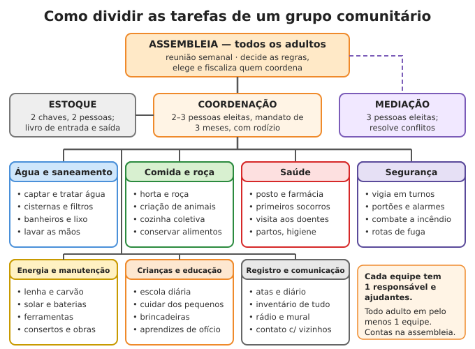

# Organização comunitária

**Resumo:** grupos sobrevivem melhor que indivíduos: dividem o trabalho, cuidam dos doentes,
vigiam em turnos e somam conhecimentos. Para funcionar, um grupo precisa de **4 coisas
escritas**: quem tem o quê e sabe o quê (inventário), quem faz o quê (equipes), como se decide
(assembleia e voto) e o que acontece quando alguém erra (acordo e mediação). Comece pequeno,
com gente de confiança, **antes** da crise.

---

## Por que grupos sobrevivem melhor

- **Trabalho:** água, roça, animais, cozinha, lenha, consertos, crianças e doentes ao mesmo
  tempo. Uma família sozinha não dá conta e ainda precisa dormir.
- **Vigilância:** vigiar 24 horas com 2 pessoas por turno exige **8 a 12 adultos** em rodízio.
- **Saúde:** quem adoece precisa de alguém que cuide dele e faça o trabalho dele.
- **Conhecimento:** ninguém sabe tudo. Enfermeira, pedreiro, agricultor, mecânico e professora
  juntos resolvem quase tudo.
- **Cabeça:** isolamento, medo e falta de propósito derrubam as pessoas tanto quanto a fome
  ([Saúde mental](../02-saude/11-saude-mental.md)).

O Brasil tem tradição nisso: **mutirão** (do tupi), **puxirão** no Sul, **ajuri** na Amazônia,
"troca de dia" na roça, associações de moradores, cooperativas, quilombos e comunidades de
fundo de pasto. Use esses nomes e costumes: as pessoas já sabem como funcionam.

## Tamanho do grupo

| Tamanho | Vantagens | Cuidados |
|---|---|---|
| 1 família (3–6 pessoas) | Confiança total | Não consegue vigiar, plantar e cuidar ao mesmo tempo |
| **3 a 10 famílias (15–50 pessoas)** | **Ideal para começar:** todos se conhecem, decidem em assembleia | Precisa de regras escritas desde o início |
| 50–150 pessoas | Muitas habilidades, feira, escola | Equipes com responsáveis; assembleia com pauta curta |
| Mais de 150 | Vira uma pequena vila | Divida em núcleos (rua, quarteirão, sítio) com representantes eleitos |

## Como formar o grupo

1. **Comece com quem você já conhece:** vizinhos da rua, parentes, igreja, associação, escola,
   time de futebol. Proximidade conta: é preciso chegar a pé em minutos.
2. **Converse antes da crise**, com uma proposta simples: horta comunitária, plano de
   emergência da rua, mutirão de limpeza. Projetos pequenos mostram quem trabalha.
3. **Sinais de confiança:** cumpre o combinado, devolve o que pega emprestado, trata bem
   crianças, idosos e animais, controla a raiva, assume os próprios erros, não espalha segredos.
4. **Sinais de alerta:** violência (inclusive dentro de casa), mentira repetida, pequenos
   furtos, quer mandar sem ouvir, vive criando intriga, álcool ou drogas sem controle. Ninguém
   é perfeito, mas esses comportamentos **pioram** na crise.
5. **Habilidades complementares:** use a ficha abaixo e procure o que falta.
6. **Cresça devagar.** Cada nova família passa pelo período de experiência (veja adiante).

## Inventário de habilidades e recursos

Cada família preenche uma ficha. A equipe de registro guarda as fichas e monta um quadro-resumo.

```
FICHA DE CADASTRO — Comunidade: ____________________   Data: ___/___/____
Família / responsável: ______________________________________________
Endereço / onde mora: _______________________________________________
PESSOAS DA CASA
 Nome                 Idade  Tipo sang.  Alergias / remédios contínuos / deficiência
 ____________________ _____  _________   ______________________________________
 ____________________ _____  _________   ______________________________________
HABILIDADES (1 = sabe um pouco, 2 = faz bem, 3 = pode ensinar)
 ( ) saúde/enfermagem ( ) parto ( ) dentes ( ) veterinária ( ) horta/roça
 ( ) criação de animais ( ) cozinha/conservas ( ) pedreiro ( ) carpinteiro
 ( ) eletricista ( ) encanador ( ) mecânico ( ) ferreiro/solda ( ) costura
 ( ) sapateiro/couro ( ) professor ( ) rádio ( ) contas/administração
 ( ) caça/pesca ( ) mediação de conflitos ( ) outra: ______________________
RECURSOS (o que tem — não é o que vai entregar)
 Terra/quintal (m²): ____ Água (poço, cisterna, nascente): ______________
 Animais: ________________ Ferramentas importantes: ____________________
 Veículos / bicicletas: ___________ Energia (solar, gerador): _____________
 Rádio / comunicação: ______________ Sementes: ___________________________
DISPONIBILIDADE: ____ horas por dia · Restrições de saúde: ______________
O QUE PODE ENSINAR: ________________________________________________
Assinatura: __________________________
```

> **ATENÇÃO:** a ficha de recursos é **confidencial**. Guarde em lugar fechado e não leia em
> voz alta na assembleia. Quem sabe o que cada um tem pode ser roubado ou chantageado.

**Regra da redundância:** cada habilidade crítica (saúde, parto, água, sementes, conserto de
bomba, rádio) precisa de **pelo menos 2–3 pessoas** que saibam. Quem sabe sozinho deve ensinar
um aprendiz ([Educação](04-educacao-e-conhecimento.md)).

## Papéis: as equipes



| Equipe | Tarefas principais | O que relata na assembleia |
|---|---|---|
| **Água e saneamento** | Captar, tratar e distribuir água; filtros e cisternas; banheiros, lixo, torneiras de lavar mãos | Litros disponíveis, dias de reserva, problemas de qualidade |
| **Comida e roça** | Horta, roça, animais, cozinha coletiva, conservação, sementes | Estoque em dias, colheitas, plantios da semana |
| **Saúde** | Atendimento, farmácia, higiene, visitas a doentes, gestantes e idosos, quarentena | Doentes, remédios que estão acabando, surtos |
| **Segurança** | Escala de vigia, portões, alarmes, combate a incêndio, rotas de fuga, simulados | Ocorrências, falhas na escala, melhorias |
| **Energia e manutenção** | Lenha, carvão, solar, baterias, ferramentas, consertos, obras | Ferramentas quebradas, materiais que faltam |
| **Crianças e educação** | Escola diária, cuidado dos pequenos, brincadeiras, aprendizes | Frequência, necessidades de material |
| **Registro e comunicação** | Atas, diário, inventário, mural, rádio, contato com outras comunidades | Notícias de fora, decisões pendentes |

- Cada equipe tem **1 responsável** (eleito ou indicado pela equipe) e ajudantes. Todo adulto
  participa de **pelo menos 1 equipe**.
- **Coordenação** (2–3 pessoas): junta as equipes, resolve o dia a dia e as urgências, cuida do
  estoque com a equipe de registro. **Não pode**: mudar o acordo, punir com sanção grave,
  expulsar, gastar a reserva intocável. Isso é da assembleia.

## Reuniões e tomada de decisão

### Assembleia
- **Quem:** todos os adultos (defina a idade: 16 anos é um bom limite). Crianças podem assistir.
- **Quando:** **um dia e hora fixos por semana**, de dia, **no máximo 1h30**.
- **Quórum:** metade dos adultos + 1. Sem quórum, só se discute, não se decide.
- **Papéis em cada reunião (em rodízio):** **facilitador** (conduz e dá a palavra),
  **secretário** (escreve a ata), **guarda do tempo** (avisa quando a fala passa do limite).
- **Pauta** afixada no mural **1 dia antes**. Ordem:
  1. Informes das equipes (2 minutos cada).
  2. Assuntos urgentes.
  3. Decisões (um assunto por vez).
  4. O que fica para a próxima.
  5. Rodada final: cada um diz uma palavra sobre como está.
- **Regras de fala:** levante a mão e espere a vez; **2–3 minutos** por fala; sem interromper;
  sem xingar; critique a ideia, não a pessoa.

### Como decidir

| Tipo de decisão | Método | Exemplos |
|---|---|---|
| Regras básicas, acordo de convivência | **Consenso** (todos aceitam) ou, depois de 2 tentativas, **2/3** dos votos | Aprovar o acordo, criar nova regra |
| Assuntos graves | **Maioria de 2/3** dos presentes | Mudar o acordo, expulsar alguém, usar a reserva intocável, aceitar muitas pessoas de uma vez |
| Rotina | **Maioria simples** (metade + 1 dos presentes) | Calendário de plantio, escala, compras e trocas grandes |
| Tarefa do dia a dia | Decide a **equipe** ou a **coordenação** | Que canteiro regar, quem busca lenha |
| Urgência (fogo, enchente, ataque) | Decide **quem coordena na hora**; explica na próxima assembleia, que pode desfazer | Evacuar, fechar o portão |

**Consenso com a mão:** polegar **para cima** = apoio; **de lado** = tenho dúvida, mas aceito;
**para baixo** = bloqueio (precisa explicar o motivo e propor outra saída). Muitos polegares de
lado = melhore a proposta antes de votar.

**Voto secreto** (papel dobrado numa caixa) para eleições e assuntos sobre pessoas: evita
pressão e vingança.

### Mandatos e rodízio
- Coordenação, mediação e responsáveis de equipe: **mandato de 3 meses**, podendo ser
  reeleitos **uma vez seguida**. Depois, descansam pelo menos um mandato.
- Rodízio impede que alguém vire "dono" do grupo e forma novas lideranças.
- A assembleia pode **tirar** alguém do cargo antes do fim, por 2/3 dos votos.
- Ao sair, cada um **presta contas**: estoque, decisões, problemas em aberto.

### Modelo de ata
```
ATA DA ASSEMBLEIA Nº ___ — Data: ___/___/____  Hora: ____  Local: ____________
Presentes: ____ adultos (quórum: ____)   Facilitador: ________  Secretário: ________
Informes: água ____ dias · comida ____ dias · doentes: ______ · ocorrências: ______
Decisões:
 1. ___________________________________ Votos: sim ___ não ___ abst. ___
 2. ___________________________________ Votos: sim ___ não ___ abst. ___
Responsáveis e prazos: _______________________________________________
Próxima assembleia: ___/___   Assinaturas: _______________  _______________
```

## Regras escritas: modelo de acordo

Leia em voz alta, discuta item por item, aprove e **cada adulto assina**. Afixe no mural.

```
ACORDO DE CONVIVÊNCIA DA COMUNIDADE ______________________   Versão __  Data __/__/____
1. OBJETIVO: viver juntos com segurança, comida, saúde e respeito, até a situação melhorar.
2. MEMBROS: são membros os adultos que assinam este acordo e suas crianças. Novos membros
   passam por quarentena e período de experiência de ___ dias.
3. TRABALHO: todo adulto capaz dá ___ horas por dia ao trabalho comum, conforme a escala.
   Quem não pode fazer trabalho pesado faz outras tarefas.
4. RECURSOS: o que é de cada família continua dela. O estoque comum é de todos, controlado
   por 2 pessoas e anotado no livro. A reserva intocável só é usada com 2/3 da assembleia.
5. PROIBIDO: violência física, ameaça, abuso de qualquer tipo, furto, contar a estranhos o que
   temos, dormir ou beber no turno de vigia, armas ao alcance de crianças.
6. DECISÕES: assembleia semanal. Rotina por maioria; regras e expulsão por 2/3.
7. CONFLITOS: conversa → mediação → comissão de mediação → assembleia.
8. SANÇÕES: proporcionais, por escrito, com direito de defesa. Nunca castigo físico, nunca
   negar água, comida básica ou remédio.
9. CRIANÇAS: frequentam a escola; nunca ficam sozinhas fora do perímetro.
10. SAÍDA: quem quiser sair leva seus pertences e a sua parte combinada.
11. REVISÃO: este acordo é revisto a cada 3 meses.
Assinaturas: ________________________________________________________________
```

## Justiça e mediação de conflitos

Conflitos são inevitáveis com cansaço, fome e medo. **Trate cedo**, antes de virar briga.

### Princípios
1. **Proteger primeiro** quem está em perigo (vítima, criança).
2. **Ouvir os dois lados** antes de decidir. Ninguém julga a própria causa nem a de parente.
3. **Reparar é melhor que punir:** devolver, consertar, compensar com trabalho.
4. **Proporcional:** falta pequena, resposta pequena.
5. **Tudo por escrito:** o que aconteceu, quem viu, o que se decidiu.
6. **Nunca no calor da raiva:** salvo perigo imediato, decida casos graves depois de 24 horas.
7. **Nunca linchamento.** Boato mata inocentes: em 2014, em Guarujá (SP), uma mulher foi
   espancada até a morte por uma multidão por causa de um boato falso na internet.

### A escada da resolução
1. **Conversa direta** entre as pessoas, com calma.
2. **Mediação:** um mediador neutro ajuda os dois a chegarem a um acordo.
3. **Comissão de mediação** (3 pessoas eleitas): ouve, investiga e decide.
4. **Assembleia:** recursos e casos graves.

### Como mediar (passo a passo)
1. Lugar reservado, sentados, com água. Combine: um fala de cada vez, sem xingar.
2. Cada um conta **a sua versão** sem ser interrompido. O mediador **repete com as próprias
   palavras** ("você está dizendo que...") até a pessoa concordar que foi entendida.
3. Pergunte **o que cada um precisa** (não o que cada um exige). Por trás de "quero a enxada
   dele" muitas vezes está "preciso de ferramenta para cumprir minha tarefa".
4. Peça que os dois deem ideias de solução. Escolham uma que os dois aceitem.
5. **Escreva o acordo** (quem faz o quê, até quando), todos assinam.
6. **Volte a conversar em 1–2 semanas** para ver se funcionou.

### Sanções proporcionais

| Gravidade | Exemplos | Resposta |
|---|---|---|
| **Leve** | Atraso, tarefa mal feita, barulho, desleixo | Conversa, advertência verbal, refazer a tarefa |
| **Média** | Faltar ao turno, desperdício, briga de palavras, mentira | Advertência escrita, horas extras de trabalho, devolver ou consertar, perder por um tempo uma função de confiança |
| **Grave** | Furto do estoque, agressão física, dormir no turno em hora de perigo, contar segredos de segurança a estranhos | Reparação + horas de trabalho + afastamento de funções de confiança; se repetir, a assembleia pode decidir pela expulsão (2/3) |
| **Gravíssima** | Abuso sexual, violência contra criança, estupro, homicídio | Proteger a vítima, separar o acusado sob vigilância (sem maus-tratos), registrar provas e testemunhas por escrito, assembleia decide; **entregar à polícia e à Justiça assim que existirem** |

**Nunca:** castigo físico, tortura, humilhação pública, negar água, comida básica ou remédio,
punir a família inteira pelo ato de um membro.

**Expulsão** (último recurso): direito de se defender na assembleia, voto de 2/3, entrega dos
pertences pessoais e de **provisões para pelo menos 3 dias**, registro em ata.

## Divisão de trabalho justa e registro de horas

1. Comece com **4 horas por dia** de trabalho comum por adulto (o resto é para a própria casa)
   e ajuste conforme a necessidade (época de plantio e colheita pede mais).
2. **Tarefas ruins em rodízio:** limpar banheiros, lixo, vigia de madrugada, carregar água.
   Ninguém fica preso a elas.
3. **Peso das horas:** o mais simples e justo é **1 hora = 1 hora**. Se o grupo quiser, vigia de
   madrugada e trabalho muito pesado valem **1,5**.
4. **Quem não pode trabalho pesado** contribui de outro jeito: cuidar de crianças, ensinar,
   costurar, debulhar, escolher sementes, cozinhar, vigiar de dia, anotar, consertar sentado.
5. **Dispensas:** doentes, gestantes no fim da gravidez, mães no **resguardo** (cerca de 40 dias
   após o parto), idosos frágeis.

### Quadro de tarefas da semana (no mural)
| Tarefa | Seg | Ter | Qua | Qui | Sex | Sáb | Dom |
|---|---|---|---|---|---|---|---|
| Água (buscar e tratar) | Ana, Zé | Rita, Léo | ... | | | | |
| Cozinha coletiva | | | | | | | |
| Horta | | | | | | | |
| Banheiros e lixo | | | | | | | |
| Vigia 18h–24h | | | | | | | |
| Vigia 0h–6h | | | | | | | |

### Caderno de horas
```
Nome: _______________  Semana: __/__ a __/__
Data   Tarefa              Horas  Peso  Total  Visto do responsável
__/__  horta                 3     1     3     ________
__/__  vigia madrugada       2    1,5    3     ________
                                   TOTAL DA SEMANA: ____
```
Some no fim da semana e afixe o total de cada um. A transparência evita a fofoca de "fulano
não faz nada". O mesmo caderno serve de **banco de horas** ([Troca e economia](03-troca-e-economia.md)).

## Cuidado com idosos, crianças, doentes e pessoas com deficiência

- **Cadastro de necessidades:** quem toma remédio contínuo, quem não anda, quem não enxerga ou
  não ouve, quem tem demência, gestantes, bebês.
- **Padrinho e madrinha:** cada pessoa vulnerável tem **2 adultos responsáveis** (titular e
  reserva) que a tiram de casa numa evacuação e a visitam todo dia.
- **Idosos:** visitas diárias, água e comida garantidas, tarefas que valorizam o que sabem
  (ensinar ofícios, contar a história, cuidar de sementes e plantas medicinais).
- **Crianças:** nunca sozinhas fora do perímetro; órfãos têm guarda definida pela assembleia e
  registrada em ata; escola todo dia ([Educação](04-educacao-e-conhecimento.md)).
- **Pessoas com deficiência:** rotas de fuga sem degraus, alarme **visual** para surdos
  (bandeira, luz) e **sonoro** para cegos, tarefas adaptadas; perguntam-se a elas mesmas o que
  precisam.
- **Gestantes e quem amamenta:** ração maior (cerca de **+300 kcal/dia** na gravidez e **+500**
  amamentando), trabalho leve, acompanhamento ([Parto e bebês](../02-saude/07-parto-bebes-e-criancas.md)
  · [Nutrição](../03-alimentacao/03-nutricao-e-racionamento.md)).
- **Doentes:** equipe de saúde visita; isolamento quando contagioso.

## Integração de recém-chegados

1. **Recepção fora do perímetro**, por 2 pessoas (uma conversa, outra observa de longe).
2. **Conversa:** quem são, de onde vêm, o que viram no caminho, saúde, habilidades, quem
   conhecem no grupo, o que precisam.
3. **Decisão:** a coordenação ou a assembleia decide conforme a **capacidade** (água, comida,
   abrigo). Mesmo quando não dá para aceitar, ofereça água, uma refeição e informações sobre
   abrigos e outros grupos.
4. **Quarentena sanitária de 7 a 14 dias** em lugar separado: febre, tosse, diarreia e manchas
   observadas todo dia; banho, roupas lavadas com água quente ou ao sol, conferência de
   **piolho e sarna** ([Higiene](../02-saude/09-higiene-e-saneamento.md)).
5. **Período de experiência de 30 a 90 dias**, com um padrinho do grupo: lê e assina o acordo,
   trabalha nas escalas, **ainda não** recebe chaves do estoque nem detalhes do plano de
   segurança.
6. **Membro pleno** por votação na assembleia ao fim do período.

## Armazenamento comunitário e controle de estoque

1. **Regra das duas chaves:** o depósito comum só abre com **2 pessoas** presentes (de equipes
   diferentes). Ninguém tem acesso sozinho.
2. **Livro de entradas e saídas:** toda movimentação anotada na hora.

```
LIVRO DO ESTOQUE — Item: ARROZ (kg)
Data   Entrada  Saída  Saldo  Motivo / destino           Assinaturas (2)
01/03    50       -      50   colheita roça 2            ______ ______
02/03     -       6      44   cozinha coletiva           ______ ______
```

3. **Contagem semanal** por 2 pessoas, comparando com o livro. Diferença = investigar.
4. **Mural com os dias de reserva:** "água: 12 dias · arroz: 40 dias · remédio de pressão:
   20 dias". Calcule: **estoque ÷ (pessoas × consumo por dia)** ([Racionamento](../03-alimentacao/03-nutricao-e-racionamento.md)).
5. **Primeiro que entra, primeiro que sai:** use o mais velho antes.
6. **Divida em 2–3 lugares** (contra incêndio, enchente e roubo).
7. **Reserva intocável** (por exemplo, 30 dias de comida e as sementes da próxima safra): só
   com voto de 2/3.
8. **Sementes nunca se comem.** Guarde à parte ([Sementes](../04-agricultura/02-sementes.md)).
9. Proteja de umidade, ratos e carunchos ([Estoque de alimentos](../03-alimentacao/01-estoque-de-alimentos.md)).

---

Ver também: [Segurança](02-seguranca.md) · [Troca e economia](03-troca-e-economia.md) · [Educação e conhecimento](04-educacao-e-conhecimento.md) · [Prioridades e decisão](../00-emergencia/02-prioridades-e-decisao.md) · [Saúde mental](../02-saude/11-saude-mental.md)
