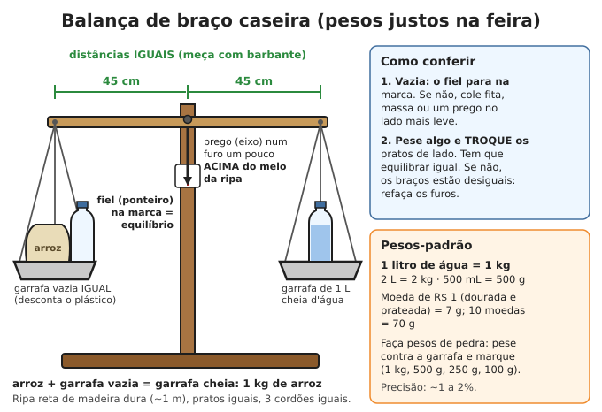

# Troca e economia

**Resumo:** quando o dinheiro some ou perde valor, a economia volta a ser **troca de coisas e de
trabalho**. Guarde itens úteis em **porções pequenas** (servem de "troco"), aprenda um ofício
(habilidade não se rouba e não acaba), organize uma **feira** com regras e **balança honesta**,
e anote tudo: dívidas, vales e horas de trabalho. A sua **reputação** de pessoa honesta vale
mais que qualquer estoque.

---

## Quando o dinheiro deixa de funcionar

Sinais: lojas fechadas ou sem reposição, preços subindo toda semana, comerciantes recusando
cartão e depois dinheiro, salários atrasando. Na hiperinflação brasileira dos anos 1980 e 1990
as pessoas gastavam o salário no mesmo dia e passavam a pensar o preço em **quilos de arroz**
([Desastres: colapso econômico](../11-natureza-e-desastres/03-desastres.md)).

Enquanto o dinheiro ainda vale alguma coisa: **troque por bens úteis** (comida estocável,
sementes, ferramentas, remédios) e **pague dívidas caras**. Guarde um pouco em notas pequenas:
em algumas regiões ele volta a valer.

## Escambo: como trocar bem

1. **Faça duas listas:** o que você **precisa** e o que pode **dispensar** sem risco.
2. **Valor = utilidade × falta que faz × urgência.** Muda com a estação: semente vale mais antes
   do plantio, agasalho antes do inverno, sal na época do abate.
3. **Use uma unidade de referência** combinada na comunidade: **quilo de arroz**, dúzia de ovos ou
   **hora de trabalho**. "Esta enxada vale 8 kg de arroz" é fácil de entender e comparar.
4. **Confira a qualidade** antes de fechar: semente (teste de germinação: 10 sementes num pano
   úmido, quantas brotam em 5–7 dias), remédio (embalagem fechada, validade), ferramenta (cabo
   firme, sem trinca), combustível (cor e cheiro normais, sem água no fundo).
5. **Troque o que sobra, nunca a última reserva** de algo essencial (água, remédio contínuo,
   semente da próxima safra).
6. **Fracione:** sal em saquinhos de 250–500 g, fósforos em caixinhas, sabão em pedaços, café em
   pacotinhos. Item grande não tem troco.
7. **Feche o acordo com clareza:** o quê, quanto, quando entrega. Troca grande: por escrito
   (modelo adiante).
8. **Seja honesto.** Quem engana uma vez fica sem parceiros para sempre.

## Itens que ficam valiosos

| Item | Por que vale | Como guardar | Dura (bem guardado) |
|---|---|---|---|
| **Sal** | Conserva carne e peixe, animais precisam, saúde | Pote fechado, seco | Indefinido |
| **Açúcar, rapadura, mel** | Energia, conservas, fermentação | Fechado (formigas) | Indefinido se seco |
| **Sementes crioulas** | Comida do ano que vem | Seco, fresco, escuro, vidro | 2–5 anos (varia) |
| **Remédios** (analgésicos, antibióticos, vermífugos, sais de reidratação, anticoncepcionais) | Sem farmácia não há | Seco, fresco, escuro, na caixa | Validade da caixa ([Medicamentos](../02-saude/04-medicamentos-e-doses.md)) |
| **Pilhas** | Luz, rádio | Seco, fresco | Alcalina 5–10 anos, lítio 15–20 |
| **Fósforos e isqueiros** | Fogo | Saco plástico, pote | Indefinido se secos |
| **Ferramentas** (enxada, facão, lima, serrote, martelo) | Trabalho e produção | Untadas com óleo | Décadas |
| **Agulhas, linha, botões, elásticos** | Consertar roupa e calçado | Lata fechada | Décadas |
| **Álcool** (70% e etílico) | Limpeza, ferimentos, lamparina | Bem fechado, longe do fogo | Anos |
| **Sabão** | Higiene = saúde | Seco, ventilado | Anos |
| **Café** | Hábito; muito procurado | Grão verde ou torrado em pacote fechado | Grão verde 1 ano ou mais; moído, meses |
| **Fumo de rolo, tabaco** | Vício: alto valor de troca (faz mal à saúde) | Fechado | ~1 ano |
| **Combustível** | Motores, gerador, transporte | Tambor fechado, sombra | Gasolina 3–6 meses; diesel 6–12 ([Combustíveis](../06-energia/09-combustiveis.md)) |
| **Óleo de cozinha** | Gordura e calorias | Escuro, fresco | 1–2 anos |
| **Velas, querosene** | Luz | Fresco | Anos |
| **Água sanitária, cloro de piscina** | Água potável | Escuro, fresco | Água sanitária 6–12 meses; granulado, anos |
| **Absorventes, coletor menstrual, fraldas de pano** | Higiene feminina e de bebê | Seco | Anos |
| **Óculos de leitura** (graus 1 a 3) | Quem não enxerga de perto não costura nem lê | Estojo | Décadas |
| **Pregos, parafusos, arame, cola, fita** | Consertos | Seco | Décadas |
| **Lonas, cordas, sacos, garrafas** | Abrigo, transporte, água | Sombra | Anos |
| **Cachaça e destilados** | Troca, festas | Fechado | Indefinido |
| **Papel, lápis, cadernos, livros** | Escola, registro, conhecimento | Seco ([Educação](04-educacao-e-conhecimento.md)) | Décadas |

## Serviços e habilidades

Habilidade é o melhor estoque: não estraga, não se rouba, não acaba e cresce com o uso.

| Área | Serviços que todo mundo vai precisar |
|---|---|
| **Saúde** | Curativos, sutura, injeção, atendimento de febre e diarreia, **parto (parteira)**, extração de dente |
| **Veterinária** | Parto de animais, castração (capação), vermifugação, casqueamento |
| **Conserto** | Bicicleta, motor, bomba d'água, rádio, eletrônica, panelas (funileiro), relógios |
| **Ferraria e solda** | Ferramentas, ferraduras, dobradiças, consertar enxada e facão |
| **Construção** | Pedreiro, carpinteiro, telhado, poço, cisterna, fogão a lenha |
| **Roupa e calçado** | Costura, remendo, tear, sapateiro, couro |
| **Alimentos** | Moinho (moer milho e trigo), forno (pão), conservas, queijo, abate, farinhada |
| **Química** | Sabão, vela, vinagre, álcool, carvão |
| **Outros** | Professor, barbeiro, cuidador de idosos e crianças, apicultor, transporte (carroça, bicicleta de carga), mediador |

Quem sabe um ofício deve **ensinar um aprendiz** em troca de trabalho: o conhecimento fica na
comunidade ([Educação](04-educacao-e-conhecimento.md)).

## Feira comunitária

### Organização
1. **Lugar neutro e aberto:** praça, pátio de escola, igreja, campo. Longe das casas e estoques.
2. **Dia e horário fixos**, de dia (por exemplo, sábado das 7 h às 11 h). Todos aprendem a data.
3. **Comissão da feira** (3 pessoas eleitas): faz cumprir as regras, guarda a **balança e as
   medidas padrão**, resolve reclamações na hora, organiza a segurança.
4. **Entrada única**, vigias nos cantos, saída em grupos.

### Regras (afixe na entrada)
1. Trocas só dentro do horário e do espaço da feira.
2. **Pesos e medidas conferidos na balança da comissão** sempre que alguém pedir.
3. Proibido: armas à mostra, bebida alcoólica, briga, venda de remédio sem embalagem e
   validade.
4. Comida pronta coberta; quem serve lava as mãos ([Higiene](../02-saude/09-higiene-e-saneamento.md)).
5. Carne só de abate do dia ou conservada (salgada, defumada); animais vivos sem sinal de
   doença ([Veterinária](../05-animais/14-veterinaria-basica.md)).
6. Reclamação: vai à comissão, que decide na hora. Quem roubar no peso fica **fora da feira**
   pelo tempo que a comissão decidir.
7. Contribuição pequena e combinada (um ovo, um punhado de feijão) para o **fundo de quem
   precisa** (viúvas, órfãos, doentes).

### Quadro de referência (exemplo — ajuste à sua região e à estação)
| Item | Vale cerca de (em kg de arroz) |
|---|---|
| 1 dúzia de ovos | 1 |
| 1 galinha viva | 3–4 |
| 1 kg de sal | 1–2 |
| 1 sabonete ou pedaço de sabão de 200 g | 1 |
| 1 caixa de fósforos | 0,5 |
| 1 enxada boa | 8–12 |
| 1 hora de trabalho comum | 1 |
| 1 hora de trabalho especializado (conserto, saúde) | 2–3 |

Atualize o quadro no mural toda semana. Ele não é obrigatório: serve para ninguém ser enganado
por não saber o preço.

## Pesos e medidas justos

### Balança de braço caseira



1. **Braço:** ripa **reta** de madeira dura, de ~1 m (2 × 4 cm). Ache o meio exato com um
   barbante dobrado ao meio.
2. **Eixo:** faça um furo **um pouco acima** da linha do meio (1 cm) e passe um prego ou
   parafuso liso preso num poste firme. Com o furo acima do centro, a balança volta sozinha ao
   equilíbrio; com o furo abaixo, ela tomba para um lado.
3. **Pratos:** duas latas ou bacias **iguais**, cada uma pendurada por **3 cordões de mesmo
   comprimento**, nos pontos a **exatamente a mesma distância** do eixo (por exemplo, 45 cm).
4. **Fiel:** um ponteiro (arame ou palito) preso no meio da ripa, e uma marca no poste. Fiel na
   marca = equilíbrio.
5. **Conferir:** vazia, o fiel tem que parar na marca (se não parar, prenda fita, massa ou um
   prego no lado mais leve). Depois pese algo e **troque o conteúdo dos pratos de lado**: tem que
   equilibrar igual. Se não equilibrar, os braços estão desiguais: refaça os furos dos pratos.
6. **Precisão** de uma balança bem feita: 1–2%.

**Balança romana** (de gancho): uma barra pendurada perto de uma ponta; a mercadoria no gancho
curto e um **peso que corre** pelo braço comprido. Marque os riscos com pesos conhecidos
(1 kg, 2 kg, 5 kg...). Pesa mais com um só contrapeso.

### Pesos-padrão
- **1 litro de água = 1 kg.** Garrafa de 2 L = 2 kg; 500 mL = 500 g. Para descontar o plástico,
  ponha uma **garrafa vazia igual** no prato da mercadoria.
- **Moeda de R$ 1** (dourada e prateada) = **7 g**; 10 moedas = 70 g.
- Faça **pesos de pedra** (1 kg, 500 g, 250 g, 100 g), conferidos contra garrafas de água,
  marcados com tinta e guardados pela comissão da feira.

### Medidas de volume e conversão (aproximadas)
Pese **uma vez** a lata ou o litro padrão cheio de cada produto e anote: a feira inteira passa a
usar esse número.

| Produto | 1 litro pesa cerca de |
|---|---|
| Água, leite | 1 kg |
| Arroz, feijão | 0,8 kg |
| Milho em grão | 0,75 kg |
| Açúcar | 0,85 kg |
| Sal fino | 1,2 kg |
| Farinha de mandioca, fubá | 0,6–0,7 kg |
| Farinha de trigo | 0,55 kg |

### Medidas do campo que voltam a ser usadas
| Medida | Valor |
|---|---|
| Saca (café, soja, milho, feijão) | 60 kg |
| Arroba | 15 kg |
| Lata (de querosene, de tinta) | 18–20 L |
| Braça | 2,2 m |
| Palmo | ~22 cm (meça o seu) |
| Hectare | 10.000 m² (100 × 100 m) |
| Alqueire paulista | 2,42 ha |
| Alqueire mineiro / goiano | 4,84 ha |
| Tarefa (Nordeste) | 0,3–0,44 ha, conforme o estado |

A comissão da feira guarda os **padrões**: uma lata padrão, um litro padrão (garrafa de 1 L
cortada), um **metro padrão** (vara ou barbante com nós a cada 10 cm, conferido com uma trena
antiga). Mais conversões: [Tabelas e conversões](../anexos/01-tabelas-e-conversoes.md).

## Moeda local e vales

O Brasil já tem experiência com isso: o **Banco Palmas**, criado em 1998 num bairro pobre de
Fortaleza, emitia a moeda social "palmas", aceita no comércio local, e inspirou dezenas de
bancos comunitários.

**Regras para um vale funcionar:**
1. **Lastro:** o vale vale algo concreto que a comunidade **sempre** aceita trocar, por exemplo
   **1 hora de trabalho** ou **1 kg de arroz do estoque comum**.
2. **Emissão limitada e anotada:** numerados, num livro de emissão. Só se emite com decisão da
   assembleia. **Imprimir vale para pagar despesas sem lastro é fabricar inflação.**
3. **Difícil de falsificar:** papel próprio, carimbo feito à mão (entalhado em madeira ou
   borracha), **número de série**, assinatura de 2 pessoas, uma marca secreta.
4. **Valores pequenos:** 1, 2, 5 e 10.
5. **Troca periódica:** a cada 6 meses, recolha todos e emita novos (de outra cor). Isso
   pega falsificações e mostra quanto circula.
6. **Contas abertas:** total emitido e lastro existente afixados no mural.

## Banco de horas

1. Cada pessoa tem uma **conta de horas** num caderno da comunidade.
2. **Quem trabalha para outro ganha horas; quem recebe o trabalho perde horas.** Exemplo: Ana
   costura 2 horas para o Zé → Ana +2, Zé −2.
3. Regra mais simples e justa: **1 hora de qualquer pessoa = 1 hora**. O grupo pode decidir que
   alguns serviços valem mais (ver quadro da feira).
4. **Limite de saldo negativo** (por exemplo, −20 horas): evita quem só recebe e nunca dá.
5. Toda troca é anotada com **as duas assinaturas**.

```
BANCO DE HORAS — Conta de: ANA SOUZA
Data   Serviço                 Para / de quem    +    −    Saldo  Assinaturas
03/05  costura (2 calças)      para Zé           2         2      Ana / Zé
05/05  conserto de bicicleta   de Léo                 1    1      Ana / Léo
```

## Dívidas e contratos simples

Anote **toda** dívida, mesmo entre amigos. Memória falha; papel não.

```
CONTRATO DE TROCA / EMPRÉSTIMO        Nº ____   Data: ___/___/____
Eu, ______________________ (quem recebe), recebi de ______________________ (quem entrega):
  ____________________________________ (quantidade, qualidade, estado)
e me comprometo a devolver / pagar:
  ____________________________________ (o quê, quantidade, qualidade)
até ___/___/____ , no local: ____________________.
Se não cumprir no prazo: _______________________________________________
Em caso de desacordo, aceitamos a decisão da comissão de mediação da comunidade.
Assinaturas: ________________ (recebe)  ________________ (entrega)
Testemunhas: ________________  ________________          (2 vias, uma para cada parte)
```

- **Livro de dívidas** da comunidade: a comissão de mediação anota os contratos maiores.
- **Empréstimo de sementes:** tradição das casas de sementes do semiárido: quem pega devolve
  **na colheita, com um pequeno acréscimo combinado** (por exemplo, pegou 1 kg, devolve 1,2 kg).
  Assim o banco cresce.
- **Juros:** combine por escrito e com moderação. Juro alto entre vizinhos destrói a confiança.
- Dívida não paga: conversa → mediação → comissão. **Nunca cobrança com violência**
  ([Organização comunitária](01-organizacao-comunitaria.md)).

## Não exponha tudo o que você tem

- Leve à feira **só o que pretende trocar**. Diga "tenho um pouco".
- Não negocie na porta de casa; marque na feira ou em lugar neutro.
- Vá **em dupla**, volte por caminho diferente, não conte a desconhecidos o que carrega.
- Desconfie de quem pergunta demais sobre o que você tem e onde mora.
- Veja [Segurança](02-seguranca.md).

## Armazenamento dos itens de troca

1. **Separe** o estoque de troca da reserva da família (e da reserva intocável da comunidade).
2. **Fracione** em porções pequenas e etiquete (item, quantidade, data).
3. Proteja de umidade, ratos e insetos: potes e baldes com tampa, elevados do chão
   ([Estoque de alimentos](../03-alimentacao/01-estoque-de-alimentos.md)).
4. **Gire o estoque:** troque primeiro o mais antigo.
5. **Esconda em mais de um lugar.** Anote em código onde está cada coisa.
6. Faça inventário mensal, como no [livro do estoque](01-organizacao-comunitaria.md).

---

Ver também: [Organização comunitária](01-organizacao-comunitaria.md) · [Segurança](02-seguranca.md) · [Educação e conhecimento](04-educacao-e-conhecimento.md) · [Desastres e colapso econômico](../11-natureza-e-desastres/03-desastres.md) · [Kits e estoques](../00-emergencia/03-kits-e-estoques.md) · [Tabelas e conversões](../anexos/01-tabelas-e-conversoes.md)
