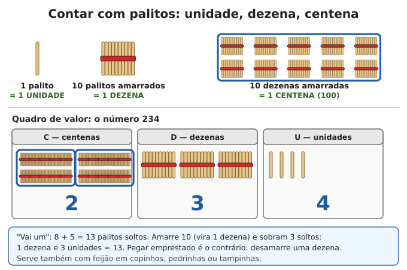

# Educação e preservação do conhecimento

**Resumo:** uma geração sem escola perde em poucos anos o que levou séculos para aprender.
Mantenha **escola todos os dias**, mesmo que só 3 horas, embaixo de uma árvore: ler, escrever,
contar, medir, cuidar da saúde, plantar e conviver. Ensine cada ofício a aprendizes. Proteja
livros da umidade, dos cupins e dos ratos, **copie à mão** o essencial e **registre** a história
da comunidade: nascimentos, mortes, colheitas e clima.

---

## Por que manter a escola

- **Rotina** acalma as crianças e libera os adultos para trabalhar ([Saúde mental](../02-saude/11-saude-mental.md)).
- Quem lê consegue usar **este manual**, uma bula, um mapa, um contrato.
- Quem faz contas não é enganado na feira e calcula sementes, rações, doses e áreas.
- O conhecimento dos mais velhos só sobrevive se for **ensinado e escrito**.

## Organização

### Onde e com o quê
- Qualquer lugar com sombra, bancos e luz: sala, varanda, galpão, embaixo de árvore.
- **Lousa:** tábua lisa ou compensado, lixado e pintado com tinta preta fosca (ou uma mistura de
  cola branca com carvão bem moído).
- **Giz:** gesso de construção misturado com água até virar massa mole, moldado em canudos de
  papel enrolado (1–1,5 cm de grossura); seca em 2–3 dias. Sem gesso: pedaço de carvão na
  tábua clara.
- **Caixa de areia:** tabuleiro raso com areia fina; escreve-se com o dedo ou um graveto e
  apaga-se passando a mão. Economiza papel nas primeiras letras.
- **Fichas** de papelão com letras, sílabas e números; feijões, palitos, tampinhas e pedrinhas
  para contar.

### Turmas por nível (não por idade)
| Nível | Quem | Foco |
|---|---|---|
| 1 | 4–6 anos | Brincar, falar, cantar, contar até 20, cores, formas, regras de convivência |
| 2 | Quem ainda não lê (crianças de 6–8 anos e adultos) | Alfabetização, números até 100, somar e tirar |
| 3 | Já lê com calma | Ler para aprender, 4 operações, frações, medidas, ciências, saúde |
| 4 | 12 anos ou mais | Ofícios, contas da roça, ciências aplicadas, ajudar a ensinar os menores |

**Professores:** em rodízio, cada adulto ensina o que sabe (a enfermeira dá saúde, o agricultor
dá horta). Os alunos do nível 4 ajudam com os pequenos: ensinar fixa o que se aprendeu.

### Horário modelo (manhã, 5 dias por semana)
| Hora | Atividade |
|---|---|
| 7h30–8h00 | Roda de conversa: data, clima, notícias, uma música |
| 8h00–9h00 | Leitura e escrita |
| 9h00–9h20 | Lanche e brincadeira |
| 9h20–10h20 | Matemática com material concreto |
| 10h20–11h00 | Ciências, saúde ou prática (horta da escola, medir, consertar) |
| 11h00–11h30 | Leitura em voz alta pelo professor, história, convivência |

À tarde: trabalho leve com a família, aprendizado de ofício, brincar.

### Currículo mínimo
| Matéria | O que ensinar | Exemplo prático |
|---|---|---|
| Ler e escrever | Letras, sílabas, palavras, textos, bilhetes, listas | Ler a ficha de remédio, escrever a lista da feira |
| Matemática | Contar, 4 operações, frações, porcentagem, regra de três | Calcular sementes, ração, troco |
| Medidas | Comprimento, área, volume, peso, tempo, temperatura | Medir canteiro, encher tambor, pesar na balança |
| Ciências práticas | Micróbios e água, solo, plantas, animais, clima, corpo humano, fogo e energia | Por que ferver a água; como a semente germina |
| Saúde | Lavar as mãos, dentes, alimentação, primeiros socorros, cobras | Treino de lavar as mãos e de RCP em boneco |
| Agricultura e criação | Horta, compostagem, sementes, cuidar de galinhas | Canteiro da escola, cada criança com uma planta |
| História e geografia | Brasil, região, mapa da comunidade, pontos cardeais | Desenhar o mapa do bairro com as rotas de fuga |
| Convivência | Regras, combinados, resolver conflitos falando, direitos e deveres | Assembleia das crianças |
| Corpo e arte | Brincadeiras, música, desenho, artesanato | Jogos de roda, cestaria |

## Como ensinar a ler (método fônico e silábico)

### Passo a passo
1. **Sons antes das letras:** rimas, músicas, bater **palmas para cada sílaba** (CA-VA-LO = 3
   palmas), descobrir "qual palavra começa com o som de **mmm**?".
2. **Vogais:** A, E, I, O, U, primeiro em **letra de forma maiúscula** (letra bastão). Som e
   desenho juntos: "A de ABELHA".
3. **Famílias silábicas**, uma por vez, sempre lendo **palavras que só usam o que já foi
   aprendido**:

| Família | Sílabas | Palavras para ler |
|---|---|---|
| P | PA PE PI PO PU | PAPAI, PIPA, PIA, PIPOU |
| B | BA BE BI BO BU | BEBÊ, BOBO, BAÚ, BOI |
| T | TA TE TI TO TU | TATU, PATO, BOTA, TETO |
| D | DA DE DI DO DU | DADO, DEDO, TODO, DIA |
| F | FA FE FI FO FU | FITA, FOFO, FADA |
| V | VA VE VI VO VU | UVA, VOVÓ, VIDA, OVO |
| M | MA ME MI MO MU | MATO, MEDO, MOTO, AMIGO (depois do G) |
| N | NA NE NI NO NU | NADA, NOVE, MENINO |
| L | LA LE LI LO LU | BOLA, LATA, MALA, LUVA |
| R | RA RE RI RO RU | RATO, RODA, e o som fraco: ARARA, FIO DE ARAME |
| S, C, G, J, Z, X, H | ... | SAPO, CASA, GATO, JACA, ZEBRA... |
| Dígrafos | CH, LH, NH, RR, SS, QU, GU | CHUVA, MILHO, NINHO, CARRO, OSSO, QUEIJO |
| Sílabas difíceis | BRA, CLA, TRE, AN, EM, ÃO... | BRASIL, CLARO, TREM, CANTO, PÃO |

4. **Juntar e separar:** com fichas de sílabas, monte PA + TO = PATO; troque PA por GA = GATO.
5. **Frases curtas** com as palavras aprendidas ("O PATO VIU A BOTA"), depois **textos feitos
   pela turma** (o professor escreve na lousa o que as crianças contam; elas leem de novo).
6. **Escrita junto com a leitura:** traçar na areia, copiar, ditado de palavras, o **próprio
   nome**, bilhetes, a lista de compras.
7. Letra cursiva (de mão) e minúsculas depois que a leitura em letra de forma estiver firme.

### Dicas
- Sessões **curtas** (15–20 minutos para os pequenos), **todo dia**, revisando o anterior.
- **Leia em voz alta para as crianças todos os dias**: é o que mais faz uma criança querer ler.
- Elogie o esforço, não só o acerto. Errar é parte do aprendizado.
- **Adultos:** use o **método Paulo Freire**: parta de **palavras da vida deles** (TIJOLO,
  ENXADA, FEIRA, CHUVA), discuta o que a palavra significa, separe as sílabas (TI-JO-LO), monte
  as famílias (TA TE TI TO TU, JA JE JI JO JU, LA LE LI LO LU) e forme palavras novas. Em
  Angicos (RN), em 1963, cerca de **300 trabalhadores** aprenderam a ler e escrever em cerca de
  **40 horas** de aula.

## Como ensinar a contar (material concreto)



1. **Contar objetos de verdade:** feijões, pedrinhas, tampinhas. Um objeto para cada número
   falado (encostando o dedo).
2. **Agrupar de 10 em 10:** 10 palitos amarrados com elástico = **1 dezena**; 10 dezenas
   amarradas = **1 centena**. O número 234 = 2 centenas, 3 dezenas e 4 soltos.
3. **Somar** é juntar; **tirar** é separar. Com os palitos: 8 + 5 = 13 soltos → amarra 10 → 1
   dezena e 3 ("vai um"). Para tirar e faltar unidades, **desamarra uma dezena** ("pede
   emprestado").
4. **Multiplicar** é juntar grupos iguais: 3 pratos com 4 feijões = 3 × 4 = 12.
5. **Dividir** é repartir igual: 12 feijões em 3 pratos = 4 em cada. O que sobra é o **resto**.
6. Só depois passe para o papel, sempre lembrando o que os números significam.

### Tabuada
| × | 1 | 2 | 3 | 4 | 5 | 6 | 7 | 8 | 9 | 10 |
|---|---|---|---|---|---|---|---|---|---|---|
| **1** | 1 | 2 | 3 | 4 | 5 | 6 | 7 | 8 | 9 | 10 |
| **2** | 2 | 4 | 6 | 8 | 10 | 12 | 14 | 16 | 18 | 20 |
| **3** | 3 | 6 | 9 | 12 | 15 | 18 | 21 | 24 | 27 | 30 |
| **4** | 4 | 8 | 12 | 16 | 20 | 24 | 28 | 32 | 36 | 40 |
| **5** | 5 | 10 | 15 | 20 | 25 | 30 | 35 | 40 | 45 | 50 |
| **6** | 6 | 12 | 18 | 24 | 30 | 36 | 42 | 48 | 54 | 60 |
| **7** | 7 | 14 | 21 | 28 | 35 | 42 | 49 | 56 | 63 | 70 |
| **8** | 8 | 16 | 24 | 32 | 40 | 48 | 56 | 64 | 72 | 80 |
| **9** | 9 | 18 | 27 | 36 | 45 | 54 | 63 | 72 | 81 | 90 |
| **10** | 10 | 20 | 30 | 40 | 50 | 60 | 70 | 80 | 90 | 100 |

**Ordem para decorar com menos esforço:**
1. **×1, ×10** (acrescenta um zero) e **×2** (o dobro).
2. **×5** (metade do ×10; termina sempre em 0 ou 5) e **×4** (o dobro do dobro).
3. **×9 nos dedos:** abra as 10 mãos; para 9 × 4, abaixe o 4º dedo: ficam **3** dedos antes
   e **6** depois = 36.
4. **A ordem não muda o resultado** (3 × 7 = 7 × 3): metade da tabela já está sabida.
5. Sobram só: 3×3, 3×6, 3×7, 3×8, 6×6, 6×7, 6×8, 7×7, 7×8, 8×8. Treine essas com jogos e cartões.

## Frações, porcentagem e regra de três (com exemplos da roça)

### Frações
- **Metade (1/2), terça (1/3), quarta (1/4):** o povo já usa: "meia arroba", "meeiro" (fica com
  metade da colheita), "uma quarta de farinha".
- Mostre com coisas: corte uma laranja em 4 = 4 quartos; 2 quartos = 1 metade.
- **Somar frações simples:** 1/2 saco + 1/4 saco = 2/4 + 1/4 = **3/4 de saco**.
- **Fração de uma quantidade:** 1/3 de 60 kg = 60 ÷ 3 = **20 kg**; 2/3 = 40 kg.

### Porcentagem ("de cada 100")
- **10%** = divida por 10 · **5%** = metade de 10% · **25%** = 1/4 · **50%** = 1/2.
- **Germinação:** plantou 50 sementes, nasceram 40 → 40 ÷ 50 = 0,8 = **80%**.
- **Perda:** de 60 kg de feijão, 15% carunchou → 10% de 60 = 6 kg, 5% = 3 kg → **9 kg** perdidos.
- **Desconto ou acréscimo:** devolver a semente com 20% a mais: 5 kg + 1 kg = **6 kg**.

### Regra de três
"Se 2 kg de semente de feijão plantam 400 m², quanto preciso para 1.000 m²?"
**2 × 1.000 ÷ 400 = 5 kg.** (Multiplique cruzado e divida pelo que sobra.)

### Áreas e volumes
- **Área do retângulo** = comprimento × largura. Canteiro de 1,2 m × 10 m = **12 m²**.
  **1 hectare** = 100 m × 100 m = 10.000 m².
- **Volume de caixa** = comprimento × largura × altura. **1 m³ = 1.000 litros.**
  Caixa de 2 m × 1 m × 0,5 m = 1 m³ = 1.000 L.
- **Volume de cilindro** (tambor, caixa redonda, poço) = 3,14 × raio × raio × altura.
  Tambor de 57 cm de diâmetro (raio 0,285 m) e 85 cm de altura:
  3,14 × 0,285 × 0,285 × 0,85 ≈ 0,217 m³ ≈ **217 L** (é o "tambor de 200 litros").
- Mais conversões: [Tabelas e conversões](../anexos/01-tabelas-e-conversoes.md).

## Aprendizado por ofício: mestre e aprendiz

Assim se aprendeu por milhares de anos: **vendo e fazendo ao lado de quem sabe**.

1. **Ver:** o aprendiz observa o mestre trabalhar e pergunta.
2. **Ajudar:** busca ferramentas, segura, prepara material.
3. **Fazer junto:** faz partes do trabalho com o mestre ao lado corrigindo.
4. **Fazer sozinho** com conferência do mestre.
5. **Ensinar:** quando consegue ensinar outro, aprendeu de verdade.

- **Combinado por escrito:** o que o mestre ensina, quantas horas o aprendiz trabalha, por quanto
  tempo (meses a anos), o que o aprendiz recebe (comida, horas no banco de horas, ferramentas ao
  final).
- **Caderneta de competências:** lista das tarefas do ofício; o mestre assina cada uma quando o
  aprendiz já faz sozinho (ex.: costureira — "pregar botão", "fazer bainha", "cortar calça pelo
  molde").
- **Toda habilidade crítica com 2–3 pessoas que saibam:** saúde, parto, sementes, água, ferraria,
  conserto de bomba, rádio ([Organização comunitária](01-organizacao-comunitaria.md)).
- Adolescentes: **escola de manhã, ofício à tarde**.

> **ATENÇÃO:** criança não faz trabalho perigoso: forja e solda, motosserra, machado, venenos,
> soda cáustica, poços, telhados, eletricidade, abate. Adolescentes só com supervisão direta e
> equipamento de proteção.

## Preservar livros e papéis

| Inimigo | Sinais | Prevenção | Se acontecer |
|---|---|---|---|
| **Umidade e mofo** | Manchas, cheiro de mofo, páginas onduladas | Lugar seco e ventilado; **20–30 cm do chão** (mais de 1 m em área de enchente) e **10 cm das paredes**; sacos plásticos fechados com sílica gel | Seque à sombra e no vento, com papel absorvente entre as páginas a cada 20–30 folhas, trocando; livro em pé aberto em leque; **nunca no sol nem no fogo**. Mofo seco: escove ao ar livre com pincel macio, de máscara |
| **Cupins** | Túneis de terra na parede ou estante, pó, livro oco | Livro sem encostar em madeira, parede e chão; estante de metal ou com os pés dentro de latas; inspeção todo mês | Isole e queime o que está infestado longe dos outros livros; procure o ninho |
| **Traças e baratas** | Páginas raspadas, furinhos, fezes pretas | Limpeza, nada de comida perto, caixas fechadas | Limpe, separe os atacados |
| **Ratos** | Papel roído, fezes | Caixas de metal ou plástico com tampa; gatos | Reforce as caixas |
| **Luz e calor** | Papel amarelado e quebradiço, tinta desbotada | Escuro e fresco | Copie o que está se perdendo |
| **Fogo e enchente** | — | **Cópias em 3 lugares diferentes** | — |

**Caixa do conhecimento (guarda longa):** bombona plástica de 50–100 L com **tampa de rosca**;
livros e papéis dentro de **sacos plásticos fechados** com saquinhos de **sílica gel** (os que
vêm em sapatos e remédios; seque no forno baixo para reutilizar); a bombona em lugar alto e
seco. Abra e confira a cada 6 meses.

Pendrives, celulares e leitores digitais guardam bibliotecas inteiras, mas dependem de energia e
estragam: **tenha os dois**, papel e digital ([Biblioteca offline](../anexos/02-biblioteca-offline.md)).

## Copiar o conhecimento à mão

1. **Prioridade:** saúde e doses, água, agricultura e calendário, sementes, mapas, este manual.
2. **Caderno grosso de capa dura**, **letra de forma** clara, páginas **numeradas** e um
   **índice** no começo.
3. **Tinta permanente:** tinta de carvão (abaixo) ou nanquim. **Lápis grafite** também não
   desbota (só borra se esfregar). Caneta esferográfica desbota com a luz ao longo dos anos.
4. Copie também os **desenhos**: eles ensinam mais que o texto.
5. **Conferência obrigatória:** outra pessoa compara a cópia com o original, principalmente
   **números, doses e quantidades**, e assina "conferido por ___".
6. Copiar é ótimo treino de escrita para os alunos maiores: duas tarefas numa só.

## Fazer papel e tinta

### Papel reciclado
1. Rasgue papel usado (jornal, caderno, papelão fino) em pedacinhos e deixe **de molho 12–24 h**.
2. Bata no pilão ou no liquidificador com bastante água até virar **polpa** sem pedaços.
3. **Molde:** moldura de madeira do tamanho da folha (ex.: 21 × 30 cm) com **tela de
   mosquiteiro** bem esticada e pregada.
4. Numa bacia com **~10 L de água**, misture **2–3 punhados de polpa** (mais polpa = folha mais
   grossa). Para a tinta não borrar, junte **2 colheres de sopa de goma de polvilho** (abaixo).
5. Mexa, mergulhe o molde de pé, **deite-o debaixo da água e levante na horizontal**, devagar.
   Deixe escorrer.
6. Vire a folha sobre um **pano de algodão** liso, aperte por trás com uma esponja e solte o molde.
7. Empilhe pano, folha, pano, folha; ponha uma tábua por cima com peso (pedras) por 1 hora.
8. Seque cada pano com a folha **à sombra** (1–2 dias). Descole e alise sob peso.

**Papel de fibra vegetal** (bananeira, taboa, sisal, palha de milho): pique, **cozinhe 2–4 horas
em água com cinza** (a cinza solta as fibras), lave muito bem, bata e siga do passo 3.
Água de cinza irrita a pele e os olhos: luvas e cuidado ([Química prática](../09-quimica-e-oficios/02-quimica-pratica.md)).

### Goma de polvilho (cola e "liga" da tinta)
1 colher de sopa de polvilho (ou amido de milho) em 100 mL de água fria; leve ao fogo mexendo
até ficar **transparente e grossa**. Serve de cola de papel e de liga para tinta.

### Tinta de carvão (permanente)
1. **Fuligem:** segure um prato ou uma colher de metal sobre a chama de uma lamparina ou vela;
   raspe o pó preto que gruda. Ou **carvão** socado no pilão e peneirado num pano fino (quanto
   mais fino, melhor).
2. Misture **1 colher de chá de fuligem** com **2 colheres de sopa de goma** e água aos poucos,
   esfregando com o fundo de uma colher ou uma pedra lisa até ficar **lisa, sem grãos**.
3. Uma pitada de sal ou um cravo-da-índia esmagado evita mofo. Guarde em vidrinho fechado.
4. Não desbota com o tempo: é a tinta mais durável que existe.

### Tinta de tanino e ferro (alternativa)
- Ferva por 1 hora **cascas ricas em tanino** (barbatimão, angico, cajueiro, goiabeira, casca de
  romã) até um chá bem escuro; coe.
- Separadamente, deixe **pregos enferrujados em vinagre** por 1–2 semanas; coe.
- Misture 3 partes do chá com 1 parte da água de ferro e um pouco de goma: escurece no papel em
  minutos.
- É ácida: com as décadas corrói o papel e enferruja penas de metal. Prefira a de carvão para o
  que precisa durar.

### Canetas
- **Pena de ave** grande (ganso, peru): corte a ponta em bisel e faça uma pequena fenda no meio.
- **Caneta de taquara ou bambu:** graveto oco cortado em bisel com fenda.

## Registro histórico da comunidade

Um livro (ou vários) guardado pela equipe de registro, **com cópia** em outro lugar.

| Livro | O que anotar | Para que serve |
|---|---|---|
| **Diário** | Data, tempo (chuva em mm, temperatura, vento), acontecimentos, visitantes, notícias | Memória; ver padrões |
| **Nascimentos** | Nome, data, hora, local, mãe, pai, parteira, **2 testemunhas** com assinatura | Prova para o registro em cartório quando voltar a existir (o registro tardio é possível) |
| **Óbitos** | Nome, idade, data, causa provável, **local da sepultura** (mapa do cemitério), testemunhas | Herança, família, saúde pública |
| **Uniões e casamentos** | Nomes, data, testemunhas | Direitos da família |
| **Colheitas e plantios** | Data de plantio, variedade, área, data e quantidade colhida (kg) | Monta o **calendário agrícola local** ([Calendário](../04-agricultura/05-calendario-de-plantio.md)) |
| **Clima** | Chuva diária (pluviômetro), primeira e última geada, ventos fortes, secas e cheias | Prever e planejar ([Tempo e clima](../10-comunicacao-e-navegacao/04-tempo-clima-calendario.md)) |
| **Atas e acordos** | Decisões da assembleia | Justiça e continuidade ([Organização](01-organizacao-comunitaria.md)) |
| **Doenças** | Casos, datas, quem adoeceu, o que funcionou | Perceber surtos cedo |

```
LIVRO DE NASCIMENTOS — Comunidade: ____________________   Registro nº ____
Nome da criança: ______________________________  Sexo: ____
Data: ___/___/____  Hora: ____  Local: ______________________
Mãe: ____________________________  Pai: ____________________________
Parteira / quem ajudou: ________________  Peso (se houver balança): ____
Testemunha 1: __________________ Ass.: ________  Testemunha 2: __________________ Ass.: ________
Anotado por: __________________  Data da anotação: ___/___/____
```

## Biblioteca comunitária

1. **Um responsável** (com ajudante), um lugar seco e um **horário fixo** de abertura.
2. **Catálogo:** caderno com número, título, autor, assunto e onde está. Escreva o número dentro
   da capa de cada livro.
3. **Empréstimo:** caderno com data, nome, número do livro e data de devolução (**2 semanas**).
4. **Livros de referência não saem:** manuais de saúde, este manual, mapas. Consulta no local.
5. **Organize por assunto:** saúde, água, agricultura, animais, construção, ofícios, escola,
   histórias.
6. **Conserto:** cole páginas soltas com goma de polvilho; costure lombadas com linha forte.
7. **Roda de leitura** semanal para crianças e adultos que ainda não leem bem.
8. **Memória oral:** escreva (ou grave, enquanto houver energia) as histórias, receitas, remédios
   e técnicas dos mais velhos. Quando um idoso morre sem contar, uma biblioteca se perde.
9. **Troque livros e cópias** com outras comunidades.

---

Ver também: [Organização comunitária](01-organizacao-comunitaria.md) · [Troca e economia](03-troca-e-economia.md) · [Biblioteca offline](../anexos/02-biblioteca-offline.md) · [Tabelas e conversões](../anexos/01-tabelas-e-conversoes.md) · [Parto, bebês e crianças](../02-saude/07-parto-bebes-e-criancas.md) · [Saúde mental](../02-saude/11-saude-mental.md)
