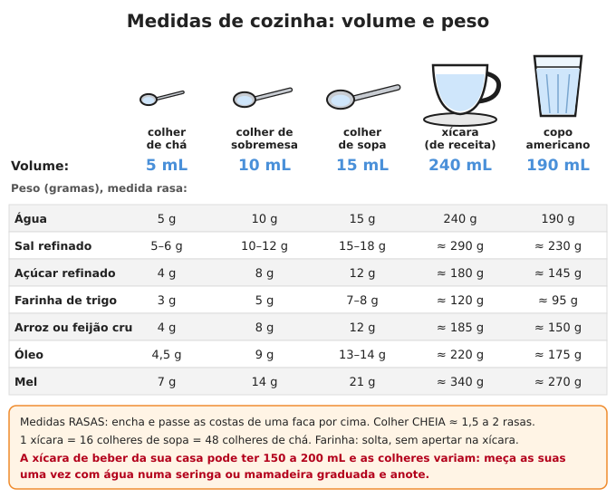
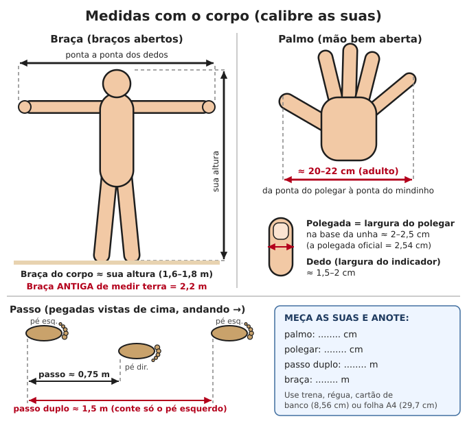
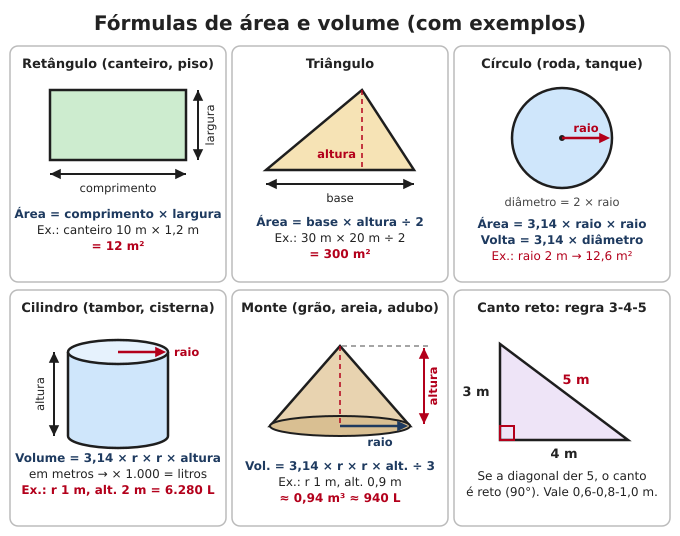

# Tabelas e conversões

**Resumo:** tabelas para consulta rápida: unidades (comprimento, área, volume, massa,
temperatura, energia), medidas de cozinha em mL e gramas, medidas rurais antigas do Brasil
(alqueire, tarefa, braça, arroba, saca), medidas com o próprio corpo, calorias e proteína
dos alimentos, peso de grãos por litro, tempos de cozimento, diluições e fórmulas com
exemplos resolvidos. Os valores marcados com "≈" são aproximados: servem para o dia a dia.

---

## 1. Comprimento

| Unidade | Equivale a |
|---|---|
| 1 centímetro (cm) | 10 milímetros (mm) |
| 1 metro (m) | 100 cm = 1.000 mm |
| 1 quilômetro (km) | 1.000 m |
| 1 polegada (pol ou ") | 2,54 cm |
| 1 pé (ft) | 30,48 cm (12 polegadas) |
| 1 jarda | 91,44 cm (3 pés) |
| 1 milha terrestre | 1,609 km |
| 1 milha náutica | 1,852 km |
| 1 metro | 3,28 pés = 39,4 polegadas |
| 1 km | 0,62 milha |

**Bitolas em polegadas** (canos, parafusos, brocas): 1/4" = 6,35 mm · 3/8" = 9,5 mm ·
1/2" = 12,7 mm · 3/4" = 19,05 mm · 1" = 25,4 mm. Em cano, a "polegada" é um nome comercial
e não bate exatamente com a medida real do diâmetro.

### Medidas antigas de comprimento (ainda usadas no interior)

| Nome | Valor | Observação |
|---|---|---|
| Palmo (craveiro) | 22 cm | Medida oficial antiga; o palmo de cada pessoa varia |
| Vara | 1,10 m | 5 palmos |
| Braça | 2,20 m | 10 palmos; base das medidas de terra |
| Légua (de sesmaria) | ≈ 6,6 km | 3.000 braças. "Légua" falada no mato varia muito: confirme |

## 2. Área

| Unidade | Equivale a |
|---|---|
| 1 metro quadrado (m²) | quadrado de 1 m × 1 m |
| 1 are | 100 m² (10 m × 10 m) |
| 1 hectare (ha) | 10.000 m² (100 m × 100 m) |
| 1 km² | 100 ha |
| 1 acre | 4.047 m² = 0,405 ha |
| 1 braça quadrada | 4,84 m² |

### Medidas de terra do Brasil

| Nome | Área | Em hectares | Onde se usa |
|---|---|---|---|
| Alqueire paulista | 24.200 m² (50 × 100 braças) | 2,42 ha | SP, PR, MS, parte de MG |
| Alqueire mineiro / goiano | 48.400 m² (100 × 100 braças) | 4,84 ha | MG, GO, RJ, ES, TO |
| Alqueire do norte | 27.225 m² | ≈ 2,72 ha | Partes do Norte e Nordeste |
| Alqueire baiano | 96.800 m² | 9,68 ha | BA |
| Quarta (paulista) | 6.050 m² | 0,605 ha | 1/4 do alqueire paulista |
| Quarta (mineira) | 12.100 m² | 1,21 ha | 1/4 do alqueire mineiro |
| Litro (de planta) | ≈ 605 m² | ≈ 0,06 ha | Área semeada com 1 litro de milho |
| Tarefa (BA) | ≈ 4.356 m² | ≈ 0,44 ha | Bahia (cana, mandioca, cacau) |
| Tarefa (CE) | ≈ 3.630 m² | ≈ 0,36 ha | Ceará |
| Tarefa (AL, SE, PE) | ≈ 3.000–3.050 m² | ≈ 0,30 ha | Zona da mata nordestina |

> **ATENÇÃO:** "alqueire", "tarefa", "quarta" e "litro" mudam de região para região e até de
> município para município. Antes de comprar, vender, arrendar ou dividir terra, **pergunte
> quanto mede a medida local em braças ou metros** e escreva no papel do acordo.

**Conversões rápidas:** alqueires paulistas × 2,42 = hectares · alqueires mineiros × 4,84 =
hectares · hectares ÷ 2,42 = alqueires paulistas.

## 3. Volume

| Unidade | Equivale a |
|---|---|
| 1 litro (L) | 1.000 mL = 1 decímetro cúbico (10 × 10 × 10 cm) |
| 1 metro cúbico (m³) | 1.000 L |
| 1 galão americano | 3,785 L |
| 1 galão inglês (imperial) | 4,546 L |
| 1 barril de petróleo | 159 L |
| 1 pé cúbico | 28,3 L |
| 1 onça fluida (EUA, fl oz) | 29,6 mL |
| Tambor padrão | 200 L |
| Bombona azul comum | 50 L |
| Galão de água mineral | 20 L |
| Lata de tinta/óleo ("lata de 18 L") | 18 L (muito usada como medida de grão e farinha) |

**Chuva:** 1 mm de chuva = **1 litro por metro quadrado**. 1 m³ de água pesa 1.000 kg.

## 4. Massa (peso)

| Unidade | Equivale a |
|---|---|
| 1 quilograma (kg) | 1.000 gramas (g) |
| 1 tonelada (t) | 1.000 kg |
| 1 libra (lb) | 453,6 g |
| 1 onça (oz) | 28,35 g |
| 1 arroba (@) | 15 kg |
| 1 saca (café, soja, milho, feijão, trigo) | 60 kg |
| 1 saca de arroz em casca | 50 kg |
| 1 litro de água | 1 kg |

**Arroba de boi:** conta-se em **carcaça** (carne com osso, sem couro, cabeça e vísceras).
Regra de bolso: **peso vivo ÷ 30 = arrobas** (rendimento de carcaça de 50%). Boi gordo bem
acabado rende 52–55%: 540 kg vivo × 0,53 = 286 kg de carcaça ÷ 15 = **19 arrobas**.

### Pesar sem balança (balança de vara)
1. Pendure uma vara reta por uma corda (o **ponto de apoio**). Ajuste até a vara vazia ficar
   em equilíbrio.
2. Pendure a carga de um lado, a uma distância fixa do apoio (ex.: 10 cm).
3. Do outro lado, deslize um **peso conhecido** (garrafa PET com 2 L de água = 2 kg) até
   equilibrar. Meça a distância dele ao apoio (ex.: 40 cm).
4. **Peso da carga = peso conhecido × distância dele ÷ distância da carga** = 2 × 40 ÷ 10 = **8 kg**.
5. Marque na vara os pontos de 1, 2, 5, 10 kg e ela vira uma balança romana permanente.

## 5. Temperatura

**°F = °C × 1,8 + 32** · **°C = (°F − 32) ÷ 1,8** · Kelvin = °C + 273

| °C | °F | Referência |
|---|---|---|
| −18 | 0 | Congelador (freezer) |
| 0 | 32 | Água congela |
| 4 | 39 | Geladeira (máximo 5 °C) |
| 10 | 50 | Abaixo disso, cloro age mais devagar (espere 60 min) |
| 37 | 98,6 | Corpo humano normal |
| 37,8 | 100 | Febre começa |
| 39 | 102 | Febre alta |
| 40 | 104 | Água morna para fermento e coalho do queijo (35–40 °C) |
| 63–65 | 145–149 | Pasteurização lenta do leite: manter 30 minutos |
| 72–75 | 162–167 | Pasteurização rápida: 15 a 20 segundos |
| 74 | 165 | Frango e carne moída seguros no centro |
| 100 | 212 | Água ferve (nível do mar) |
| 121 | 250 | Panela de pressão / autoclave (esteriliza) |
| 150–160 | 300–325 | Forno baixo |
| 180 | 356 | Forno médio (receitas americanas: 350 °F) |
| 200–220 | 400–425 | Forno alto |

**Altitude:** a água ferve cerca de **1 °C mais baixo a cada 300 m**. A 1.000 m ferve a
≈ 97 °C; a 2.000 m, a ≈ 93 °C. Comida demora mais para cozinhar; a fervura para purificar
água passa de 1 para 3 minutos acima de 2.000 m.

## 6. Energia e potência

| De | Para |
|---|---|
| 1 kcal (a "caloria" dos alimentos) | 4,184 kJ = 1,163 Wh |
| 1 kJ | 0,239 kcal |
| 1 Wh (watt-hora) | 3,6 kJ = 0,86 kcal |
| 1 kWh | 3.600 kJ = 860 kcal |
| 1 cv (cavalo-vapor) | 735,5 W |
| 1 hp | 745,7 W |
| 1 kW | 1,36 cv |

**Eletricidade:** watts = volts × ampères · watt-hora = watts × horas · energia da bateria
(Wh) = volts × ampère-hora (Ah). Bateria de 12 V e 100 Ah = **1.200 Wh**; se for de
chumbo-ácido, use só metade (600 Wh) para ela durar. Veja [Baterias](../06-energia/05-baterias.md).

### Quanta energia tem cada coisa (aproximado)

| Fonte | Energia |
|---|---|
| Comida de 1 adulto por dia (2.000–2.500 kcal) | ≈ 2,3–2,9 kWh |
| Lenha seca ao ar (1 kg) | ≈ 4 kWh ≈ 3.500 kcal |
| Carvão vegetal (1 kg) | ≈ 7–8 kWh ≈ 6.500 kcal |
| Gás de cozinha GLP (1 kg) | ≈ 12,8 kWh ≈ 11.000 kcal (botijão P13 ≈ 166 kWh) |
| Gasolina brasileira (1 L, com etanol) | ≈ 8 kWh |
| Diesel (1 L) | ≈ 10 kWh |
| Etanol hidratado (1 L) | ≈ 5,7 kWh |
| Querosene (1 L) | ≈ 9,6 kWh |
| Biogás (1 m³) | ≈ 6 kWh (≈ 0,45 kg de GLP) |
| Bateria de celular | ≈ 10–20 Wh |
| Pessoa pedalando por horas | ≈ 75–100 W |
| Cavalo trabalhando por horas | ≈ 500–750 W |

## 7. Medidas de cozinha



| Medida | Volume |
|---|---|
| Pitada | ≈ 0,3–0,5 g (o que cabe entre 2 dedos) |
| Colher de café | ≈ 2 mL |
| Colher de chá | 5 mL |
| Colher de sobremesa | 10 mL |
| Colher de sopa | 15 mL (= 3 colheres de chá) |
| Xícara (padrão de receita) | 240 mL (= 16 colheres de sopa) |
| Copo americano | ≈ 190 mL cheio |
| Copo de requeijão | ≈ 250 mL |
| Lata de leite condensado | 395 g |

> **ATENÇÃO:** colheres e xícaras de casa variam muito (a xícara de chá de beber tem de
> 150 a 200 mL). **Para remédio e soro, meça a sua colher uma vez** com seringa ou mamadeira
> graduada e anote. Sempre medidas **rasas** (passe a faca por cima).

### Gramas por medida rasa

| Ingrediente | Colher de chá | Colher de sopa | Xícara (240 mL) |
|---|---|---|---|
| Água, leite | 5 g | 15 g | 240 g |
| Sal refinado | 5–6 g | 15–18 g | ≈ 290 g |
| Sal grosso | ≈ 5 g | ≈ 15 g | ≈ 250 g |
| Açúcar refinado | 4 g | 12 g | ≈ 180 g |
| Açúcar cristal | 4–5 g | 13 g | ≈ 200 g |
| Farinha de trigo | 3 g | 7–8 g | ≈ 120 g |
| Fubá | 3 g | 8 g | ≈ 130 g |
| Farinha de mandioca | 3 g | 9 g | ≈ 150 g |
| Polvilho / amido | 3 g | 8 g | ≈ 130 g |
| Arroz cru | 4 g | 12 g | ≈ 190 g |
| Feijão cru | 4 g | 12 g | ≈ 180 g |
| Aveia em flocos | 1,5 g | 5 g | ≈ 80 g |
| Leite em pó | 2 g | 7 g | ≈ 110 g |
| Óleo | 4,5 g | 13–14 g | ≈ 220 g |
| Manteiga, banha | 5 g | 14 g | ≈ 210 g |
| Mel | 7 g | 21 g | ≈ 340 g |
| Fermento biológico seco | 3 g | 9 g | — |
| Bicarbonato de sódio | 4–5 g | 13 g | — |
| Café em pó | 2 g | 6 g | ≈ 90 g |

Colher **cheia** ≈ 1,5 a 2 vezes a rasa. Copo americano ≈ 0,8 da xícara de receita.

## 8. Medidas com o corpo



| Medida | Como fazer | Adulto típico |
|---|---|---|
| Dedo | Largura do indicador | 1,5–2 cm |
| Polegada | Largura do polegar na base da unha | 2–2,5 cm |
| Palmo | Mão bem aberta, ponta do polegar à ponta do mindinho | 20–22 cm |
| Pé | Calcanhar à ponta do pé (calçado) | 25–30 cm |
| Côvado | Cotovelo à ponta do dedo médio | 45–50 cm |
| Jarda do corpo | Nariz à ponta dos dedos, braço esticado para o lado | ≈ 90 cm |
| Passo | Calcanhar a calcanhar, andando normal | ≈ 0,75 m |
| Passo duplo | Cada vez que o MESMO pé toca o chão | ≈ 1,5 m |
| Braça do corpo | Braços abertos, ponta a ponta dos dedos | ≈ sua altura |

A braça do corpo (≈ 1,7 m) é **menor** que a braça antiga de medir terra (2,2 m).

### Calibre as suas (faça uma vez e anote na capa do caderno)
1. **Palmo, polegar, pé:** meça com régua, trena, ou um objeto de tamanho conhecido:
   cartão de banco ou documento = **8,56 × 5,4 cm**; folha A4 = **21 × 29,7 cm**;
   moeda de R$ 1 = **2,7 cm** de diâmetro.
2. **Passo duplo:** marque **100 m** com trena (ou 10 vezes uma corda de 10 m). Ande no seu
   ritmo normal contando só o pé esquerdo. Faça 3 vezes e tire a média.
   Ex.: 66, 64 e 65 passos duplos → média 65 → 100 ÷ 65 = **1,54 m por passo duplo**.
3. **Ajustes:** em subida, mato fechado, areia ou carregando peso, o passo encurta: some
   **10 a 20%** de passos. À noite, mais ainda.
4. **Ritmo:** a pé, em terreno plano, anda-se **4 a 5 km/h**; uma légua (6,6 km) leva
   **1h20 a 1h40**. Em trilha de morro, conte 2 a 3 km/h.

## 9. Calorias e proteína dos alimentos (por 100 g)

Valores aproximados, baseados na Tabela Brasileira de Composição de Alimentos (TACO).
Adulto precisa de **≈ 2.000–2.500 kcal** e **≈ 50–70 g de proteína** por dia (trabalho pesado:
3.000+ kcal). Veja [Nutrição e racionamento](../03-alimentacao/03-nutricao-e-racionamento.md).

| Alimento (100 g) | kcal | Proteína (g) |
|---|---|---|
| Arroz branco cru | 358 | 7 |
| Arroz cozido | 128 | 2,5 |
| Feijão carioca/preto cru | 325–330 | 20–21 |
| Feijão cozido (só grão) | 76 | 5 |
| Feijão-de-corda (caupi) cru | ≈ 340 | ≈ 22 |
| Lentilha crua | 339 | 23 |
| Grão-de-bico cru | 355 | 21 |
| Soja em grão | ≈ 400 | ≈ 36 |
| Milho seco / fubá | 350–360 | 7–9 |
| Farinha de trigo | 360 | 10 |
| Macarrão cru | 371 | 10 |
| Aveia em flocos | 394 | 14 |
| Farinha de mandioca | 365 | 1,5 |
| Mandioca crua | 151 | 1 |
| Batata-doce crua | 118 | 1,3 |
| Batata inglesa crua | 64 | 1,8 |
| Inhame / cará cru | 97 | 2 |
| Banana | 90–100 | 1,3 |
| Abacate | 96 | 1,2 |
| Abóbora | 30–50 | 1 |
| Couve | 27 | 2,9 |
| Açúcar | 387 | 0 |
| Rapadura | 352 | 1 |
| Mel | 309 | 0 |
| Óleo vegetal | 884 | 0 |
| Banha de porco | 900 | 0 |
| Manteiga | 726 | 0,4 |
| Leite integral (líquido) | 61 | 3 |
| Leite em pó integral | 497 | 25 |
| Queijo minas frescal | 264 | 17 |
| Ovo de galinha (1 ovo ≈ 50 g) | 143 | 13 |
| Frango (peito, cru) | 119 | 21,5 |
| Carne bovina magra crua | 140–150 | 20–21 |
| Carne de porco (lombo, cru) | 176 | 22,6 |
| Peixe de água doce (tilápia, crua) | ≈ 96 | ≈ 20 |
| Sardinha em lata (em óleo) | 285 | 16 |
| Atum em lata (em óleo) | 166 | 26 |
| Amendoim cru | 544 | 27 |
| Castanha-do-pará | 643 | 14,5 |
| Castanha de caju torrada | 570 | 18,5 |
| Coco (polpa) | 406 | 3,7 |

Exemplo: 1 kg de feijão cru ≈ 3.300 kcal e 200 g de proteína. **Arroz + feijão** (2 partes de
arroz para 1 de feijão) dá proteína completa.

## 10. Peso de grãos e farinhas por litro (densidade)

Use para converter "litro", "lata" e "cuia" em quilos, e para saber quanto cabe num recipiente.

| Produto | kg por litro | 1 saca (60 kg) ocupa | Tambor de 200 L guarda |
|---|---|---|---|
| Arroz branco (beneficiado) | 0,80–0,85 | ≈ 73 L | ≈ 165 kg |
| Arroz em casca | 0,55–0,60 | ≈ 105 L | ≈ 115 kg |
| Feijão | 0,75–0,80 | ≈ 77 L | ≈ 155 kg |
| Milho em grão | 0,72–0,76 | ≈ 81 L | ≈ 150 kg |
| Soja | 0,72–0,75 | ≈ 82 L | ≈ 145 kg |
| Trigo em grão | 0,77–0,80 | ≈ 77 L | ≈ 155 kg |
| Sorgo | 0,70–0,75 | ≈ 83 L | ≈ 145 kg |
| Café beneficiado (verde) | 0,65–0,70 | ≈ 90 L | ≈ 135 kg |
| Amendoim sem casca | 0,60–0,65 | ≈ 95 L | ≈ 125 kg |
| Amendoim com casca | 0,25–0,35 | ≈ 200 L | ≈ 60 kg |
| Farinha de mandioca | 0,60–0,70 | ≈ 92 L | ≈ 130 kg |
| Farinha de trigo | 0,50–0,60 | ≈ 110 L | ≈ 110 kg |
| Fubá | 0,55–0,65 | ≈ 100 L | ≈ 120 kg |
| Açúcar cristal | 0,85–0,90 | ≈ 68 L | ≈ 175 kg |
| Sal refinado | ≈ 1,2 | ≈ 50 L | ≈ 240 kg |
| Aveia em flocos | 0,35–0,40 | ≈ 160 L | ≈ 75 kg |

- **Garrafa PET de 2 L** guarda ≈ 1,6 kg de arroz ou feijão (ótima contra carunchos e ratos).
- **Bombona de 50 L** guarda ≈ 40 kg de arroz.
- **"Litro" de feijão** vendido na feira ≈ 0,78 kg; "lata de 18 L" de farinha ≈ 11–12 kg.
- Em várias regiões a **quarta** e a **cuia** também são medidas de volume de grão e farinha,
  de tamanho variável: **pese uma vez e anote**.

## 11. Tempos de cozimento de grãos

Tempos depois de levantar fervura (panela comum) ou depois de **pegar pressão** (panela de
pressão), com fogo baixo. Ao nível do mar; em altitude, aumente.

| Grão | Demolho | Água (partes por 1 de grão) | Panela comum | Pressão |
|---|---|---|---|---|
| Arroz branco | Não | 2 | 15–20 min | — |
| Arroz integral | Opcional 4–8 h | 2,5 | 40–50 min | 15–20 min |
| Feijão carioca/preto | 8–12 h | 3 | 1h30–2h30 | 20–30 min (sem demolho: 35–45) |
| Feijão-de-corda / fradinho | Opcional | 3 | 40–60 min | 10–15 min |
| Grão-de-bico | 12 h | 3 | 1h30–2h30 | 25–35 min |
| Soja | 12 h | 3 | 2h30–3h | 30–45 min |
| Lentilha | Não | 3 | 20–30 min | Evite (espuma entope a válvula) |
| Ervilha seca partida | Não | 3 | 40–60 min | Evite |
| Canjica / milho branco | 12 h | 4 | 2–3 h | 40–60 min |
| Trigo em grão | 12 h | 3 | 1–1h30 | 30 min |
| Fubá (angu, polenta) | Não | 3 (firme) a 5 (mole) | 30–40 min mexendo | — |
| Quirera (milho quebrado) | Não | 4 | 30–40 min | — |
| Aveia em flocos | Não | 2–3 | 3–5 min | — |
| Mandioca mansa (em pedaços) | — | Cobrir | 20–40 min | 10–15 min |

- **Feijão velho** (mais de 1 ano) pode levar o dobro do tempo. Uma pitada de bicarbonato
  (1/4 de colher de chá por kg) ajuda a amolecer, mas destrói parte das vitaminas.
- **Economize combustível:** demolho, panela tampada e **caixa térmica** (ferva 10 minutos,
  coloque a panela tampada dentro de uma caixa forrada com palha, cobertor ou isopor e deixe
  2–4 horas: termina de cozinhar sozinha e gasta metade ou menos de lenha/gás).
  Veja [Fogões](../06-energia/02-lenha-carvao-e-fogoes.md).

> **ATENÇÃO:** feijão cru ou mal cozido tem uma substância tóxica (lectina) que causa vômito e
> diarreia fortes. Jogue fora a água do demolho e **ferva forte por pelo menos 10 minutos** antes
> de baixar o fogo. Nunca cozinhe feijão só em fogo morno ou na caixa térmica sem essa fervura.
> **Mandioca-brava** (amarga) só se come depois de processada: veja
> [Processamento de alimentos](../03-alimentacao/05-processamento-de-alimentos.md).

## 12. Diluições comuns

Água sanitária comum = **2,0 a 2,5% de cloro ativo**. Detalhes e cuidados em cada seção indicada.

| Para quê | Receita | Onde está explicado |
|---|---|---|
| Água de beber (clara) | 2 gotas de água sanitária por litro; espere 30 min | [Tratamento da água](../01-agua/02-tratamento-e-purificacao.md) |
| Água de beber (turva, já filtrada) | 4 gotas por litro | [Tratamento da água](../01-agua/02-tratamento-e-purificacao.md) |
| Cloro granulado 65–70% (solução-mãe) | 1 colher de chá rasa (≈ 5 g) em 140 mL de água; use como água sanitária | [Tratamento da água](../01-agua/02-tratamento-e-purificacao.md) |
| Desinfetar galão/recipiente | 1 colher de chá de água sanitária por litro, agitar | [Armazenamento de água](../01-agua/03-armazenamento-e-calculos.md) |
| Desinfecção de choque de poço (50 mg/L) | 2 L de água sanitária por 1.000 L de água do poço, 12–24 h | [Encontrar e captar água](../01-agua/01-encontrar-e-captar-agua.md) |
| Lavar frutas e verduras | 1 colher de sopa por litro, 15 min, enxaguar | [Higiene e saneamento](../02-saude/09-higiene-e-saneamento.md) |
| Chão, banheiro, superfícies (0,05%) | 1 copo (200 mL) em 10 L de água | [Higiene e saneamento](../02-saude/09-higiene-e-saneamento.md) |
| Roupas, fezes e vômito de doentes (0,5%) | 1 parte de água sanitária + 4 de água | [Higiene e saneamento](../02-saude/09-higiene-e-saneamento.md) |
| Soro de reidratação oral | 1 L de água tratada + 1/2 colher de chá rasa de sal + 6 colheres de chá rasas de açúcar | [Cartões de bolso](../00-emergencia/04-cartoes-de-bolso.md) · [Doenças](../02-saude/03-doencas-e-infeccoes.md) |
| Soro fisiológico caseiro (lavar ferida, nariz) | 1 L de água fervida + 9 g de sal (≈ 1 e 1/2 colher de chá rasa) | [Ferimentos](../02-saude/02-ferimentos-queimaduras-fraturas.md) |
| Álcool 70% a partir de álcool 92,8° INPM | 3 partes de álcool + 1 parte de água fervida | [Química prática](../09-quimica-e-oficios/02-quimica-pratica.md) |
| Tintura de iodo 2% para água | 5 gotas por litro (turva: 10), 30 min; uso curto | [Tratamento da água](../01-agua/02-tratamento-e-purificacao.md) |
| Urina como adubo | 1 parte de urina + 5 a 10 de água, no solo | [Higiene e saneamento](../02-saude/09-higiene-e-saneamento.md) |
| Calda bordalesa 1% (fungos) | 100 g de sulfato de cobre + 100 g de cal virgem em 10 L de água | [Pragas e doenças](../04-agricultura/06-pragas-e-doencas.md) |
| Calda de sabão (pulgão, cochonilha) | 10–20 g de sabão de coco por litro | [Pragas e doenças](../04-agricultura/06-pragas-e-doencas.md) |
| Leite contra oídio (pó branco nas folhas) | 1 parte de leite + 9 partes de água | [Pragas e doenças](../04-agricultura/06-pragas-e-doencas.md) |

**Água oxigenada:** 10 volumes ≈ 3% (uso em ferida); 20 volumes ≈ 6%; 40 volumes ≈ 12%.

**Calcular qualquer diluição:** concentração inicial × volume inicial = concentração final ×
volume final. Ex.: quero 10 L de solução 0,5% usando água sanitária 2,5% →
volume de água sanitária = 0,5 × 10 ÷ 2,5 = **2 L** de água sanitária + 8 L de água.
Lembre: **1% = 10 g por litro = 10.000 ppm** · **1 ppm = 1 mg por litro**.

## 13. Fórmulas úteis



### Áreas e volumes
- **Retângulo:** comprimento × largura. Canteiro de 10 m × 1,2 m = **12 m²**.
- **Triângulo:** base × altura ÷ 2. Terreno de base 30 m e altura 20 m = **300 m²**.
- **Terreno torto de 4 lados:** média dos dois lados opostos × média dos outros dois.
  Ex.: lados 100 e 90 m, 50 e 60 m → 95 × 55 = **5.225 m²** (aproximado).
- **Círculo:** 3,14 × raio × raio. Raio 2 m → **12,6 m²**. Volta (circunferência) = 3,14 × diâmetro.
- **Caixa:** comprimento × largura × altura. 2 × 1,5 × 1 m = 3 m³ = **3.000 L**.
- **Cilindro (tambor, poço, cisterna):** 3,14 × raio × raio × altura. Raio 1 m, altura 2 m
  = 6,28 m³ = **6.280 L**.
- **Monte de grão, areia ou composto (cone):** 3,14 × raio × raio × altura ÷ 3.
- **Canto reto (esquadro 3-4-5):** marque 3 m num lado e 4 m no outro; o canto está reto
  quando a diagonal medir **5 m** (ou 60 cm, 80 cm e 1 m).
- **Declividade (%):** desnível ÷ distância × 100. Desce 1 m em 20 m = **5%**.
- **Velocidade:** km/h ÷ 3,6 = metros por segundo.

### Regra de três
**Direta** (as duas coisas crescem juntas): "se 3 kg de milho custam 12 ovos, quanto custam 5 kg?"
```
3 kg ---- 12 ovos
5 kg ----  x        x = 5 × 12 ÷ 3 = 20 ovos
```
**Inversa** (uma cresce, a outra diminui): "4 pessoas capinam a roça em 6 dias; e 8 pessoas?"
```
x = 4 × 6 ÷ 8 = 3 dias
```
**Altura de árvore pela sombra:** finque um pau de 1 m; se a sombra dele tem 1,5 m e a da
árvore 18 m → altura = 18 × 1 ÷ 1,5 = **12 m**.

**Dose de remédio por peso:** dose (mg) = mg/kg × peso. 15 mg/kg para criança de 12 kg =
180 mg. Veja [Medicamentos e doses](../02-saude/04-medicamentos-e-doses.md).

### Porcentagem
- **X% de um valor** = valor × X ÷ 100. 20% de 50 sacas = **10 sacas**.
- **Que porcentagem é?** = parte ÷ total × 100. 45 sementes germinaram de 50 = **90%**.
- **Rendimento:** de 100 kg de mandioca saem ≈ 25–30 kg de farinha (25–30%).

### Juros (empréstimo e troca a prazo)
- **Simples:** juros = capital × taxa × tempo. R$ 1.000 a 2% ao mês por 12 meses = 240 →
  devolve **R$ 1.240**.
- **Compostos** (juros sobre juros): montante = capital × (1 + taxa)^tempo.
  R$ 1.000 × 1,02^12 = **R$ 1.268**.
- **Regra dos 72:** a dívida dobra em ≈ 72 ÷ taxa meses. A 2% ao mês, dobra em **36 meses**.
- **Empréstimo de semente:** "pega 10 kg, devolve 15 kg na colheita (6 meses)" = 50% no
  período ≈ 7% ao mês. Combine sempre por escrito, com testemunha.

## 14. Tabuada (1 a 10)

| × | 1 | 2 | 3 | 4 | 5 | 6 | 7 | 8 | 9 | 10 |
|---|---|---|---|---|---|---|---|---|---|---|
| **1** | 1 | 2 | 3 | 4 | 5 | 6 | 7 | 8 | 9 | 10 |
| **2** | 2 | 4 | 6 | 8 | 10 | 12 | 14 | 16 | 18 | 20 |
| **3** | 3 | 6 | 9 | 12 | 15 | 18 | 21 | 24 | 27 | 30 |
| **4** | 4 | 8 | 12 | 16 | 20 | 24 | 28 | 32 | 36 | 40 |
| **5** | 5 | 10 | 15 | 20 | 25 | 30 | 35 | 40 | 45 | 50 |
| **6** | 6 | 12 | 18 | 24 | 30 | 36 | 42 | 48 | 54 | 60 |
| **7** | 7 | 14 | 21 | 28 | 35 | 42 | 49 | 56 | 63 | 70 |
| **8** | 8 | 16 | 24 | 32 | 40 | 48 | 56 | 64 | 72 | 80 |
| **9** | 9 | 18 | 27 | 36 | 45 | 54 | 63 | 72 | 81 | 90 |
| **10** | 10 | 20 | 30 | 40 | 50 | 60 | 70 | 80 | 90 | 100 |

**Números romanos** (relógios, capítulos, datas antigas): I = 1 · V = 5 · X = 10 · L = 50 ·
C = 100 · D = 500 · M = 1.000. Menor antes do maior subtrai: IV = 4, IX = 9, XL = 40, XC = 90.
Ex.: MMXXVI = 2026.

---

Ver também: [Armazenamento e cálculos de água](../01-agua/03-armazenamento-e-calculos.md) · [Medicamentos e doses](../02-saude/04-medicamentos-e-doses.md) · [Nutrição e racionamento](../03-alimentacao/03-nutricao-e-racionamento.md) · [Estoque de alimentos](../03-alimentacao/01-estoque-de-alimentos.md) · [Glossário](04-glossario.md)
