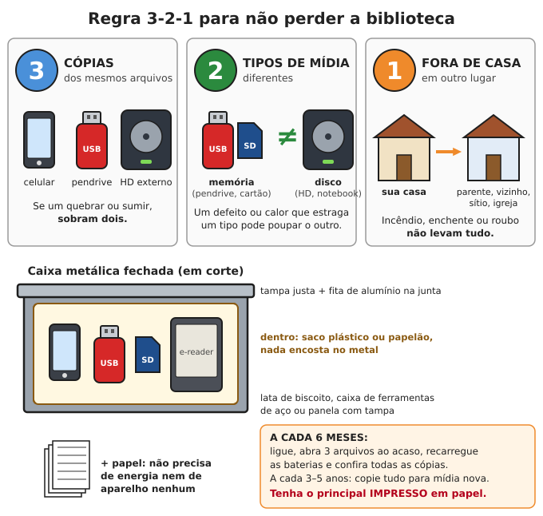

# Biblioteca offline: o que baixar agora

**Resumo:** enquanto há internet, baixe para pendrive, HD e celular: o programa **Kiwix** com a
**Wikipédia em português**, os livros gratuitos da **Hesperian** ("Onde Não Há Médico"), as
cartilhas da **Embrapa** e do **SENAR**, os guias do **Ministério da Saúde**, **mapas offline**
do seu estado e **este repositório inteiro**. Guarde pela regra **3-2-1** (3 cópias, 2 tipos de
mídia, 1 fora de casa), teste a cada 6 meses e **imprima o essencial**.

---

## Por onde começar (uma tarde resolve o básico)

1. Compre **2 pendrives de 64 GB** e, se puder, **1 HD externo de 500 GB a 1 TB**.
2. Formate em **exFAT** (aceita arquivos maiores que 4 GB, que muitos itens abaixo têm; o
   formato FAT32 dos pendrives novos **não** aceita).
3. Baixe primeiro o **kit essencial** (tabela abaixo). Depois, aos poucos, o kit completo.
4. Instale os aplicativos no celular **e guarde os instaladores** (arquivos `.apk` do Android
   e `.exe`/`.dmg`/`.AppImage` do computador) no pendrive: sem internet não há loja de apps.
5. Organize em pastas numeradas: `01-este-repositorio`, `02-saude`, `03-agricultura`,
   `04-wikipedia`, `05-mapas`, `06-programas`. Coloque um arquivo `LEIA-ME.txt` explicando
   o que é cada pasta e como abrir (alguém sem você vai precisar usar).

| Kit | O que inclui | Espaço aproximado |
|---|---|---|
| **Essencial** | Este repositório, livros Hesperian, guias do Ministério da Saúde, 30–50 cartilhas Embrapa/SENAR, Kiwix + Wikipédia em português **sem imagens**, mapa do seu estado, instaladores | **16–32 GB** |
| **Completo** | Tudo acima + Wikipédia em português **com imagens**, Wikipédia em inglês, Wikilivros, Wikivoyage, wikiHow, Stack Exchange, iFixit, Gutenberg, coleções inteiras da Embrapa, FAO, Practical Action, Appropedia, mapas do Brasil inteiro | **200 GB a 1 TB** |

Os tamanhos abaixo são **aproximados** e mudam a cada versão: confira na hora de baixar.

## 1. Programas

### Kiwix (leitor de sites offline)
- **O que é:** programa gratuito que abre cópias completas de sites (Wikipédia e outros) sem
  internet. Os sites vêm em arquivos `.zim` (um arquivo por site).
- **Por que importa:** é a forma mais compacta de ter uma enciclopédia inteira no bolso, com
  busca, links e imagens, rodando em celular velho.
- **Onde:** **kiwix.org**. Existe para Android, iPhone, Windows, Mac e Linux. Dentro do app há
  um catálogo: filtre por idioma "Português" e baixe direto.
- **Tamanho:** o programa tem dezenas de MB; o conteúdo é baixado à parte.
- **Para a comunidade:** o Kiwix pode servir a biblioteca por Wi-Fi para vários celulares ao
  mesmo tempo (em um computador ou num Raspberry Pi, procure "Kiwix Hotspot" ou "kiwix-serve").
  Uma escola ou posto de saúde com isso vira biblioteca da vizinhança.

### Mapas offline
| App | O que é | Por que importa | Onde | Tamanho |
|---|---|---|---|---|
| **Organic Maps** | Mapas gratuitos e simples, baseados no OpenStreetMap, com trilhas, estradas de terra e busca offline | Navega por GPS **sem internet** (o GPS do celular funciona por satélite, mesmo em modo avião) | **organicmaps.app** | Cada estado/região: dezenas a centenas de MB; Brasil inteiro: ≈ 1–2 GB |
| **OsmAnd** | Mapas offline mais completos: **curvas de nível**, relevo, trilhas, marcação de pontos | Planejar rotas a pé, achar nascentes e vales, marcar recursos | **osmand.net** | Igual ao acima, mais curvas de nível (≈ 10–100 MB por estado) |

- Baixe o mapa do **seu estado e dos estados vizinhos** nos dois apps.
- A versão gratuita do OsmAnd na loja pode limitar quantos mapas você baixa; a versão
  publicada na loja de apps livres **F-Droid** não tem esse limite.
- Para o papel: **cartas topográficas do IBGE** (1:50.000 ou 1:100.000) da sua região, gratuitas
  no site do IBGE (ibge.gov.br; busque "cartas topográficas" + seu município) e o mapa rodoviário
  do seu estado. Veja [Orientação e navegação](../10-comunicacao-e-navegacao/03-orientacao-e-navegacao.md).

### Outros aplicativos e arquivos
- **Leitor de PDF e de EPUB** que funcione offline (no Android, por exemplo, KOReader; no
  computador, o programa gratuito **Calibre**, que também converte formatos para e-reader).
- **F-Droid** (loja de apps livres para Android): guarde o instalador; permite instalar apps
  a partir de arquivos no pendrive.
- **Tradutor com idiomas baixados** para uso offline (inglês e espanhol: muitos manuais técnicos
  bons só existem nessas línguas).
- **Dicionário offline** (o Wikcionário em português existe para Kiwix).
- Apps de identificação de plantas por foto **precisam de internet**: não conte com eles.

> **ATENÇÃO:** instale só apps e arquivos de fontes conhecidas (sites oficiais e lojas). Um
> instalador baixado de site duvidoso pode roubar dados ou estragar o aparelho.

## 2. Enciclopédias e wikis (todos abrem no Kiwix)

| Conteúdo | O que é | Por que importa | Tamanho aproximado |
|---|---|---|---|
| **Wikipédia em português** | Enciclopédia completa. Versões: "maxi" (com imagens), "nopic" (sem imagens), "mini" (só o começo de cada artigo) | Consulta geral: química, história, plantas, doenças, máquinas | Com imagens: dezenas de GB (≈ 20–40 GB); sem imagens: ≈ 5–12 GB; mini: ≈ 1–3 GB |
| **Wikipédia em inglês** | A maior de todas, bem mais detalhada em técnica e ciência | Para quem lê inglês (ou com tradutor offline) | Com imagens: ≈ 100 GB; sem imagens: ≈ 50 GB; mini: ≈ 10 GB |
| **Wikilivros (Wikibooks)** | Livros-texto livres: matemática, química, programação, culinária | Ensinar crianças e jovens; manuais | Português: centenas de MB; inglês: alguns GB |
| **Wikivoyage** | Guia de viagem: cidades, estradas, distâncias | Conhecer rotas e lugares longe de casa | Português: pequeno; inglês: ≈ 1 GB |
| **Wikcionário** | Dicionário | Significado e grafia de palavras | ≈ 1–3 GB |
| **wikiHow** | Passo a passo ilustrado de tarefas práticas (consertos, cozinha, primeiros socorros) | Muito visual, fácil para leigos | Alguns GB a dezenas de GB; disponibilidade varia por idioma |
| **Stack Exchange** | Perguntas e respostas de especialistas. Os mais úteis: Home Improvement (casa), Gardening (jardinagem e horta), Cooking (cozinha), Bicycles, Motor Vehicle Maintenance (mecânica), Electrical Engineering (eletrônica), Amateur Radio (rádio), Outdoors, Sustainability | Soluções para problemas reais, explicadas por quem já fez | Cada site: dezenas de MB a alguns GB (quase todos em inglês) |
| **iFixit** | Guias de conserto com fotos (celulares, eletrodomésticos, ferramentas, carros) | Manter aparelhos funcionando sem assistência técnica | Alguns GB (em inglês) |
| **Projeto Gutenberg** | Dezenas de milhares de livros clássicos em domínio público | Leitura, ensino, livros antigos de técnica rural | Dezenas de GB (dá para baixar só uma parte) |

## 3. Saúde

| Item | O que é | Por que importa | Onde achar | Tamanho |
|---|---|---|---|---|
| **Onde Não Há Médico** (Hesperian, David Werner) | O manual de saúde para comunidades sem médico mais usado do mundo | Diagnóstico e tratamento de doenças comuns por leigos, com desenhos | **hesperian.org** (seção de livros; filtre por português). Já teve edição brasileira em papel: procure em sebos | ≈ 10–40 MB (PDF) |
| **Onde Não Há Dentista** (Hesperian) | Saúde bucal, extração, abscesso, prevenção | Dor de dente sem dentista é uma das piores emergências longas | hesperian.org | ≈ 10–30 MB |
| **Um Livro para Parteiras** (Hesperian) | Gravidez, parto, pós-parto e complicações | Partos vão continuar acontecendo | hesperian.org | ≈ 20–40 MB |
| **Outros títulos Hesperian** | Saúde da mulher, saúde ambiental, água e saneamento, deficiência | Procure no site o que existe em português (e espanhol, que é fácil de ler) | hesperian.org | ≈ 10–40 MB cada |
| **Doenças Infecciosas e Parasitárias: Guia de Bolso** (Ministério da Saúde) | Resumo de cada doença: sintomas, transmissão, tratamento | Referência oficial brasileira, doenças daqui | Busque o título exato (Biblioteca Virtual em Saúde do Ministério da Saúde) | ≈ 5–10 MB |
| **Guia Alimentar para a População Brasileira** e **Guia para Crianças Menores de 2 Anos** | Como comer bem com comida de verdade | Nutrição de família e de bebês | Busque o título exato | ≈ 5–10 MB cada |
| **Formulário de Fitoterápicos da Farmacopeia Brasileira** (ANVISA) e **Memento Fitoterápico** | Receitas oficiais de chás, tinturas e pomadas de plantas, com doses | Remédio caseiro com dose certa | Site da ANVISA (Farmacopeia Brasileira) | ≈ 2–10 MB |
| **Manual de Diagnóstico e Tratamento de Acidentes por Animais Peçonhentos** (Ministério da Saúde) | Cobras, escorpiões, aranhas | Saber o que fazer e o que esperar | Busque o título exato | ≈ 5 MB |
| **Cadernos de Atenção Básica** (Ministério da Saúde) | Série sobre hipertensão, diabetes, saúde da criança, pré-natal, plantas medicinais | Cuidar de doenças crônicas sem especialista | Busque "Cadernos de Atenção Básica" + tema | ≈ 2–10 MB cada |
| **RENAME** (Relação Nacional de Medicamentos Essenciais) | Lista oficial de remédios essenciais | Saber o que estocar e o que substitui o quê | Busque "RENAME" + ano | ≈ 5 MB |

Veja também [Medicamentos e doses](../02-saude/04-medicamentos-e-doses.md) e
[Plantas medicinais](../02-saude/05-plantas-medicinais.md).

## 4. Agricultura, criação e alimentos

| Item | O que é | Por que importa | Onde achar | Tamanho |
|---|---|---|---|---|
| **Coleção ABC da Agricultura Familiar** (Embrapa) | Livretos curtos, ilustrados, linguagem simples: hortaliças, galinha caipira, mudas, conservas, peixes, mel | Feitos exatamente para o pequeno produtor | **embrapa.br** (Livraria Embrapa e repositório **Infoteca-e**, gratuitos) | ≈ 1–5 MB cada |
| **Coleção 500 Perguntas 500 Respostas** (Embrapa) | Um livro por cultura ou criação: feijão, mandioca, milho, arroz, banana, gado de leite, ovinos, caprinos, suínos, piscicultura, apicultura e outros | Responde as dúvidas práticas mais comuns | embrapa.br (busque "500 perguntas" + tema) | ≈ 2–20 MB cada |
| **Sistemas de Produção** (Embrapa) | Guia completo de cada cultura por região | Calendário, espaçamento, adubação, pragas | embrapa.br | Variável |
| **Galinha caipira, peixes, abelhas sem ferrão, cabras** (Embrapa) | Publicações específicas de criação em pequena escala | Proteína animal no quintal | embrapa.br / Infoteca-e | ≈ 1–10 MB cada |
| **Cartilhas do SENAR** | Coleção de cartilhas de cursos rurais: ordenha, casqueamento, apicultura, piscicultura, máquinas, conservas | Passo a passo com fotos, do curso presencial | **senar.org.br** (seção de publicações) | ≈ 2–20 MB cada |
| **Manual de Hortaliças Não-Convencionais** (Ministério da Agricultura) | PANC: ora-pro-nóbis, taioba, bertalha, peixinho e outras | Plantas rústicas que produzem sem cuidado | Busque o título exato | ≈ 10 MB |
| **Manuais da FAO** (Organização das Nações Unidas para a Alimentação e a Agricultura) | Manuais técnicos de agricultura, pesca, armazenamento de grãos, conservação de alimentos; vários em português e espanhol | Técnicas testadas em países pobres, com poucos recursos | **fao.org** (busque "FAO" + tema + "manual") | ≈ 1–20 MB cada |

**Sugestão de 20 cartilhas para baixar primeiro:** horta doméstica, compostagem, produção de
mudas, sementes (como colher e guardar), feijão, milho, mandioca, batata-doce, banana,
galinha caipira, suínos em pequena escala, cabras de leite, coelhos, piscicultura em tanque,
abelhas sem ferrão, ordenha higiênica, queijo artesanal, conservas e doces, secagem de
alimentos, defensivos naturais (caldas).

## 5. Tecnologia apropriada, construção e ofícios

| Item | O que é | Por que importa | Onde achar | Tamanho |
|---|---|---|---|---|
| **Practical Action** (antiga ITDG) | Fichas técnicas curtas ("technical briefs") de energia, água, processamento de alimentos, construção, pequenas indústrias | Tecnologias simples para comunidades | **practicalaction.org** (busque "Practical Action technical brief" + tema; inglês e espanhol) | ≈ 0,5–2 MB cada |
| **Appropedia** | Wiki de tecnologia apropriada: fogões eficientes, filtros, bombas, energia, saneamento | Projetos testados, com medidas | **appropedia.org** (verifique se há versão para Kiwix; senão, salve as páginas como PDF) | Variável |
| **Open Source Ecology** | Projetos abertos das 50 máquinas do "Global Village Construction Set": prensa de tijolo de terra, trator, moinho, serra | Construir máquinas com peças comuns | **opensourceecology.org** (inglês) | Variável |
| **Internet Archive** | Biblioteca digital com manuais antigos de domínio público (agricultura, ferraria, carpintaria, rádio) e a coleção "Appropriate Technology Library" | Livros técnicos de um tempo sem eletrônica | **archive.org** | Variável |
| **Manuais dos seus aparelhos** | Manual do carro, moto, gerador, bomba, inversor, motosserra, rádio | Peças, folgas, óleo certo, diagnóstico | Site do fabricante (busque modelo + "manual") | ≈ 1–20 MB cada |

## 6. Educação

- **Kolibri** (da organização Learning Equality): plataforma de ensino que funciona offline,
  com aulas e exercícios da Khan Academy em português. Busque "Kolibri Learning Equality".
- **Livros didáticos** em PDF do 1º ao 9º ano e do ensino médio (matemática, ciências,
  português, física, química, biologia, história, geografia).
- Para crianças: livros infantis, jogos, músicas. Veja
  [Educação e preservação do conhecimento](../12-comunidade-e-seguranca/04-educacao-e-conhecimento.md).

## 7. Este repositório

1. Baixe o repositório inteiro (botão "Code" → "Download ZIP" ou `git clone`).
2. Guarde também a **versão livro**: `livro/fim-do-mundo.html` (abre em qualquer navegador,
   inclusive de celular) e `livro/fim-do-mundo.pdf` (para imprimir).
3. Para e-reader: converta o HTML para EPUB com o **Calibre** (PDF em A4 fica pequeno demais
   numa tela de 6 polegadas).
4. Baixe de novo **a cada 6 meses**: ele é corrigido e ampliado.

## Como guardar

### Regra 3-2-1
- **3 cópias** de tudo (ex.: celular, pendrive, HD externo).
- **2 tipos de mídia** diferentes (memória flash como pendrive e cartão; disco como HD; e papel).
- **1 cópia fora de casa** (parente, vizinho de confiança, sítio, igreja, local de trabalho).
  Incêndio, enchente e roubo levam tudo o que está num lugar só.

### Quanto dura cada mídia (guardada em lugar fresco e seco)

| Mídia | Durabilidade aproximada | Cuidados |
|---|---|---|
| Pendrive, cartão SD | Alguns anos sem uso; marcas baratas perdem dados antes | Ligue a cada 6 meses; prefira marcas conhecidas; calor acelera a perda |
| HD externo (disco que gira) | 3–5+ anos de uso | Não derrube ligado; ligue a cada 6–12 meses |
| SSD | Bom em uso; parado por anos no calor pode perder dados | Não use como única cópia de longo prazo |
| DVD/Blu-ray gravável comum | 5–20 anos, muito variável | Guarde em capa, no escuro; precisa de leitor |
| Disco M-DISC | Feito para durar décadas | Precisa de gravador compatível |
| Celular e e-reader | Anos, se a bateria for cuidada | Guarde com 50–60% de carga; carregue a cada 3–6 meses |
| **Papel** | Décadas a séculos | Impressão a **laser** resiste à água; jato de tinta borra quando molha |

### Leitores e energia
- **E-reader de tinta eletrônica** (tela que parece papel) gasta muito pouco: **semanas** de
  leitura com uma carga, e se lê ao sol. Modelos que leem EPUB e PDF são os mais práticos
  (alguns só leem PDF e formatos próprios: converta com o Calibre).
- **Celular velho** com cartão SD grande, sem chip, vira "biblioteca de bolso".
- **Carregar com sol:** um painel dobrável de **10–20 W com saída USB** carrega celular e
  e-reader direto. Um carregador portátil (power bank) de 10.000 mAh guarda ≈ 37 Wh, o
  suficiente para 2–3 cargas de celular. Veja [Energia solar](../06-energia/04-energia-solar.md).

### Caixa metálica (contra raio e pulso eletromagnético)
Um pulso eletromagnético muito forte (tempestade solar extrema) é raro, e surtos por raio na
rede elétrica são bem mais comuns. Proteger custa pouco:
1. Use uma **caixa de metal com tampa justa**: lata de biscoito, caixa de ferramentas de aço,
   panela com tampa.
2. Embrulhe cada aparelho em **saco plástico ou papelão**: nada pode encostar no metal.
3. Passe **fita de alumínio** na junta da tampa.
4. Dentro: pendrive, cartão SD, celular velho, e-reader, rádio pequeno, carregador solar
   pequeno.
5. Teste simples: coloque um celular ligado dentro e ligue para ele. Se tocar, a caixa não
   está vedando bem (o teste não garante, mas reprova caixas ruins).
6. Em temporal, **tire da tomada** computador, roteador e carregadores.

### Teste a cada 6 meses
- [ ] Ligar cada pendrive, HD e cartão; abrir 3 arquivos ao acaso de pastas diferentes
- [ ] Abrir a Wikipédia no Kiwix e o mapa no Organic Maps sem internet (modo avião)
- [ ] Recarregar celular velho, e-reader e power bank (deixar em 50–60%)
- [ ] Baixar a versão nova deste repositório e de itens atualizados
- [ ] Trocar a cópia de fora de casa pela nova
- [ ] A cada 3–5 anos: copiar tudo para mídia nova

## Livros de papel que valem a pena

Papel não precisa de energia nem de aparelho. Compre aos poucos (sebos são ótimos).

**Saúde**
- *Onde Não Há Médico*, *Onde Não Há Dentista*, *Um Livro para Parteiras* (Hesperian): imprima
  os PDFs ou compre edições em papel.
- Um manual de primeiros socorros atual (Cruz Vermelha, bombeiros).
- *Plantas Medicinais no Brasil: Nativas e Exóticas* (Harri Lorenzi e F. J. Abreu Matos).
- *Formulário de Fitoterápicos da Farmacopeia Brasileira* (ANVISA), impresso.

**Plantas e alimentação**
- *Plantas Alimentícias Não Convencionais (PANC) no Brasil* (Valdely Kinupp e Harri Lorenzi).
- Os livros de árvores e frutas do Brasil de Harri Lorenzi e colaboradores.
- *Manual de Hortaliças Não-Convencionais* (Ministério da Agricultura), impresso.
- Um livro clássico de cozinha brasileira com pães, conservas, doces e carnes (por exemplo,
  *Dona Benta: Comer Bem*).

**Agricultura e criação**
- *Manejo Ecológico do Solo* e *Manual do Solo Vivo* (Ana Primavesi).
- Os volumes "500 Perguntas 500 Respostas" e "ABC da Agricultura Familiar" (Embrapa) das
  culturas e criações que você tem.
- *Manual Merck de Veterinária* (técnico, mas completo).

**Construção, mecânica e ofícios**
- *Manual do Arquiteto Descalço* (Johan van Lengen): construção simples em clima tropical.
- Manuais do proprietário e de serviço do seu carro, moto, gerador e ferramentas a motor.
- Um livro de nós e amarrações.

**Geral**
- Livros de "conhecimento para recomeçar" em inglês: *The Knowledge* (Lewis Dartnell),
  *The Encyclopedia of Country Living* (Carla Emery), *Back to Basics* (Reader's Digest).
- Manual de sobrevivência do SAS (John "Lofty" Wiseman); procure edição em português.
- Atlas geográfico escolar, mapa rodoviário do estado e cartas topográficas da sua região.
- Dicionário de português e livros didáticos (matemática, ciências, português, química, física).
- Livros que dão alegria: literatura, poesia, livros infantis, jogos.

## O que imprimir primeiro deste repositório

Imprima na ordem abaixo. Use fichário de argolas (dá para trocar páginas quando atualizar),
frente e verso, e guarde em saco plástico fechado.

| Ordem | Arquivos | Por quê |
|---|---|---|
| 1 | Toda a pasta [00-emergencia](../00-emergencia/) | Decisões das primeiras horas |
| 2 | [Cartões de bolso](../00-emergencia/04-cartoes-de-bolso.md) (2 cópias, **plastificados**) | Um na mochila, um na cozinha |
| 3 | [Tratamento da água](../01-agua/02-tratamento-e-purificacao.md) e [Armazenamento](../01-agua/03-armazenamento-e-calculos.md) | Água mata mais rápido |
| 4 | [Primeiros socorros](../02-saude/01-primeiros-socorros.md), [Ferimentos](../02-saude/02-ferimentos-queimaduras-fraturas.md), [Doenças](../02-saude/03-doencas-e-infeccoes.md), [Medicamentos](../02-saude/04-medicamentos-e-doses.md) | Saúde sem médico |
| 5 | [Peçonhentos](../02-saude/06-animais-peconhentos.md), [Parto e crianças](../02-saude/07-parto-bebes-e-criancas.md), [Higiene](../02-saude/09-higiene-e-saneamento.md) | Emergências comuns |
| 6 | [Tabelas e conversões](01-tabelas-e-conversoes.md) e [Rotinas de manutenção](03-rotinas-de-manutencao.md) | Consulta diária; rotinas na parede |
| 7 | [Estoque](../03-alimentacao/01-estoque-de-alimentos.md), [Conservação](../03-alimentacao/02-conservacao-de-alimentos.md), [Nutrição](../03-alimentacao/03-nutricao-e-racionamento.md) | Comida dura mais e rende mais |
| 8 | [Horta](../04-agricultura/03-horta.md), [Sementes](../04-agricultura/02-sementes.md), [Calendário de plantio](../04-agricultura/05-calendario-de-plantio.md) | Produzir a próxima comida |
| 9 | [Fogo](../06-energia/01-fogo.md), [Rádio](../10-comunicacao-e-navegacao/01-radio.md), [Sinais e Morse](../10-comunicacao-e-navegacao/02-sinais-e-morse.md) | Calor, cozinha e comunicação |
| 10 | O livro inteiro (`livro/fim-do-mundo.pdf`) | Quando puder |

> **ATENÇÃO:** não deixe para imprimir "depois". Se a energia cair, impressora, internet e
> papelaria param juntas. Uma cópia em papel do essencial vale mais que 1 TB num HD sem energia.

---

Ver também: [Kits e estoques](../00-emergencia/03-kits-e-estoques.md) · [Educação e preservação do conhecimento](../12-comunidade-e-seguranca/04-educacao-e-conhecimento.md) · [Energia solar](../06-energia/04-energia-solar.md) · [Rotinas de manutenção](03-rotinas-de-manutencao.md)
