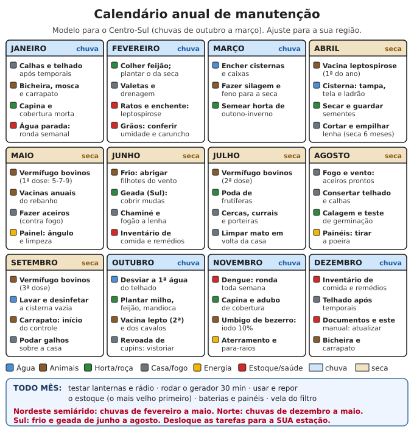

# Rotinas de manutenção

**Resumo:** quase tudo que quebra numa crise quebra por falta de cuidado pequeno e regular:
filtro entupido, bateria descarregada, calha cheia, vacina esquecida, semente com caruncho.
Este arquivo traz **checklists** diários, semanais, mensais, por estação e anuais para água,
horta, animais, estoque, energia, ferramentas, casa, veículos, segurança e documentos.
Imprima, pendure na parede, divida as tarefas entre as pessoas e **anote tudo num caderno**.

---

## Como usar

1. Imprima este arquivo e o calendário abaixo. Pendure na cozinha ou no galpão.
2. Dê **um responsável para cada área** (água, animais, horta, energia...). Faça rodízio a
   cada 3 meses para todos aprenderem tudo.
3. Tenha um **caderno de registro** (modelo no fim). O que não é anotado é esquecido.
4. Escolha um **dia fixo** para as tarefas semanais (ex.: sábado de manhã) e o **1º domingo
   do mês** para as mensais.
5. Adapte: as datas são para o Centro-Sul do Brasil. Veja a nota de regiões no calendário.

## Visão geral

| Diário | Semanal | Mensal | Semestral / anual |
|---|---|---|---|
| Água tratada para o dia | Ronda contra água parada (dengue) | Testar lanternas, rádio, gerador | Trocar água guardada (6 meses) |
| Animais: água, comida, olhar saúde | Limpar galinheiro e ninhos | Inventário rápido do estoque | Revisar remédios e validades |
| Horta: regar, colher, catar pragas | Afiar ferramentas em uso | Baterias: nível e terminais | Limpar caixa d'água e cisterna |
| Fechar e trancar à noite | Calibrar pneus, olhar óleo | Vistoria de telhado e calhas | Vacinas e vermífugos do calendário |
| Anotar no caderno | Teste de rádio com vizinhos | Conferir sementes guardadas | Atualizar documentos e este manual |

## Calendário anual

## 1. Água

### Diário
- [ ] Tratar a água de beber do dia (filtro + cloro, fervura ou SODIS)
- [ ] Filtro de areia: usar todo dia; a água deve ficar **sempre acima da areia**
- [ ] Filtro de barro: reabastecer; água filtrada em vasilha tampada
- [ ] Água de beber com **leve cheiro de cloro** 30 minutos depois de clorar

### Semanal
- [ ] **Ronda contra água parada** (10 minutos): pratos de vaso, pneus, calhas, garrafas,
      lonas, tambores destampados
- [ ] Conferir tampas e telas de caixas, tambores e cisternas
- [ ] Fazer nova solução-mãe de cloro granulado (perde força em ~1 semana)
- [ ] Filtro de areia: se a vazão caiu muito, mexer só os 1–2 cm de cima da areia e retirar a sujeira

### Mensal
- [ ] Limpar as velas do filtro de barro com escova macia e água filtrada, **sem sabão**
      (ferver, se o fabricante permitir)
- [ ] Cisterna: tampa, tela do ladrão, cheiro, cor, bichos; nível anotado no caderno
- [ ] Calhas e telas da entrada da cisterna limpas (na época de chuva, a cada temporal)
- [ ] Poço: tampa, laje, valeta de desvio de enxurrada; nada de lixo ou animais por perto
- [ ] Bomba manual ou sarilho: lubrificar, ver corda, balde e couros

### A cada 2–3 meses
- [ ] Trocar o carvão do filtro de carvão

### Semestral
- [ ] **Trocar a água guardada** em galões e tambores (ou tratar de novo)
- [ ] **Limpar a caixa d'água:**
  1. Feche a entrada; use a água até sobrar um palmo no fundo.
  2. Tampe a saída. Esfregue paredes e fundo com escova ou pano, **sem sabão**.
  3. Retire a água suja com balde e pano. Abra a saída para escoar o resto.
  4. Encha um pouco e coloque **1 L de água sanitária para cada 1.000 L** da caixa.
     Deixe **2 horas**, molhando as paredes com uma caneca a cada 30 minutos.
  5. Esvazie pelas torneiras (essa água serve para lavar chão, não para beber).
  6. Tampe bem e encha. Anote a data na tampa.
- [ ] Trocar velas do filtro de barro, se a vazão não volta com limpeza (duram 6–12 meses)

### Anual
- [ ] **Limpar e desinfetar a cisterna** no fim da seca, quando estiver quase vazia
      (Centro-Sul: setembro), antes das primeiras chuvas
- [ ] Recolocar o desvio da primeira água de chuva antes da estação chuvosa
- [ ] Desinfecção de choque do poço após enchente ou se a água mudar de cheiro/cor
      (veja [Encontrar e captar água](../01-agua/01-encontrar-e-captar-agua.md))

> **ATENÇÃO:** ninguém desce sozinho em poço, fossa ou cisterna. Gases sem cheiro matam em
> minutos. Desça com corda presa na cintura, alguém do lado de fora, e saia à primeira
> tontura ou dor de cabeça.

## 2. Horta, roça e sementes

### Diário
- [ ] Regar no começo da manhã ou no fim da tarde (4–6 L por m² em tempo seco e quente)
- [ ] Olhar **embaixo das folhas**: lagartas, pulgões, ovos; catar à mão
- [ ] Colher o que está pronto (colher estimula a planta a produzir mais)

### Semanal
- [ ] Capinar entre canteiros; repor **cobertura morta** (palha, folhas secas) de 5–10 cm
- [ ] Semear um pouco de alface, rúcula, rabanete, coentro a cada 2–3 semanas (colheita contínua)
- [ ] Amarrar tomate, feijão-de-vara e chuchu nos tutores
- [ ] Revirar a composteira (a cada 1–2 semanas); manter úmida como esponja espremida
- [ ] Iscas e catação de lesmas e caracóis após chuva

### Mensal
- [ ] Adubo de cobertura com composto ou esterco curtido nas plantas em produção
- [ ] Conferir **sementes guardadas**: secas, sem caruncho, sem mofo, potes bem fechados
- [ ] Anotar no caderno: o que foi plantado, onde, quando, o que deu certo

### Por estação (Centro-Sul)
- [ ] **Fim da seca (ago–set):** calagem 2–3 meses antes do plantio; preparar canteiros;
      teste de germinação
- [ ] **Início das chuvas (out–nov):** plantio de milho, feijão das águas, mandioca, abóbora
- [ ] **Fim das chuvas (fev–mar):** feijão da seca (safrinha); semear horta de outono-inverno
- [ ] **Seca (abr–set):** irrigar a horta; colher, secar e guardar sementes
- [ ] **Inverno (jun–jul):** poda de frutíferas; no Sul, proteger mudas da geada

### Anual
- [ ] **Teste de germinação** de cada lote: 100 sementes (ou 20) em pano úmido; contar as
      que brotam em 5–10 dias. Abaixo de 70%, plante mais denso e renove o lote
- [ ] Renovar sementes com mais de 2–3 anos plantando e colhendo de novo
- [ ] Rotação: não repetir a mesma família no mesmo canteiro no ano seguinte
- [ ] Ramas de mandioca e batata-doce: manter sempre plantas vivas para multiplicar

Detalhes: [Horta](../04-agricultura/03-horta.md) · [Sementes](../04-agricultura/02-sementes.md) ·
[Calendário de plantio](../04-agricultura/05-calendario-de-plantio.md).

## 3. Animais

### Diário
- [ ] Água limpa e à vontade (bebedouro lavado se estiver com lodo)
- [ ] Comida na hora certa; recolher ovos; ordenhar no mesmo horário
- [ ] **Olhar cada animal:** come? anda normal? isolado do grupo? diarreia? ferida? bicheira?
- [ ] Fechar aves e animais pequenos à noite (gambá, cachorro do mato, raposa)

### Semanal
- [ ] Limpar galinheiro, ninhos, chiqueiro e coelheira; trocar a cama úmida
- [ ] Conferir cercas, porteiras e telas
- [ ] Separar e observar animal doente (curral ou baia de isolamento)
- [ ] Peixes: transparência da água (ver a mão a 30–40 cm de fundo é o ideal)

### Mensal
- [ ] Piolho e ácaro nas aves (embaixo da asa, perto da cloaca; à noite, nos poleiros)
- [ ] Escore corporal (magro, bom, gordo) e peso estimado dos animais
- [ ] Cascos e unhas: cabras e ovelhas a cada 2–3 meses; vacas de leite, avaliar a cada 6
      meses; cavalos, aparar ou ferrar a cada 6–8 semanas
- [ ] Cabras e ovelhas: **FAMACHA** (cor da mucosa do olho) a cada 15 dias nas chuvas e a
      cada 30 dias na seca; vermifugar **só** os anêmicos (mucosa pálida)
- [ ] Abelhas: revisar colmeias a cada 15–30 dias (rainha, cria, alimento, traça, formiga)
- [ ] Repor sal mineral; conferir estoque de ração e remédios veterinários

### Calendário sanitário anual (típico no Brasil)

| Espécie | Vacina ou tratamento | Quando |
|---|---|---|
| Bovinos | **Brucelose** (dose única, fêmeas de 3 a 8 meses; aplicada por veterinário) | Na idade certa, qualquer mês |
| Bovinos | **Raiva** (em região com morcego hematófago) | 1ª vez: 2 doses com 30 dias; depois **anual** |
| Bovinos | **Clostridioses** (manqueira, gangrena, enterotoxemia) | Bezerros a partir de 3–4 meses: 2 doses com 30 dias; reforço **anual** |
| Bovinos | **Leptospirose** (rebanho de leite e de cria) | A cada **6 meses** (ex.: abril e outubro) |
| Bovinos | **Vermífugo estratégico 5-7-9** (até 2 anos de idade) | **Maio, julho e setembro** |
| Bovinos | **Carrapato**: controle estratégico | A partir de set–out: 5–6 tratamentos a cada 21 dias |
| Bovinos | **Cura do umbigo** do bezerro | Ao nascer: iodo 7–10%, 1–2 vezes ao dia até secar (3–5 dias) |
| Bovinos | Febre aftosa | **Vacinação suspensa**: o Brasil foi reconhecido livre sem vacinação. Bolha na boca ou no casco: isole e avise o serviço veterinário |
| Cabras e ovelhas | **Clostridioses** | Crias com 2–3 meses: 2 doses com 30 dias; fêmeas prenhes: reforço **30 dias antes do parto** |
| Cabras e ovelhas | Raiva (região de risco) | Anual |
| Cabras e ovelhas | Vermífugo | Só pelo FAMACHA (acima) |
| Cabras e ovelhas | Tosquia (ovelhas de lã, Sul) | Primavera |
| Suínos | Ferro injetável (leitões **sem acesso à terra**) | 1º a 3º dia de vida |
| Suínos | Vermífugo | Porcas 7–14 dias antes do parto; leitões na desmama; reprodutores a cada 4–6 meses |
| Suínos | Parvovirose + leptospirose + erisipela (se houver) | Fêmeas 2–3 semanas antes da cobertura |
| Galinhas | **Marek** | 1º dia (pintinho de incubatório já vem vacinado) |
| Galinhas | **Newcastle + bronquite** (gota no olho ou na água) | 7–10 dias; reforço aos 28–30 dias; depois conforme o rótulo |
| Galinhas | **Bouba aviária** (punção na asa) | 4–6 semanas de idade |
| Galinhas | Vermífugo | A cada 3–4 meses, ou se emagrecerem |
| Cavalos e burros | **Tétano, raiva, encefalomielite** | Anual (encefalomielite antes das chuvas) |
| Cavalos e burros | Influenza equina | Anual ou semestral |
| Cavalos e burros | Vermífugo | A cada 2–3 meses (potros: mais frequente) |
| Cavalos e burros | Dentes (grosar pontas) | Anual |
| Cães | **Antirrábica** e V8/V10 | Anual |
| Gatos | **Antirrábica** e V3/V4/V5 | Anual |
| Cães e gatos | Vermífugo | A cada 3–6 meses (filhotes: a cada 15 dias até 3 meses) |
| Cães | Coleira repelente (região de leishmaniose) | Trocar a cada 4–6 meses |
| Peixes | Esvaziar, secar, fazer calagem e consertar taludes do viveiro | Entre um ciclo e outro (1×/ano) |
| Abelhas | Trocar favos velhos e escuros; alimentar na falta de florada | Anual / na entressafra |

> **ATENÇÃO:** vacinas precisam de **geladeira (2–8 °C)**, não podem congelar e perdem efeito
> no sol. Use seringa e agulha limpas (fervidas 20 minutos se não houver descartáveis), uma
> agulha por animal em doença contagiosa. Siga sempre a dose e a via da bula. Brucelose e
> raiva também pegam em gente: luvas, e nunca beba leite cru de rebanho sem vacinação.

Detalhes: [Veterinária básica](../05-animais/14-veterinaria-basica.md) ·
[Princípios gerais](../05-animais/01-principios-gerais.md).

## 4. Estoque de comida e remédios

### Semanal
- [ ] Usar **do mais antigo para o mais novo** (o primeiro que entra é o primeiro que sai)
- [ ] Procurar sinais de rato (fezes, sacos roídos) e de caruncho, traça e formiga

### Mensal
- [ ] Inventário rápido: quantos dias de comida há para todos? Anotar
- [ ] Repor o que foi usado
- [ ] Descartar latas **estufadas, enferrujadas no fecho, amassadas na costura ou que
      espirram ao abrir** (risco de botulismo)
- [ ] Grãos: sem umidade, sem cheiro de mofo; garrafas PET e tambores bem fechados

### Semestral
- [ ] Revisar **validade dos remédios**; usar primeiro os que vencem antes
- [ ] Conferir remédios de uso contínuo: há para pelo menos 3 meses?
- [ ] Kit de primeiros socorros: gaze, luvas, esparadrapo, soro, sais de reidratação
- [ ] Repensar o estoque: alguém nasceu, cresceu, mudou de dieta?

### Anual
- [ ] Inventário completo com pesagem; plano do que plantar e criar para cobrir o que falta
- [ ] Revisar mochilas de fuga (roupas das crianças, remédios, documentos)
- [ ] Sal, açúcar, mel, vinagre, álcool e cal: estoque de longo prazo conferido

Detalhes: [Estoque de alimentos](../03-alimentacao/01-estoque-de-alimentos.md) ·
[Medicamentos e doses](../02-saude/04-medicamentos-e-doses.md) ·
[Kits e estoques](../00-emergencia/03-kits-e-estoques.md).

## 5. Energia

### Diário
- [ ] Ver se a bateria está carregando (luz do controlador) e não usar além do planejado
- [ ] Desligar o que não está em uso; carregar celulares e lanternas durante o sol

### Semanal
- [ ] **Tensão da bateria de 12 V em repouso** (pelo menos 2 horas sem carga e sem sol):

| Tensão (chumbo-ácido 12 V) | Carga |
|---|---|
| 12,7 V | 100% |
| 12,4 V | ≈ 75% |
| 12,2 V | ≈ 50% (não descarregue abaixo disso no dia a dia) |
| 12,0 V | ≈ 25% |
| 11,9 V ou menos | Descarregada: recarregue já |

- [ ] Diesel: drenar a água do copo do filtro separador

### Mensal
- [ ] Bateria de chumbo-ácido aberta: completar com **água destilada** até cobrir as placas
      (sem passar da marca); nunca água da torneira nem ácido
- [ ] Limpar terminais (bicarbonato com água, escova), secar e passar vaselina
- [ ] Painéis solares: limpar a poeira com água e pano macio **de manhã cedo** (água fria em
      painel quente pode trincar o vidro); ver sombra nova de árvore
- [ ] Conexões, cabos ressecados, sinais de aquecimento (cheiro, plástico derretido)
- [ ] **Gerador: rodar 20–30 minutos com carga** (pelo menos 1/3 da potência)
- [ ] Pilhas do estoque: tirar de aparelhos guardados (vazam e corroem)
- [ ] Testar lanternas, lampiões e rádio

### Gerador e motores (por horas de uso)
- [ ] Trocar o óleo: 1ª vez com 20–25 horas (motor novo); depois a cada 50–100 horas (veja o manual)
- [ ] Filtro de ar: limpar a cada 25–50 horas (antes se houver poeira)
- [ ] Vela de ignição: limpar e conferir a folga a cada 100 horas
- [ ] Parado mais de 1 mês: feche a torneira de combustível e deixe o motor rodar até parar
      (esvazia o carburador). A gasolina brasileira tem 27–30% de etanol e estraga em poucos meses

### Por estação e anual
- [ ] Antes do inverno: painéis no ângulo de inverno, se ajustáveis (inclinação ≈ latitude + 10°)
- [ ] Antes das chuvas: aterramento e para-raios conferidos
- [ ] Anual: aperto de todas as conexões elétricas (com tudo desligado); inversor sem poeira
- [ ] Fogão a lenha e chaminé: ver a crosta de fuligem todo mês na época de uso; limpar
      quando passar de 3 mm
- [ ] Gás: mangueira e regulador dentro da validade impressa (em geral 5 anos); teste de
      vazamento com espuma de sabão a cada troca de botijão, **nunca com fogo**

> **ATENÇÃO:** gerador **nunca** dentro de casa, garagem ou varanda fechada (monóxido de
> carbono mata dormindo). Bateria de chumbo solta hidrogênio ao carregar: lugar ventilado,
> sem chama ou faísca por perto, óculos ao mexer no ácido.

Detalhes: [Baterias](../06-energia/05-baterias.md) · [Energia solar](../06-energia/04-energia-solar.md) ·
[Motores pequenos e geradores](../08-ferramentas-e-mecanica/03-motores-pequenos-e-geradores.md).

## 6. Ferramentas

### Depois de cada uso
- [ ] Tirar terra e seiva, secar, passar um pano com óleo (óleo de cozinha serve)
- [ ] Guardar no lugar marcado (desenhe o contorno da ferramenta na parede)
- [ ] Anotar no caderno ferramenta emprestada: com quem e quando

### Semanal (época de uso)
- [ ] Afiar enxada, foice, facão e machado com lima e pedra
- [ ] Apertar cabos frouxos (cunha nova, não água)

### Mensal
- [ ] Ferrugem: lixar e passar óleo; serrote e serras sem dente torto
- [ ] Contar: pá, enxada, facão, machado, serrote, martelo, alicates, chaves, lima, pedra

### Anual
- [ ] Cabos de madeira: lixar e passar óleo de linhaça; trocar os rachados
- [ ] Repor limas, lixas, pregos, parafusos, arame, abraçadeiras, fita, cola

Detalhes: [Ferramentas manuais](../08-ferramentas-e-mecanica/01-ferramentas-manuais.md).

## 7. Casa

### Semanal
- [ ] Lixo orgânico na composteira; lixo seco separado e tampado
- [ ] Varrer cantos e atrás dos móveis (escorpião, barata, rato)

### Mensal
- [ ] Extintor: ponteiro do manômetro no verde; lacre inteiro
- [ ] Tomadas e fios: aquecimento, cheiro de queimado, emendas soltas
- [ ] Caixa de gordura: limpar (a cada 1–3 meses)
- [ ] Ralos e ladrões com tela

### Antes das chuvas (Centro-Sul: agosto–setembro)
- [ ] Telhado: telhas quebradas ou deslocadas, rufos, cumeeira
- [ ] **Calhas e condutores** limpos; desvio da primeira água pronto
- [ ] Podar galhos secos ou sobre o telhado; cortar árvore que ameaça cair na casa
- [ ] Valetas de drenagem em volta da casa e do terreiro desentupidas

### Depois de cada temporal
- [ ] Telhado, calhas, árvores, cercas, fios caídos (**não toque**), encostas com rachadura

### Semestral
- [ ] **Cupins:** vistoriar madeiramento do telhado, batentes, rodapés e móveis (pó tipo
      serragem, túneis de barro, asas no chão após a revoada de início das chuvas)
- [ ] Rachaduras no reboco (esconderijo de barbeiro e escorpião): fechar
- [ ] Fossa seca: nível; fossa séptica: ver se precisa esvaziar (quando o lodo passa de 1/3)

### Anual
- [ ] Caiação (pintura de cal) de paredes de barro, galinheiro e chiqueiro: desinfeta e protege
- [ ] Limpeza da chaminé antes do inverno
- [ ] Extintor: recarga conforme etiqueta (em geral anual)

Detalhes: [Telhados e conforto](../07-abrigo-e-construcao/05-telhados-e-conforto.md) ·
[Higiene e saneamento](../02-saude/09-higiene-e-saneamento.md).

## 8. Veículos e bicicleta

### Carro e moto
- [ ] **Semanal:** pneus calibrados **a frio** (estepe também); nível de óleo (vareta);
      água do radiador **com o motor frio**; luzes
- [ ] **Mensal:** fluido de freio, água do limpador, palhetas, terminais da bateria
- [ ] **Moto:** limpar e lubrificar a corrente a cada 500–1.000 km ou depois de chuva; folga
      conforme o manual (em geral 2–3 cm)
- [ ] **Parado:** ligar e rodar 15–20 minutos a cada 15 dias, ou desligar o cabo negativo da
      bateria; tanque cheio (menos condensação)
- [ ] **Troca de óleo e filtros:** pela quilometragem ou pelo tempo do manual (o que vier
      primeiro; em geral 6 meses a 1 ano)
- [ ] **A cada 2 anos:** trocar o fluido de freio (absorve água)
- [ ] Correia dentada e de acessórios: pela quilometragem do manual (se quebrar, pode
      destruir o motor)

### Bicicleta
- [ ] **Semanal:** calibrar os pneus (a pressão está escrita na lateral, em PSI); freios
      firmes; corrente limpa
- [ ] **A cada 150–300 km ou depois de chuva:** limpar e lubrificar a corrente; tirar o excesso
- [ ] **Mensal:** apertos (guidão, selim, rodas), raios frouxos, cabos esgarçados, sapatas de
      freio (ranhura sumiu = trocar)
- [ ] **Desgaste da corrente:** 12 elos de corrente nova medem 30,5 cm; se passar de
      **30,6 cm**, troque a corrente antes que ela gaste as catracas
- [ ] Sempre ter: câmara reserva, kit de remendo, bomba, chave de raio, chaves Allen

Detalhes: [Mecânica automotiva](../08-ferramentas-e-mecanica/02-mecanica-automotiva.md) ·
[Bicicleta](../08-ferramentas-e-mecanica/04-bicicleta.md).

## 9. Segurança

- [ ] **Diário:** portas, portões e galinheiro fechados à noite; luzes e lanterna à mão;
      quem está fora, voltou?
- [ ] **Semanal:** teste de rádio com vizinhos em horário combinado; ver se cercas e cadeados
      estão inteiros
- [ ] **Mensal:** treinar o plano de fuga e o ponto de encontro (inclusive à noite);
      conferir mochilas de fuga
- [ ] **Semestral:** revisar a lista de contatos, frequências de rádio e sinais combinados
- [ ] **Anual:** refazer o plano da família e da vizinhança; ensinar as crianças de novo

Detalhes: [Segurança](../12-comunidade-e-seguranca/02-seguranca.md) ·
[Rádio](../10-comunicacao-e-navegacao/01-radio.md).

## 10. Documentos e este repositório

### Anual
- [ ] Cópias em papel de RG, CPF, certidões, cartão SUS, carteira de vacinação, CNH, receitas
      de uso contínuo, documentos do imóvel (escritura; em área rural, CCIR e CAR), em saco
      plástico fechado; fotos dos mesmos no pendrive
- [ ] Conferir validade de documentos e renovar receitas
- [ ] Lista de contatos em papel atualizada

### Semestral
- [ ] Baixar a versão nova deste repositório; conferir pendrives, HD e cartões
      (veja [Biblioteca offline](02-biblioteca-offline.md))
- [ ] Trocar a cópia guardada fora de casa
- [ ] Reimprimir páginas gastas, molhadas ou desatualizadas
- [ ] Anotar no próprio papel o que funcionou ou não na sua região (é assim que o
      conhecimento melhora)

## Modelo de caderno de registro

| Data | Área | O que foi feito | Quem | Observação / próximo passo |
|---|---|---|---|---|
| 05/05 | Animais | Vermífugo nos bezerros (1ª dose do 5-7-9) | João | 2ª dose em julho |
| 06/05 | Água | Limpeza da caixa d'água 1.000 L | Ana | Próxima em novembro |
| 07/05 | Energia | Bateria 12,3 V às 6 h | Ana | Cortar o uso da TV à noite |
| 10/05 | Horta | Teste de germinação feijão 2025: 18 de 20 (90%) | Pedro | Lote bom |

---

Ver também: [Kits e estoques](../00-emergencia/03-kits-e-estoques.md) · [Calendário de plantio](../04-agricultura/05-calendario-de-plantio.md) · [Veterinária básica](../05-animais/14-veterinaria-basica.md) · [Tempo, clima e calendário](../10-comunicacao-e-navegacao/04-tempo-clima-calendario.md) · [Tabelas e conversões](01-tabelas-e-conversoes.md)
